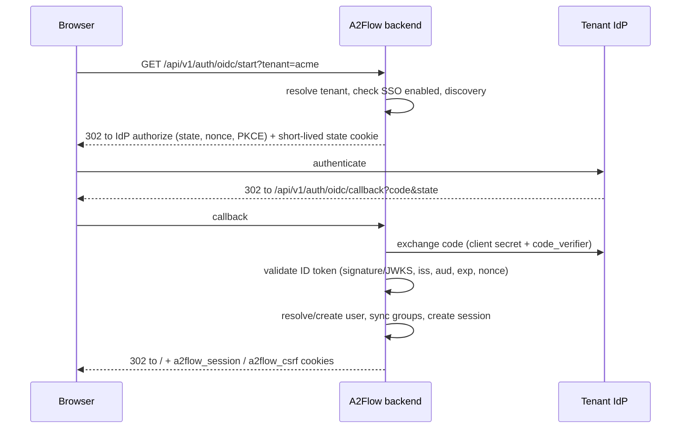

# Per-tenant OIDC single sign-on — design

## Why

A2Flow is multi-tenant; each tenant is a customer company. Today the only way in
is tenant name + username + bcrypt password. Customers manage their staff in
their own identity provider (Entra ID, Okta, Keycloak, …), so handing out and
maintaining a second set of A2Flow accounts and passwords is overhead.

This feature lets **each tenant register its own OIDC IdP**. Staff sign in with
their company account; account creation and role assignment follow what the
IdP says.

## Goals

- A tenant `admin` registers one OIDC IdP for their own tenant.
- A user enters the tenant name on the login screen and presses **Sign in with
  SSO** to sign in through the IdP.
- The first sign-in creates the A2Flow user (just-in-time provisioning).
- The IdP's groups claim maps onto A2Flow user groups and membership is synced
  on every sign-in; roles come from the groups.
- An existing password user is linked automatically when the e-mail matches
  (trust rules below).
- Password sign-in keeps working alongside SSO.

## Non-goals

- More than one IdP per tenant.
- SAML; IdP discovery from an e-mail domain.
- RP-initiated or back-channel logout — signing out of A2Flow leaves the IdP
  session alive.
- SCIM — a user removed at the IdP simply can no longer sign in; A2Flow does not
  disable them.
- SSO for `super_admin` (platform-scoped; stays on passwords).
- A per-tenant "disable password sign-in" switch.
- Fetching groups from Microsoft Graph when Entra omits the claim (overage).

## Anti-goals (a failure even if it "works")

- Taking over someone else's account through another tenant's IdP or an
  unverified e-mail address.
- Learning whether a tenant exists from an SSO error (an unknown tenant and a
  tenant without SSO get the same error).
- Sync removing group memberships an admin granted by hand in an unmapped group,
  or touching directly granted roles.
- A client secret stored in plaintext or returned by the API.

## Decisions made by the product owner

| Topic | Decision |
|---|---|
| IdP scope | One IdP per tenant, configured per tenant |
| First sign-in | Create the user automatically |
| Roles | IdP groups map to A2Flow user groups; membership synced on every sign-in |
| Passwords | Kept alongside SSO; users with a password can still use it |
| Existing users | Linked automatically when the e-mail matches |
| E-mail trust | `email_verified=true` required by default; the tenant setting **Trust e-mail from this IdP** (off by default) links without it (for Entra ID) |
| Who configures | The tenant `admin`, on **Tenant settings**; group mapping on each user group's edit screen |
| Who gets created | Only people in at least one mapped IdP group; anyone else is refused. No setting for this |
| Private-network IdPs | Allowed only for hosts the operator lists in an environment variable; otherwise public addresses only |
| Mapped group membership | The IdP is the only source of truth; manual edits to a mapped group's members are refused in UI and API |

## Behaviour

### Sign-in flow

1. The login screen gains a **Sign in with SSO** button, disabled while the
   tenant field is empty. It does a full-page navigation to `start` (no fetch).
2. `start` resolves the tenant by name. An unknown tenant, a disabled tenant, or
   a tenant whose SSO is unconfigured or off all redirect to
   `/login?sso_error=unavailable` — indistinguishable.
3. State, nonce, PKCE verifier and tenant id travel in a short-lived (10 min)
   HttpOnly cookie, encrypted with `SecretCipher`; no DB row. `SameSite=Lax`,
   path limited to the callback. The server enforces the 10-minute limit too
   (Fernet `ttl`).
   - If the `start` request's origin differs from `app_base_url`'s, `start`
     first redirects to itself on the `app_base_url` origin, otherwise the state
     cookie would never reach the callback.
4. `callback` checks state, exchanges the code and validates the ID token: `iss`
   equals the registered issuer exactly, `aud` contains the client id, `nonce`
   matches. It resolves the user, creates a session the same way password login
   does, sets the cookies and redirects to `/`.
5. Any failure redirects to `/login?sso_error=<code>`, where code is one of
   `unavailable`, `failed`, `account_disabled`, `not_permitted`. Details go to
   the server log only. The login page shows the code as a translated toast.
6. The redirect URI is `{app_base_url}/api/v1/auth/oidc/callback`, shared by
   every tenant (the state cookie names the tenant). `app_base_url` is read from
   the `system_settings` row (the env value is copied there at startup). If it
   is unset, SSO is `unavailable` and Tenant settings shows a warning.
7. Logout is unchanged.

### Resolving the user (in the callback)

Evaluated in order, using `sub` (the issuer is the tenant's single registered
one):

1. A user in the tenant with `oidc_subject = sub` → that user.
2. Otherwise try linking by e-mail. Requires a trusted e-mail
   (`email_verified == true`, or **Trust e-mail** on) **and exactly one**
   non-deleted user in the tenant whose e-mail matches case-insensitively and
   whose `oidc_subject` is null. Link by setting `oidc_subject`. Two or more
   candidates → `failed`.
3. Otherwise create a user — unless:
   - the person is in no mapped IdP group, or the groups claim overflowed (see
     below) → `not_permitted`;
   - a user in the tenant with the same e-mail is already linked to a different
     `sub` → `failed` (no duplicate account; logged).

   New user fields:
   - username: `preferred_username`, else the e-mail local part; normalised to
     the `Username` constraint (`^[a-zA-Z0-9._-]+$`, 3–64 chars); on collision
     within the tenant append `-2`, `-3`, ….
   - names: `given_name` / `family_name`, else `name` split on the first space,
     else the username.
   - e-mail is required (ID token, else userinfo); missing → `failed`.
     `email_verified` copies the IdP's value (true when **Trust e-mail** is on).
   - no direct roles; `created_by` is the system user; password null.
4. The resolved user disabled or deleted, or the tenant disabled →
   `account_disabled`.
5. An existing user's names and e-mail are never overwritten from the IdP.

### Group sync

- `UserGroup.idp_group: str | None`, unique within a tenant (nulls allowed). The
  user group edit screen gets an **IdP group** field.
- On every sign-in, read `<groups claim name>` from the ID token (else userinfo)
  as a string array. For **groups with `idp_group` set only**: add the user if
  the claim contains it, remove them if not. Groups with a null `idp_group` are
  untouched.
- A missing claim counts as an empty array (removed from every mapped group).
  The manual warns that forgetting to configure the claim at the IdP strips
  roles.
- Entra ID sends group object ids; `idp_group` holds that id. Exact,
  case-sensitive match.
- **Overage (Entra):** if `_claim_names` contains the groups claim name, skip
  the sync (keep memberships) and log a warning. Membership cannot be checked,
  so creating a new user is `not_permitted`.
- **Mapped groups are read-only:** members of a group with `idp_group` set
  cannot be changed through the group edit (`member_ids`) or
  `PUT /users/{id}/groups`; the API answers 422, the UI shows the member list
  read-only with "Managed by your IdP". Only SSO sync changes them.
- Setting `idp_group` on a group that already has members keeps them until each
  one's next SSO sign-in.

### IdP settings (Tenant settings)

New `Tenant` columns, readable and writable by `admin` through
`TenantSettings` / `TenantSettingsUpdate`:

| Field | Column | Notes |
|---|---|---|
| Enable SSO | `oidc_enabled: bool = False` | |
| Issuer URL | `oidc_issuer: str \| None` | discovered at `/.well-known/openid-configuration` |
| Client ID | `oidc_client_id: str \| None` | |
| Client secret | `oidc_client_secret: str \| None` | encrypted with `SecretCipher`; reads return only `oidc_client_secret_set: bool` (as `vault_credential`) |
| Groups claim | `oidc_groups_claim: str = "groups"` | |
| Trust e-mail from this IdP | `oidc_trust_email: bool = False` | |
| Redirect URI | (read-only) | shown with a copy button |

- **SSRF:** `oidc_issuer` is checked with `assert_public_http_url`, except hosts
  listed in the new env var `OIDC_ALLOWED_PRIVATE_HOSTS` (comma-separated host
  names, e.g. `keycloak.internal,localhost`). Every IdP call (discovery, token,
  JWKS, userinfo) goes through `guard_peer_address`, with the same exemption.
  Endpoints returned by discovery get the same check. Documented in
  `operations/configuration.md`.
- Enabling requires issuer, client id and secret on the merged result, else
  `TenantValidationError` (422). Saving does not contact the IdP.
- Scopes are fixed: `openid email profile`.

### User model

- `users.oidc_subject: str | None`, partial unique index on
  `(tenant_id, oidc_subject)` where not null. Changing the tenant's **issuer or
  client id** clears every `oidc_subject` in the tenant (Entra issues a
  different `sub` per app registration); users re-link by e-mail.
- Soft-deleting a user clears `oidc_subject`.
- `users.password` becomes nullable (overridden on the `User` table class;
  `UserCreate` still requires it). `verify_password` returns False for None,
  and the login path still spends `burn_password_check`. SSO-created users have
  none; an admin may set one later (break-glass).
- `UserRead.sso_linked: bool`, shown in the user list and edit screen. No unlink
  action.

## Constraints

- Follow `.claude/rules/backend-patterns.md`; new logic in
  `services/oidc_login.py`, thin router.
- Alembic migration uses `batch_alter_table` and runs on SQLite and PostgreSQL.
- No new packages: promote `pyjwt[crypto]` (already locked, 2.15.1) to a direct
  dependency; HTTP via `httpx`. Discovery and JWKS cached per issuer for 5 min.
- All GUI text in the six catalogs; the manual in all six languages.
- Regenerate `backend/openapi.yaml` and the frontend API bindings.
