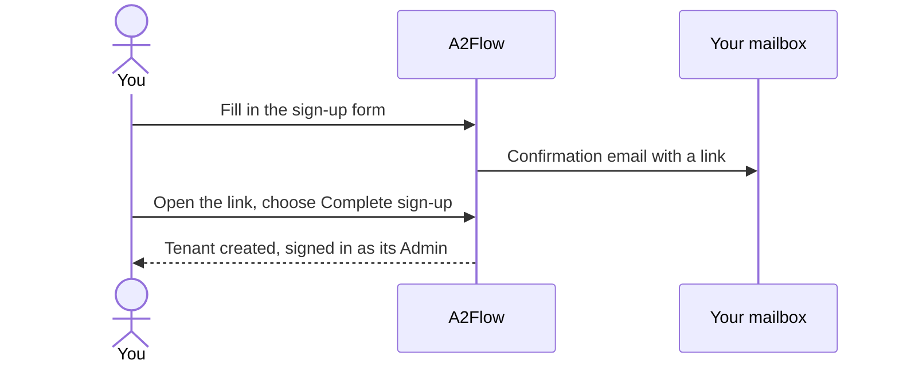

# Signing up

When the deployment allows it, anyone can create a tenant of their own from the sign-in page and start using A2Flow as its Admin. No Super Admin has to create the tenant or the account first. Sign-up is off until the operator turns it on — see [Sign-up](../operations/configuration.md#sign-up) in the configuration reference.

## Creating your account {#creating-your-account}

1. Open A2Flow at its main address, not at a tenant's own address, and choose **Create an account** under the sign-in form.
2. Fill in **Email**, **Username**, **First Name**, **Last Name** and **Password**, then choose **Create account**. The **Check your email** screen appears. Nothing has been created yet.
3. Open the link in the email A2Flow sent you. The **Finish signing up** screen opens; choose **Complete sign-up**.
4. The **Welcome to A2Flow** screen shows your new **Tenant** and your **Username**. Write the tenant down: you need it to sign in again.
5. Choose **Continue**. You are signed in as the tenant's **Admin**.

| Item | Rule |
|---|---|
| **Username** | 3 to 64 letters, digits, dots, hyphens or underscores. An email address is not accepted |
| **Password** | 12 to 72 characters |
| The link | Works once, within 24 hours of being sent. It can be opened in any browser |
| Another email | One address gets at most one confirmation email a minute |

## If the link does not work {#link-problems}

| What you see | What to do |
|---|---|
| No email arrives | Check your spam folder. After a minute, fill in the form again to get a new email |
| "This sign-up link is invalid or has expired" | The link was already used or is older than 24 hours. Fill in the form again |
| "This link is incomplete" | Your mail program cut the link short. Copy the whole link from the email into the browser |

## Your new tenant {#your-new-tenant}

A2Flow names the tenant after your username, followed by six random characters: the username `Jane.Doe` gets a tenant such as `jane-doe-3fa9c1`. You are its only user, with the **Admin** role, so you can add the rest of your team under [Users](../guides/users-and-groups.md#users) and connect your company's sign-in under [Single sign-on](../guides/single-sign-on.md). Until you set an LLM of the tenant's own, its agents use the system's — see [The tenant's LLM](../guides/users-and-groups.md#tenant-llm).

## Signing in again {#signing-in-again}

At the main address, enter your **Username**, the **Tenant** from the welcome screen, and your **Password**. When the deployment gives each tenant an address of its own, the welcome screen also shows it as **Tenant address**. Sign in there and the tenant is filled in for you — see [At your tenant's address](../guides/single-sign-on.md#tenant-address).
