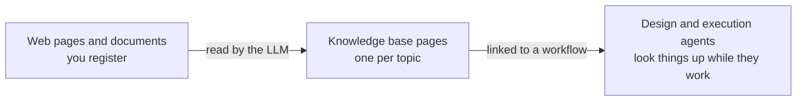

# Knowledge Bases

A knowledge base is a wiki that the LLM writes for you from the web pages and documents you register. Link it to a workflow, and the workflow's agents look things up in it while they design and run the workflow — to carry out a task the way your organization does it, or to answer a participant's question in the chat.

Open **Knowledge Bases** in the admin sidebar to manage them.

## How the wiki is written

The LLM does not file one summary per document. It reads each source and folds what it says into **topic pages**: it updates the page about a topic that already exists, and writes a new page only for a topic no page covers yet. Five documents about the same VPN end up as one VPN page that says everything they say together.

Every statement on a page carries a footnote naming the source it came from, and each page lists its sources at the top. That is what lets A2Flow take a source back out later without rebuilding the whole wiki.

## Creating a knowledge base

1. Click **+ Add knowledge base**.
2. Enter a **Name** and a **Description**. Write the description for the agents: it is what they read when deciding whether this knowledge base can answer what they are looking for.
3. Click **Save**. The knowledge base opens, ready for sources.

Creating, editing, and deleting knowledge bases and their sources needs the **developer** role. Anyone who can open a knowledge base can read its pages.

## Adding sources

On the knowledge base's page, the **Sources** section takes two kinds of source:

| Source | How to add it |
|---|---|
| A web page | Enter its URL and click **Add URL** |
| A document | Click **Upload documents** and pick one or more files: PDF, Word (`.docx`), HTML, Markdown, CSV, JSON, or plain text |

A source is read in the background, so you can keep working or leave the page. Its **Status** moves through these states:

| Status | Meaning |
|---|---|
| **Not read** | Registered, but not read yet. Click **Read** to start. Only a source added with the [demo data](../getting-started/demo-data.md) starts this way |
| **Queued** | Waiting its turn. Sources of one knowledge base are read one at a time, because they edit the same pages |
| **Reading** | The LLM is reading the source and writing pages |
| **Ready** | The source's knowledge is in the wiki. **Read At** shows when |
| **Failed** | Reading failed, and nothing it would have written was kept. The reason is shown under the status |
| **Removing** | The source is being taken out of the wiki (see below) |

A long document is read in parts, one after another, so a large manual takes a while. A scanned PDF with no text layer has nothing to read and fails with a message saying so.

Web pages are fetched from the A2Flow server, so a page behind a login, or on a private network address, cannot be added.

### Reading a source again

Click **Read again** on a source to take what it contributed out of the wiki and read it afresh. Use it when a web page has changed, or to retry a source that failed. A source stuck in **Reading** after a server restart is recovered the same way.

### Removing a source

Click **Delete** on a source and confirm. The LLM revisits only the pages that cite it, takes out what came from that source alone, and keeps what other sources also support. A page left with no sources at all is deleted. The source disappears from the list once that is done.

## Browsing the pages

The **Pages** section lists every page with its **Title**, **Path**, **Type**, and **Description**. Click a title to read the page. The pages are read-only: to correct one, fix or remove the source it came from and read it again.

Click **Download bundle** in the page header to download the whole knowledge base as a zip file. The bundle follows the [Open Knowledge Format](https://github.com/GoogleCloudPlatform/open-knowledge-format) — one Markdown file per page with its metadata at the top, plus an `index.md` in every folder — so other tools that read the format can use it too.

## Linking a knowledge base to a workflow

Open the workflow's detail page, choose knowledge bases under **Knowledge Bases**, and click **Save**. You can also pick them when you [generate the workflow](./workflows.md#generating-a-workflow), so the design agent consults them from its very first design.

| Who looks things up | When |
|---|---|
| The design agent | While it designs the workflow's task templates right after generation, and while it refines them in the design session |
| The execution agent | While it works through a run's tasks, and when a participant asks it something in the workflow session |

The agents see only the knowledge bases linked to their workflow. They browse a knowledge base's contents, search it by keyword, and read the pages that fit; when they rely on a page, they name it. When the linked knowledge bases do not cover something, they are told to say so rather than guess.

Links are not part of a workflow's published design. Changing them takes effect on the next lookup, in runs already under way too, and does not mark a published workflow as modified.

## Tags

A knowledge base's create form and detail page carry a **Tags** picker, and the list has a filterable **Tags** column. An [access-control tag](./tags.md) hides a knowledge base from people whose groups do not hold it, and from the agent working for them, even when the knowledge base is linked to the workflow:

| Where the agent runs | Whose groups decide |
|---|---|
| Workflow design chat | The person chatting |
| Workflow run | The person who started the run, for the whole run |

Admins are not restricted.

## Deleting a knowledge base

Deleting a knowledge base deletes its sources and pages too, and unlinks it from every workflow.
