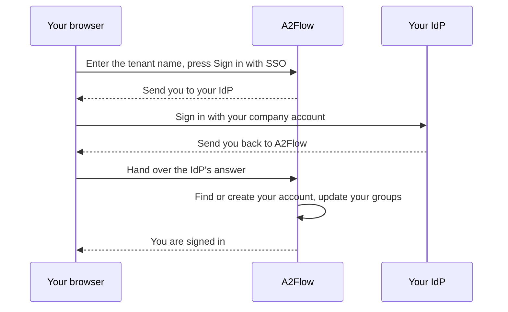

# Single sign-on

Each [tenant](../concepts/tenants.md) can connect one **identity provider (IdP)** that speaks OpenID Connect — Microsoft Entra ID, Okta, Keycloak and the like. Its staff then sign in with their company account instead of a separate A2Flow password. The first sign-in creates the A2Flow account, and the IdP's groups decide which [user groups](./users-and-groups.md#user-groups) — and so which roles — the person holds.

Passwords keep working alongside single sign-on. Super Admin accounts belong to no tenant and always sign in with a password.

## How it works {#how-it-works}

## Before you start {#before-you-start}

- You need the `admin` role in the tenant.
- A Super Admin must have filled in **Application Base URL** under [System Settings](./system-settings.md). It must be the address only — scheme, host and an optional port, such as `https://a2flow.example.com`, with nothing after it. A value with a path, such as `https://example.com/a2flow`, makes every SSO sign-in fail. While it is empty, **Tenant Settings** shows a warning in place of the **Redirect URI** and single sign-on stays unavailable.
- Your IdP must be reachable from A2Flow on a public address. An IdP on a private network works only after the operator has allowed its host — see [Single sign-on](../operations/configuration.md#single-sign-on) in the configuration reference.

## Set it up {#set-it-up}

1. At your IdP, register a new application for A2Flow — a web application with a client secret. Note its issuer URL, client ID and client secret.
2. In A2Flow, open **Tenant Settings** in the admin sidebar and find the **Single sign-on** section. Press **Copy** next to **Redirect URI** and register that address as the redirect URI of the application at your IdP.
3. At your IdP, make the application's ID token carry the list of groups each person belongs to (the groups claim). Forgetting this strips roles — see [Things to know](#things-to-know).
4. Fill in the section, using the table below, and tick **Enable single sign-on**.
5. Save. Saving checks that the issuer URL is an allowed address — `https`, or a host the operator has allowed — and, when **Enable single sign-on** is ticked, that the issuer URL, client ID and client secret are filled in. It does not contact the IdP, so the real test is the next step.
6. On each user group that should follow an IdP group, open **User Groups**, open the group and fill in **IdP group** — see [Groups and roles](#groups-and-roles).
7. Try it: open the sign-in screen, enter the tenant name and press **Sign in with SSO**.

| Field | Notes |
|---|---|
| **Enable single sign-on** | The switch. Turning it on requires the issuer URL, client ID and client secret. |
| **Issuer URL** | The OpenID Connect issuer of your IdP, such as `https://idp.example.com`. |
| **Client ID** | The application's client ID at your IdP. |
| **Client secret** | Write-only: it is never shown back. Once saved, the field reads "Saved — leave empty to keep it". |
| **Groups claim** | The name of the ID token claim that lists a person's groups. `groups` unless your IdP uses another name. |
| **Trust e-mail addresses from this IdP** | Off by default. Lets A2Flow link an existing account by e-mail address even when the IdP does not mark the address as verified. Microsoft Entra ID needs it. |
| **Redirect URI** | Read-only. The address to register at your IdP; every tenant uses the same one. |

## Signing in {#signing-in}

On the sign-in screen, enter the tenant name in **Tenant** and press **Sign in with SSO**. The button stays disabled while **Tenant** is empty. You are sent to your IdP, sign in there, and come back signed in to A2Flow. Signing in with a username and password works as before.

Signing out of A2Flow does not sign you out of the IdP, so pressing **Sign in with SSO** again may take you straight back in.

## Sign-in error messages {#sign-in-errors}

A failed attempt returns you to the sign-in screen with one of these messages.

| Message | What it means and what to do |
|---|---|
| Single sign-on is not available for this tenant. | The tenant name is wrong, the tenant is disabled, or its single sign-on is not set up or not switched on. A2Flow deliberately does not say which, so the message cannot be used to find out which tenants exist. Check the name, then ask your tenant admin. |
| Single sign-on failed. Please try again. | The exchange with the IdP did not complete, or the IdP sent no e-mail address or one that is not a usable address, or two accounts in the tenant share your e-mail address, or an account with your e-mail address is already linked to a different IdP identity, or the IdP's e-mail address is not trusted and an A2Flow account with that address already exists. In the last case ask your tenant admin to turn on **Trust e-mail addresses from this IdP**, or to change the e-mail address of one of the two accounts. Otherwise try again; if it keeps failing, ask your tenant admin to check the settings and the application registered at the IdP. |
| Your account is disabled. | Your A2Flow account or your whole tenant is disabled, or the account was deleted. An admin can switch the account on again with **Enabled**. |
| Your identity provider account is not allowed to sign in to A2Flow. | You have no A2Flow account yet and belong to no IdP group that a user group is mapped to — or the IdP left your group list out because you belong to very many groups. Ask the IdP's administrator to add you to a mapped group. |

## How people are matched to accounts {#account-matching}

At every sign-in A2Flow looks for the account in this order:

1. **An account already linked to this IdP identity** is used.
2. **An existing account with the same e-mail address** is linked, once. The address is compared without regard to case, and is accepted only when the IdP marks it as verified or **Trust e-mail addresses from this IdP** is on. Exactly one unlinked account must match; if two or more do, the sign-in fails.
3. **Otherwise a new account is created**, but only for a person who belongs to at least one IdP group that a user group is mapped to. Anyone else is refused. A new account is never created for an e-mail address that an account in the tenant already has, nor when the IdP's e-mail address is not a usable address; the sign-in fails instead.

A new account takes its username from the IdP's preferred username, else from the part of the e-mail address before the `@`. Characters other than letters, digits, `.`, `_` and `-` are dropped, the name falls back to `user` when too little is left, and `-2`, `-3` and so on are added when the name is taken. The first and last name come from the IdP. The account has no direct roles and no password: its roles come from its groups, and an admin can set a password later as a fallback.

The names and e-mail address of an existing account are never overwritten from the IdP.

## Groups and roles {#groups-and-roles}

On each user group, **IdP group** holds the value that the IdP's groups claim lists for that group. Microsoft Entra ID sends the group's object id, not its name, so enter that id. The match is exact and case-sensitive.

At every SSO sign-in, for each user group that has an **IdP group**:

- the person joins the group when the claim contains the value, and
- leaves it when the claim does not.

User groups with no **IdP group**, and roles granted directly on an account, are never touched. Group changes made at the IdP take effect at the person's next SSO sign-in, not at once.

The members of a group with an **IdP group** are managed by the IdP and cannot be edited by hand. On the group's page the **Members** list is read-only and says "Managed by your IdP", and such a group cannot be added to or removed from a user's **Groups** either. If you fill in **IdP group** on a group that already has members, they stay until each one's next SSO sign-in.

## Things to know {#things-to-know}

| Situation | What happens |
|---|---|
| The IdP sends no groups claim, or the **Groups claim** name does not match | Every person who signs in is removed from every mapped group and loses the roles those groups gave. Check the claim at the IdP before enabling single sign-on. |
| Microsoft Entra ID | It sends group object ids, not names. For a person in very many groups it leaves the list out. A2Flow then keeps that person's current memberships and cannot create a new account for them. |
| You change **Issuer URL** or **Client ID** | Every account in the tenant is unlinked from its IdP identity, because the IdP issues different identities for a different application. People are linked again by e-mail address at their next sign-in, which needs a trusted address (marked verified by the IdP, or **Trust e-mail addresses from this IdP** on). Otherwise the sign-in fails, because the old account still has that address. |
| Someone is removed at the IdP | They can no longer sign in through SSO, but A2Flow does not disable their account. Clear **Enabled** on it to block password sign-in too. |
| An account carries the **SSO** badge | It has signed in through single sign-on. The badge appears in the **Users** list and on the account's detail page. |
