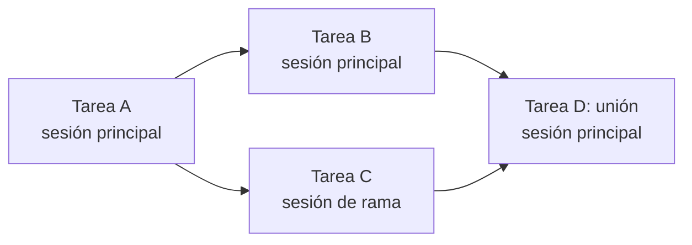
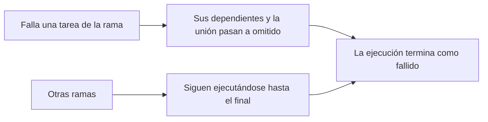

# Ejecutar un flujo de trabajo

Ejecutar un flujo de trabajo no hace que la ejecución apunte al flujo de trabajo. **Copia** el diseño publicado en una nueva [ejecución](../guides/workflow-executions.md), y a partir de entonces la ejecución vive en ese registro.

| Se copia en la ejecución | Procede de |
|---|---|
| El nombre y el prompt vigente | La última versión publicada o bien las filas actuales, si el flujo de trabajo sigue en `borrador` o si un Desarrollador eligió ejecutar las [ediciones sin publicar](../guides/workflows.md#trying-the-edits-out) de un flujo de trabajo `modificado` |
| Las tareas, todas en `pendiente`, con sus dependencias y vinculaciones de herramientas | Las plantillas de tareas de ese mismo diseño |
| La revisión de la skill de agente que sigue la ejecución | La revisión publicada de la skill en ese momento |
| Los [mocks de herramientas](./mcp-gateway-and-proxy.md#tool-mocks-and-dry-runs) elegidos, por valor | Los mocks tal como están en ese momento |

Nada de esa lista se vuelve a leer de su origen más adelante. Editar el flujo de trabajo, actualizar la skill o eliminar cualquiera de los dos nunca afecta a una ejecución ya en marcha, y una ejecución terminada sigue pudiéndose leer aunque desaparezca el flujo de trabajo del que procede.

## Cómo avanza la ejecución {#how-the-run-advances}

La sesión del flujo de trabajo se abre con un mensaje de arranque fijo y con el agente de ejecución ya trabajando. Publicar fue la aprobación del plan, así que no hay nada que confirmar antes de empezar.

El agente no elige qué tarea viene a continuación. En cuanto todas las dependencias de una tarea se han completado, A2Flow la **asigna** a la sesión que la trabajará, y el agente trabaja solo las tareas que tiene asignadas. Iniciar cualquier otra tarea, ya sea una asignada a otra sesión o una cuyas dependencias no hayan terminado, se rechaza.

Una ejecución termina en `completado` cuando todas las tareas han llegado a un estado final sin que ninguna haya fallado, y en `fallido` cuando ha fallado al menos una. Los estados pueden seguirse en vivo en la vista de tareas de solo lectura de la ejecución, como tabla o como grafo de dependencias.

Cuando una tarea falla, todas las tareas que siguen esperándola, directamente o más abajo en la cadena, pasan a `omitido`, porque ya no pueden ejecutarse. Eso es lo que permite que la ejecución termine como `fallido` en lugar de esperar para siempre una tarea que nunca empezará. Las tareas de otras ramas que no dependen de la fallida siguen ejecutándose con normalidad.

## Ramas paralelas {#parallel-branches}

Cuando el grafo de tareas se ramifica, las ramas no se esperan entre sí. Al principio, una ejecución se trabaja en una única **sesión principal**; cuando una tarea queda lista mientras la sesión que debería encargarse de ella sigue ocupada con otra, A2Flow **bifurca** una **sesión de rama** para esa tarea. La rama empieza con una copia de todo lo que la sesión principal sabía hasta ese momento y luego trabaja su propia cadena de tareas a la par que la sesión principal. Una aprobación que espera una rama detiene solo esa rama.

| Situación | A dónde va la tarea |
|---|---|
| Una tarea raíz o una cuyas dependencias trabajó la sesión principal | La sesión principal, bifurcada en una nueva sesión de rama si la sesión principal sigue ocupada con otra tarea |
| Una tarea cuyas dependencias trabajó una sola sesión de rama activa | Esa sesión de rama, también bifurcada si está ocupada |
| Una tarea cuyas dependencias trabajó una sesión de rama ya terminada | La sesión principal |
| Una **unión**: dependencias trabajadas por más de una sesión | La sesión principal, una vez que hayan terminado todas las ramas que la alimentan |

- Una sesión de rama que se queda sin tareas termina con un breve resumen de lo que hizo. La sesión principal lee esos resúmenes antes de trabajar una unión.
- Una sesión que espera una aprobación también puede bifurcar una **consulta**. Se abre cuando alguien hace una pregunta allí, no trabaja ninguna tarea ni cambia nada, y se cierra cuando se decide la aprobación. Nunca cuenta para el límite que se indica a continuación, y nada de lo que diga llega a la ejecución ([Consultas](../guides/workflow-executions.md#consultations)).
- Una rama puede volver a bifurcarse, pero solo se ejecuta un número limitado de sesiones a la vez. Al alcanzar el límite, una tarea lista espera a su sesión y la ejecución vuelve a trabajar las tareas una tras otra.
- Una tarea fallida detiene solo su propia cadena: las tareas que la esperan y cualquier unión a la que alimente pasan a `omitido`, como se ha descrito, mientras las demás ramas terminan su trabajo. Después, la ejecución termina como `fallido`.

## Por qué importa el estado en curso {#why-in_progress-matters}

Marcar una tarea como `en curso` no es un mero trámite administrativo. Es lo que desbloquea las herramientas de esa tarea: el [gateway](./mcp-gateway-and-proxy.md) solo permite una llamada cuando la herramienta está vinculada a una tarea que la ejecución tiene en curso. Una tarea que ha terminado ya no puede actuar, y una que aún no ha empezado nunca pudo hacerlo.

La lista de tareas de la ejecución y las vinculaciones de herramientas de cada tarea quedan fijadas al iniciarse la ejecución, copiadas del diseño publicado del flujo de trabajo, y el agente solo hace avanzar los estados. No puede añadir ni quitar una tarea, ni cambiar sus vinculaciones. Por eso también una [aprobación](./approvals.md) no vuelve a leer las vinculaciones de una tarea cuando llega el momento: firma el conjunto que vio cuando el aprobador decidió, de modo que ningún cambio posterior en el flujo de trabajo puede ampliar una concesión ya otorgada.
