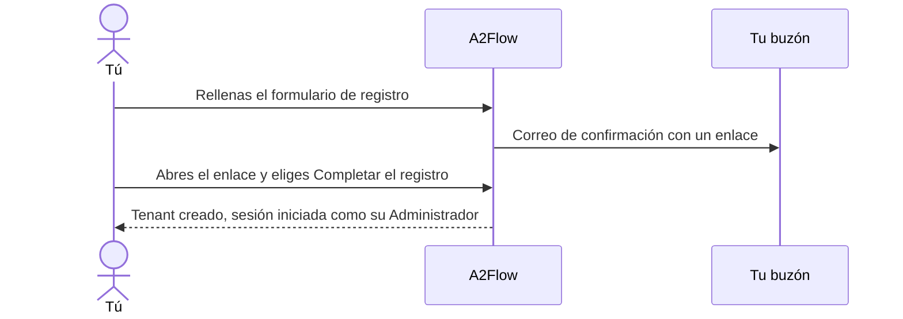

# Registrarse

Si el despliegue lo permite, cualquiera puede crear su propio tenant desde la pantalla de inicio de sesión y empezar a usar A2Flow como su Administrador. Ningún Superadministrador tiene que crear antes el tenant ni la cuenta. El registro está desactivado hasta que el operador lo activa; consulta [Registro](../operations/configuration.md#sign-up) en la referencia de configuración. La pantalla de inicio de sesión ofrece **Crear una cuenta** solo mientras el despliegue tenga sitio para otro tenant; consulta [El límite de tenants](../guides/system-settings.md#tenant-limit).

## Crear tu cuenta {#creating-your-account}

1. Abre A2Flow en su dirección principal, no en la dirección propia de un tenant, y elige **Crear una cuenta** debajo del formulario de inicio de sesión.
2. Rellena **Correo electrónico**, **Nombre de usuario**, **Nombre**, **Apellidos** y **Contraseña**, y elige **Crear cuenta**. Aparece la pantalla **Revisa tu correo**. Todavía no se ha creado nada.
3. Abre el enlace del correo que te ha enviado A2Flow. Se abre la pantalla **Termina el registro**; elige **Completar el registro**.
4. La pantalla **Te damos la bienvenida a A2Flow** muestra tu nuevo **Tenant** y tu **Nombre de usuario**. Apunta el tenant: lo necesitas para volver a iniciar sesión.
5. Elige **Continuar**. Habrás iniciado sesión como **Administrador** del tenant.

| Elemento | Regla |
|---|---|
| **Nombre de usuario** | Entre 3 y 64 letras, dígitos, puntos, guiones o guiones bajos. No se acepta una dirección de correo |
| **Contraseña** | Entre 12 y 72 caracteres |
| El enlace | Funciona una sola vez, dentro de las 24 horas siguientes al envío. Puede abrirse en cualquier navegador |
| Otro correo | Una dirección recibe como máximo un correo de confirmación por minuto |

## Si el enlace no funciona {#link-problems}

| Qué ves | Qué hacer |
|---|---|
| No llega ningún correo | Revisa la carpeta de spam. Pasado un minuto, vuelve a rellenar el formulario para recibir un correo nuevo |
| "Este enlace de registro no es válido o ha caducado" | El enlace ya se usó o tiene más de 24 horas. Vuelve a rellenar el formulario |
| «Se ha alcanzado el número máximo de Tenants» | El despliegue está lleno. Pide al operador que suba el límite en **Número máximo de Tenants**, en los ajustes del sistema; el enlace sigue funcionando hasta que caduque |
| "Este enlace está incompleto" | Tu programa de correo cortó el enlace. Copia el enlace completo del correo en el navegador |

## Tu nuevo tenant {#your-new-tenant}

A2Flow da al tenant el nombre de tu usuario seguido de seis caracteres aleatorios: el nombre de usuario `Jane.Doe` recibe un tenant como `jane-doe-3fa9c1`. Eres su único usuario, con el rol **Administrador**, así que puedes añadir al resto de tu equipo en [Usuarios](../guides/users-and-groups.md#users) y conectar el inicio de sesión de tu empresa en [Inicio de sesión único](../guides/single-sign-on.md). Hasta que configures un LLM propio del tenant, sus agentes usan el del sistema; consulta [El LLM del tenant](../guides/users-and-groups.md#tenant-llm).

## Volver a iniciar sesión {#signing-in-again}

En la dirección principal, introduce tu **Nombre de usuario**, el **Tenant** de la pantalla de bienvenida y tu **Contraseña**. Cuando el despliegue da a cada tenant una dirección propia, la pantalla de bienvenida también la muestra como **Dirección del tenant**. Inicia sesión allí y el tenant se rellena solo; consulta [En la dirección de tu tenant](../guides/single-sign-on.md#tenant-address).
