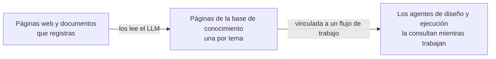

# Bases de conocimiento

Una base de conocimiento es una wiki que el LLM escribe por ti a partir de las páginas web y los documentos que registras. Vincúlala a un flujo de trabajo y los agentes de ese flujo la consultarán mientras lo diseñan y lo ejecutan, ya sea para realizar una tarea como la hace tu organización o para responder a la pregunta de un participante en el chat.

Abre **Bases de conocimiento** en la barra lateral de administración para gestionarlas.

## Cómo se escribe la wiki {#how-the-wiki-is-written}

El LLM no archiva un resumen por documento. Lee cada fuente e incorpora lo que dice a **páginas de tema**: actualiza la página de un tema que ya existe y solo escribe una página nueva para un tema que ninguna página cubre todavía. Cinco documentos sobre la misma VPN acaban siendo una sola página sobre la VPN que dice todo lo que dicen juntos.

Cada afirmación de una página lleva una nota al pie que nombra la fuente de la que procede, y cada página enumera sus fuentes al principio. Eso es lo que permite a A2Flow retirar una fuente más adelante sin reconstruir toda la wiki.

## Crear una base de conocimiento {#creating-a-knowledge-base}

1. Haz clic en **+ Añadir base de conocimiento**.
2. Introduce un **Nombre** y una **Descripción**. Escribe la descripción para los agentes: es lo que leen para decidir si esta base de conocimiento puede responder a lo que buscan.
3. Haz clic en **Guardar**. La base de conocimiento se abre, lista para recibir fuentes.

Crear, editar y eliminar bases de conocimiento y sus fuentes requiere el rol de **Desarrollador**. Cualquiera que pueda abrir una base de conocimiento puede leer sus páginas.

## Añadir fuentes {#adding-sources}

En la página de la base de conocimiento, la sección **Fuentes** admite dos tipos de fuente:

| Fuente | Cómo añadirla |
|---|---|
| Una página web | Introduce su URL y haz clic en **Añadir URL** |
| Un documento | Haz clic en **Subir documentos** y elige uno o varios archivos: PDF, Word (`.docx`), HTML, Markdown, CSV, JSON o texto sin formato |

Las fuentes se leen en segundo plano, así que puedes seguir trabajando o salir de la página. Su **Estado** pasa por estos valores:

| Estado | Significado |
|---|---|
| **Sin leer** | Registrada, pero aún no leída. Haz clic en **Leer** para empezar. Solo las fuentes añadidas con los [datos de demostración](../getting-started/demo-data.md) empiezan así |
| **En cola** | Esperando su turno. Las fuentes de una misma base de conocimiento se leen de una en una, porque editan las mismas páginas |
| **Leyendo** | El LLM está leyendo la fuente y escribiendo páginas |
| **Lista** | El conocimiento de la fuente ya está en la wiki. **Leído el** indica cuándo |
| **Fallida** | La lectura falló y no se conservó nada de lo que habría escrito. El motivo aparece debajo del estado |
| **Eliminando** | La fuente se está retirando de la wiki (ver más abajo) |

Un documento largo se lee por partes, una tras otra, así que un manual extenso tarda un rato. Un PDF escaneado sin capa de texto no tiene nada que leer y falla con un mensaje que lo indica.

Las páginas web se obtienen desde el servidor de A2Flow, así que no se puede añadir una página protegida por inicio de sesión ni una situada en una dirección de red privada.

### Volver a leer una fuente {#reading-a-source-again}

Haz clic en **Volver a leer** en una fuente para retirar de la wiki lo que aportó y leerla de nuevo. Úsalo cuando una página web haya cambiado o para reintentar una fuente que falló. Una fuente atascada en **Leyendo** después de reiniciar el servidor se recupera del mismo modo.

### Eliminar una fuente {#removing-a-source}

Haz clic en **Eliminar** en una fuente y confirma. El LLM revisa solo las páginas que la citan, retira lo que procede únicamente de esa fuente y conserva lo que otras fuentes también respaldan. Una página que se queda sin ninguna fuente se elimina. La fuente desaparece de la lista cuando termina el proceso.

## Consultar las páginas {#browsing-the-pages}

La sección **Páginas** enumera todas las páginas, y cada fila muestra su título y ruta, su **Tipo** y cuándo se actualizó por última vez (**Fecha de actualización**). Haz clic en un título para leer la página. Las páginas son de solo lectura: para corregir una, arregla o elimina la fuente de la que procede y vuelve a leerla.

Haz clic en **Descargar paquete** en el encabezado de la página para descargar toda la base de conocimiento como archivo zip. El paquete sigue el [Open Knowledge Format](https://github.com/GoogleCloudPlatform/open-knowledge-format) (un archivo Markdown por página con sus metadatos al principio, más un `index.md` en cada carpeta), de modo que también pueden usarlo otras herramientas que lean ese formato.

## Vincular una base de conocimiento a un flujo de trabajo {#linking-a-knowledge-base-to-a-workflow}

Abre la página de detalle del flujo de trabajo, elige las bases de conocimiento en **Bases de conocimiento** y haz clic en **Guardar**. También puedes elegirlas al [generar el flujo de trabajo](./workflows.md#generating-a-workflow), para que el agente de diseño las consulte desde su primer diseño.

| Quién consulta | Cuándo |
|---|---|
| El agente de diseño | Mientras diseña las plantillas de tareas del flujo de trabajo justo después de generarlo, y mientras las perfecciona en la sesión de diseño |
| El agente de ejecución | Mientras trabaja en las tareas de una ejecución, y cuando un participante le pregunta algo en la sesión del flujo de trabajo |

Los agentes solo ven las bases de conocimiento vinculadas a su flujo de trabajo. Exploran su contenido, buscan en ellas por palabra clave y leen las páginas que encajan; cuando se basan en una página, la nombran. Cuando las bases de conocimiento vinculadas no cubren algo, tienen instrucciones de decirlo en lugar de suponer.

Los vínculos no forman parte del diseño publicado de un flujo de trabajo. Cambiarlos surte efecto en la siguiente consulta, también en las ejecuciones ya en curso, y no marca un flujo de trabajo publicado como `modificado`.

## Etiquetas {#tags}

El formulario de creación y la página de detalle de una base de conocimiento incluyen un selector de **Etiquetas**, y la lista tiene una columna **Etiquetas** filtrable. Una [etiqueta de control de acceso](./tags.md) oculta una base de conocimiento a las personas cuyos grupos no tienen esa etiqueta, y al agente que trabaja para ellas, aunque la base de conocimiento esté vinculada al flujo de trabajo:

| Dónde se ejecuta el agente | Qué grupos deciden |
|---|---|
| Chat de diseño del flujo de trabajo | Los de la persona que chatea |
| Ejecución del flujo de trabajo | Los de la persona que inició la ejecución, durante toda la ejecución |

Los administradores no tienen restricciones.

## Eliminar una base de conocimiento {#deleting-a-knowledge-base}

Al eliminar una base de conocimiento se eliminan también sus fuentes y páginas, y se desvincula de todos los flujos de trabajo.
