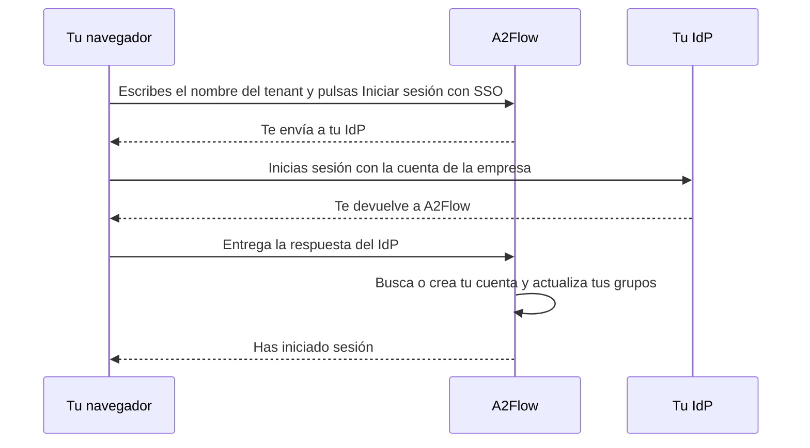

# Inicio de sesión único

Cada [tenant](../concepts/tenants.md) puede conectar un **proveedor de identidad (IdP)** que hable OpenID Connect, como Microsoft Entra ID, Okta o Keycloak. Su personal inicia sesión entonces con la cuenta de la empresa en lugar de una contraseña propia de A2Flow. El primer inicio de sesión crea la cuenta de A2Flow, y los grupos del IdP deciden a qué [grupos de usuarios](./users-and-groups.md#user-groups) pertenece la persona y, por tanto, qué roles tiene.

Las contraseñas siguen funcionando junto al inicio de sesión único. Las cuentas de Superadministrador no pertenecen a ningún tenant y siempre inician sesión con contraseña.

## Cómo funciona {#how-it-works}

## Antes de empezar {#before-you-start}

- Necesitas el rol Administrador en el tenant.
- Un Superadministrador debe haber rellenado **URL base de la aplicación** en [Configuración del sistema](./system-settings.md). Debe ser solo la dirección: esquema, host y, opcionalmente, el puerto, como `https://a2flow.example.com`, sin nada detrás. Un valor con ruta, como `https://example.com/a2flow`, hace que todos los inicios de sesión SSO fallen. Mientras esté vacío, **Configuración del tenant** muestra una advertencia en lugar de la **URI de redirección** y el inicio de sesión único no está disponible.
- A2Flow debe poder llegar a tu IdP en una dirección pública. Un IdP en una red privada solo funciona cuando el operador ha permitido su host; consulta [Inicio de sesión único](../operations/configuration.md#single-sign-on) en la referencia de configuración.

## Configurarlo {#set-it-up}

1. En tu IdP, registra una aplicación nueva para A2Flow: una aplicación web con un secreto de cliente. Anota su URL del emisor, su ID de cliente y su secreto de cliente.
2. En A2Flow, abre **Configuración del tenant** en la barra lateral de administración y busca la sección **Inicio de sesión único**. Pulsa **Copiar** junto a **URI de redirección** y registra esa dirección como URI de redirección de la aplicación en tu IdP.
3. En tu IdP, haz que el token de ID de la aplicación lleve la lista de grupos de cada persona (el claim de grupos). Olvidarlo quita los roles; consulta [Qué debes saber](#things-to-know).
4. Rellena la sección con ayuda de la tabla siguiente y marca **Habilitar el inicio de sesión único**.
5. Guarda. Al guardar solo se comprueba que la URL del emisor, el ID de cliente y el secreto de cliente estén rellenados; no se contacta con el IdP, así que la prueba real es el paso siguiente.
6. En cada grupo de usuarios que deba seguir a un grupo del IdP, abre **Grupos de usuarios**, abre el grupo y rellena **Grupo del IdP**; consulta [Grupos y roles](#groups-and-roles).
7. Pruébalo: abre la pantalla de inicio de sesión, escribe el nombre del tenant y pulsa **Iniciar sesión con SSO**.

| Campo | Notas |
|---|---|
| **Habilitar el inicio de sesión único** | El interruptor. Para activarlo hacen falta la URL del emisor, el ID de cliente y el secreto de cliente. |
| **URL del emisor** | El emisor OpenID Connect de tu IdP, como `https://idp.example.com`. |
| **ID de cliente** | El ID de cliente de la aplicación en tu IdP. |
| **Secreto de cliente** | Solo de escritura: nunca se vuelve a mostrar. Una vez guardado, el campo dice «Guardado: déjalo vacío para conservarlo». |
| **Claim de grupos** | El nombre del claim del token de ID que lista los grupos de una persona. `groups`, salvo que tu IdP use otro nombre. |
| **Confiar en las direcciones de correo de este IdP** | Desactivado por defecto. Permite que A2Flow vincule una cuenta existente por dirección de correo aunque el IdP no marque la dirección como verificada. Microsoft Entra ID lo necesita. |
| **URI de redirección** | Solo lectura. La dirección que hay que registrar en tu IdP; todos los tenants usan la misma. |

## Iniciar sesión {#signing-in}

En la pantalla de inicio de sesión, escribe el nombre del tenant en **Tenant** y pulsa **Iniciar sesión con SSO**. El botón permanece deshabilitado mientras **Tenant** esté vacío. Se te envía a tu IdP, inicias sesión allí y vuelves a A2Flow con la sesión iniciada. Iniciar sesión con nombre de usuario y contraseña funciona como antes.

Cerrar sesión en A2Flow no cierra la sesión en el IdP, así que si pulsas **Iniciar sesión con SSO** de nuevo, puede que entres directamente.

## Mensajes de error al iniciar sesión {#sign-in-errors}

Un intento fallido te devuelve a la pantalla de inicio de sesión con uno de estos mensajes.

| Mensaje | Qué significa y qué hacer |
|---|---|
| El inicio de sesión único no está disponible para este tenant. | El nombre del tenant es incorrecto, el tenant está deshabilitado, o su inicio de sesión único no está configurado o está desactivado. A2Flow no dice cuál de los casos es a propósito, para que el mensaje no sirva para averiguar qué tenants existen. Revisa el nombre y, si sigue igual, pregunta al administrador de tu tenant. |
| Error en el inicio de sesión único. Inténtalo de nuevo. | El intercambio con el IdP no se completó, o el IdP no envió ninguna dirección de correo, o dos cuentas del tenant comparten tu dirección de correo, o una cuenta con tu dirección ya está vinculada a otra identidad del IdP. Inténtalo de nuevo; si sigue fallando, pide al administrador de tu tenant que revise la configuración y la aplicación registrada en el IdP. |
| Tu cuenta está deshabilitada. | Tu cuenta de A2Flow o todo tu tenant está deshabilitado, o la cuenta se eliminó. Un administrador puede volver a activar la cuenta con **Habilitado**. |
| Tu cuenta del proveedor de identidad no tiene permiso para iniciar sesión en A2Flow. | Todavía no tienes cuenta en A2Flow y no perteneces a ningún grupo del IdP al que esté asignado un grupo de usuarios, o el IdP omitió tu lista de grupos porque perteneces a muchísimos. Pide al administrador del IdP que te añada a un grupo asignado. |

## Cómo se asocia cada persona a una cuenta {#account-matching}

En cada inicio de sesión, A2Flow busca la cuenta en este orden:

1. Se usa **una cuenta ya vinculada a esta identidad del IdP**.
2. Se vincula, una sola vez, **una cuenta existente con la misma dirección de correo**. La dirección se compara sin distinguir mayúsculas y minúsculas, y solo se acepta si el IdP la marca como verificada o si **Confiar en las direcciones de correo de este IdP** está activado. Debe coincidir exactamente una cuenta sin vincular; si coinciden dos o más, el inicio de sesión falla.
3. **Si no, se crea una cuenta nueva**, pero solo para una persona que pertenezca al menos a un grupo del IdP al que esté asignado un grupo de usuarios. Cualquier otra persona es rechazada.

Una cuenta nueva toma su nombre de usuario del nombre de usuario preferido del IdP o, si no lo hay, de la parte de la dirección de correo anterior a la `@`. Los caracteres que no sean letras, dígitos, `.`, `_` o `-` se sustituyen, y se añade `-2`, `-3` y así sucesivamente cuando el nombre ya está en uso. El nombre y los apellidos vienen del IdP. La cuenta no tiene roles directos ni contraseña: sus roles vienen de sus grupos, y un administrador puede establecer una contraseña más adelante como alternativa.

El nombre y la dirección de correo de una cuenta existente nunca se sobrescriben con los del IdP.

## Grupos y roles {#groups-and-roles}

En cada grupo de usuarios, **Grupo del IdP** contiene el valor que el claim de grupos del IdP lista para ese grupo. Microsoft Entra ID envía el id de objeto del grupo, no su nombre, así que introduce ese id. La coincidencia es exacta y distingue mayúsculas de minúsculas.

En cada inicio de sesión SSO, para cada grupo de usuarios que tenga un **Grupo del IdP**:

- la persona se une al grupo cuando el claim contiene el valor, y
- lo abandona cuando no lo contiene.

Los grupos de usuarios sin **Grupo del IdP** y los roles concedidos directamente a una cuenta nunca se tocan. Los cambios de grupos hechos en el IdP surten efecto en el siguiente inicio de sesión SSO de la persona, no al instante.

Los miembros de un grupo con **Grupo del IdP** los gestiona el IdP y no se pueden editar a mano. En la página del grupo, la lista de **Miembros** es de solo lectura y dice «Gestionado por tu IdP», y tampoco se puede añadir ni quitar un grupo así en los **Grupos** de un usuario. Si rellenas **Grupo del IdP** en un grupo que ya tiene miembros, estos se quedan hasta el siguiente inicio de sesión SSO de cada uno.

## Qué debes saber {#things-to-know}

| Situación | Qué ocurre |
|---|---|
| El IdP no envía el claim de grupos, o el nombre de **Claim de grupos** no coincide | Todas las personas que inician sesión salen de todos los grupos asignados y pierden los roles que esos grupos les daban. Comprueba el claim en el IdP antes de habilitar el inicio de sesión único. |
| Microsoft Entra ID | Envía ids de objeto de grupo, no nombres. Para una persona que está en muchísimos grupos, omite la lista. A2Flow conserva entonces las pertenencias actuales de esa persona y no puede crearle una cuenta nueva. |
| Cambias **URL del emisor** o **ID de cliente** | Todas las cuentas del tenant se desvinculan de su identidad del IdP, porque el IdP emite identidades distintas para una aplicación distinta. Las personas se vinculan de nuevo por dirección de correo en su siguiente inicio de sesión, lo que requiere una dirección de confianza. |
| Alguien se elimina en el IdP | Ya no puede iniciar sesión mediante SSO, pero A2Flow no deshabilita su cuenta. Desmarca **Habilitado** en ella para bloquear también el inicio de sesión con contraseña. |
| Una cuenta lleva la insignia **SSO** | Ha iniciado sesión mediante inicio de sesión único. La insignia aparece en la lista de **Usuarios** y en la página de detalle de la cuenta. |
