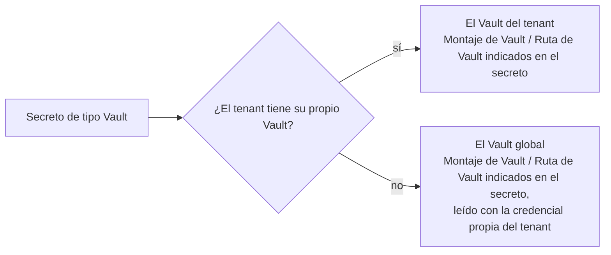

# Usuarios, grupos y tenants

Tres secciones de administración determinan quién puede iniciar sesión y a qué pertenece: las cuentas individuales, los conjuntos con nombre que conceden roles en bloque y el tenant en el que se encuentran todos ellos.

Un usuario pertenece como máximo a un tenant y a cualquier número de grupos de ese tenant. Toda comprobación de autorización usa la **unión** de los roles concedidos a la cuenta y los heredados de sus grupos; consulta [Roles y autorización](../concepts/authorization.md).

## Usuarios {#users}

Abre **Usuarios** en la barra lateral de administración para gestionar las cuentas. La lista muestra una fila por cuenta; al hacer clic en un nombre de usuario se abre su página de detalle, donde puedes editar los mismos campos o eliminar la cuenta.

| Campo | Notas |
|---|---|
| **Nombre de usuario** | Único dentro del tenant. No se puede editar después de crearlo. |
| **Nombre** / **Apellidos** | Se muestran juntos como nombre visible en todos los lugares donde se nombra a un usuario. |
| **Correo electrónico** | La dirección a la que se envía el correo de notificación. |
| **Contraseña** | Nunca se vuelve a mostrar. Al editar, si la dejas en blanco se conserva la contraseña actual. Si estableces una nueva, se cierra la sesión del usuario en todos los lugares donde la tenga iniciada. |
| **Habilitado** | Desmárcalo para impedir el inicio de sesión sin eliminar la cuenta. En la lista, una cuenta deshabilitada aparece atenuada y lleva una pequeña insignia en el avatar, así que la propia columna **Habilitado** se puede ocultar desde el selector de columnas. |
| **Correo verificado** | Las direcciones sin verificar quedan excluidas de la [entrega de correo](./notifications.md#email-delivery). |
| **Roles** | Una casilla por rol; consulta más abajo. |
| **Grupos** | Las pertenencias, editables desde cualquiera de los dos lados. |

### Roles {#roles}

El formulario de creación y la página de detalle incluyen un selector de roles, con una casilla por rol, y la lista muestra una columna **Roles**.

- **Superadministrador** solo se ofrece a un Superadministrador que haya iniciado sesión. En cualquier otro caso, concederlo o revocarlo se rechaza.
- Superadministrador es mutuamente excluyente con todos los demás roles, así que al marcarlo se deshabilitan los demás (y viceversa), con una indicación que explica por qué.
- La columna Roles no se puede ordenar ni filtrar, porque los roles se guardan como una lista y no como un único valor.

**Roles de los grupos.** El selector edita solo las concesiones **directas**. Los roles heredados de un [grupo de usuarios](./users-and-groups.md#user-groups) aparecen debajo, en **Roles de los grupos**, como chips de solo lectura: solo se pueden cambiar editando el grupo. La columna Roles de la lista muestra ambos, con los heredados atenuados, de modo que queda claro qué concesiones se pueden cambiar desde esta página.

### Grupos {#groups}

Las pertenencias actuales se muestran como chips que se pueden quitar; **Seleccionar grupos…** abre una tabla paginada y filtrable con los grupos del tenant para añadir más. El botón está oculto para una cuenta de ámbito de plataforma (un Superadministrador o el usuario del sistema creado inicialmente), que no pertenece a ningún tenant y, por tanto, nunca puede ser miembro. La misma pertenencia se puede editar desde el lado del [grupo](./users-and-groups.md#user-groups).

### Suplantar {#impersonate}

Las filas de los usuarios a los que puedes suplantar incluyen la acción **Suplantar**. Está oculta en tu propia fila, en la de cualquier Superadministrador y, salvo que seas Superadministrador, en la de cualquier Administrador. Al confirmar, llegas a la página de bienvenida actuando como ese usuario. Consulta [Suplantación](../concepts/impersonation.md) para ver las reglas completas y cómo dejar de hacerlo.

### Eliminar un usuario {#deleting-a-user}

Eliminar una cuenta a la que nada más hace referencia la borra por completo. Una cuenta que todavía posee registros (cualquier cosa que haya creado o actualizado por última vez) se conserva en cambio, deshabilitada y oculta en la lista de usuarios, para que los registros que posee sigan resolviéndose a un nombre. En ambos casos, la cuenta ya no puede iniciar sesión.

Los registros nunca muestran un ID de usuario en bruto. Todas las páginas de detalle y las listas resuelven el propietario a un nombre; dos cuentas se muestran en cambio con un rótulo, porque poseen registros de distintos tenants: la cuenta interna aparece como **Usuario del sistema**, y un Superadministrador que no puedes ver aparece como **Superadministrador**.

## Inicios de sesión fallidos {#failed-sign-ins}

Las contraseñas incorrectas repetidas bloquean una cuenta durante un tiempo. Cuando el mismo nombre de usuario (y tenant) acumula el número de fallos fijado en **Inicios de sesión fallidos antes del bloqueo** dentro del plazo de **Minutos de bloqueo** (5 en 15 minutos, salvo que el tenant los haya cambiado), la pantalla de inicio de sesión rechaza incluso la contraseña correcta e indica cuántos minutos hay que esperar. El bloqueo se levanta cuando el más antiguo de esos fallos alcanza la antigüedad de **Minutos de bloqueo**.

Cada tenant define sus propios valores. Abre **Configuración del tenant** en la barra lateral de administración (se necesita el rol Administrador) para cambiarlos en tu tenant:

| Campo | Notas |
|---|---|
| **Inicios de sesión fallidos antes del bloqueo** | Cuántos fallos bloquean una cuenta. De 1 a 100; valor predeterminado: 5. |
| **Minutos de bloqueo** | Durante cuántos minutos se cuentan los fallos y cuánto tiempo permanece bloqueada una cuenta. De 1 a 1440 (un día); valor predeterminado: 15. |

Un Superadministrador edita esos mismos dos campos en la página de detalle de un tenant, en **Tenants**, o abre **Configuración del tenant** mientras actúa como ese tenant. Las cuentas que no pertenecen a ningún tenant, como `root`, siempre usan los valores predeterminados.

Un inicio de sesión correcto pone a cero el recuento de fallos de la cuenta. Un nombre de usuario que no existe se bloquea tras el mismo número de fallos, de modo que un bloqueo nunca revela si una cuenta existe. Nadie tiene que desbloquear una cuenta: el bloqueo se levanta solo.

## El Vault del tenant {#tenant-vault}

Los [secretos de tipo Vault](./secrets.md) de un tenant se leen de un HashiCorp Vault (solo KV v2). Un tenant puede conectar **su propio** Vault; el que no lo hace lee del **Vault global** que un Superadministrador configura en [Configuración del sistema](./system-settings.md#global-vault), iniciando sesión con la [credencial del Vault global](#global-vault-credential) propia del tenant.

Para conectar el Vault propio del tenant, abre **Configuración del tenant** en la barra lateral de administración (se necesita el rol Administrador). Un Superadministrador abre la misma página mientras actúa como ese tenant.

| Campo | Notas |
|---|---|
| **Dirección de Vault** | La dirección del Vault, que empieza por `http://` o `https://`. Debe ser accesible en una dirección pública: se rechazan las direcciones de una red privada o de la máquina local. Déjala vacía y guarda para desconectar el Vault del tenant, lo que también elimina la credencial guardada; el tenant vuelve entonces al Vault global. |
| **Método de autenticación de Vault** | **Token** para un token estático, o **AppRole** para un ID de rol y un ID de secreto que A2Flow intercambia por un token de corta duración. |
| **ID de rol de Vault** / **Montaje de AppRole** | Solo para AppRole. El montaje predeterminado es `approle`. |
| **Token de Vault** / **ID de secreto de Vault** | La credencial del método elegido. Nunca se vuelve a mostrar: una vez guardada, el campo indica «Guardado: déjalo vacío para conservarlo». Cambiar el método de autenticación obliga a introducir una nueva. |

Guardar una dirección sin credencial, o AppRole sin ID de rol, se rechaza con un error. Un tenant que no tenga Vault propio ni credencial para el global no puede resolver sus secretos de tipo Vault.

## Tu propia cuenta {#your-own-account}

Haz clic en el botón de perfil de la barra de la aplicación y elige **Perfil** para revisar tu propia cuenta. La página se abre con una tarjeta de identidad (un banner, tu avatar sobre su borde inferior, tu nombre visible como encabezado y, a su lado, tu `@username`, tus roles y tus píldoras de estado), seguida de dos tarjetas de solo lectura y una tarjeta **Preferencias**:

| Tarjeta | Muestra |
|---|---|
| **Cuenta** | Nombre de usuario, correo electrónico, nombre y apellidos |
| **Acceso** | Roles, Roles de los grupos y Grupos |
| **Preferencias** | El [idioma](#language) en que se muestran las pantallas |

**Cuenta** y **Acceso** son de solo lectura: para cambiar esos atributos se necesitan el rol Administrador y la página de detalle de usuario de administración. Lo único que puedes editar por tu cuenta son tu idioma y tu avatar, que se edita haciendo clic en él.

### Idioma {#language}

Las pantallas de A2Flow están disponibles en English, 日本語, Español, 简体中文, 한국어 y Français. Cada idioma aparece con su propio nombre, para que encuentres el tuyo sea cual sea el idioma de la pantalla.

1. Abre **Perfil** desde el botón de perfil de la barra de la aplicación.
2. En la tarjeta **Preferencias**, elige un **Idioma**. La pantalla cambia al instante y se mantiene en ese idioma en todos los navegadores en los que inicies sesión.

Si eliges **Usar el idioma del navegador**, la opción predeterminada, la elección queda en manos de la configuración de idioma de tu navegador. Un navegador configurado en un idioma distinto de estos recibe inglés.

| Situación | Idioma que se muestra |
|---|---|
| Sesión iniciada, con un idioma elegido | Ese idioma |
| Sesión iniciada, siguiendo al navegador | El del navegador o, si no, inglés |
| La página de inicio de sesión | El último idioma usado en este navegador o, si no, el del navegador |
| Actuando como otro usuario ([suplantación](../concepts/impersonation.md)) | El tuyo, para que puedas leer la pantalla. El control **Idioma** está deshabilitado |

El idioma abarca lo que dice el propio A2Flow: el texto de las pantallas, los mensajes y errores de validación, y la redacción de sus propias notificaciones. Lo siguiente se queda tal como se escribió:

- Todo lo que hayan escrito personas o agentes: nombres, descripciones, títulos de aprobaciones, respuestas del chat. El agente responde en el idioma de la conversación, no en el que se configura aquí.
- El motivo técnico adjunto a algunos errores, que se muestra en inglés después del mensaje traducido.
- Los [correos de notificación](./notifications.md#email-delivery), que están en inglés.

### Avatares {#avatars}

Todos los usuarios tienen un avatar, que se muestra en el botón de perfil y en la lista y la página de detalle de usuarios de administración. De forma predeterminada se genera a partir del tenant y el nombre de usuario, por lo que no se guarda ninguna imagen y el mismo nombre de usuario en dos tenants obtiene dos caras distintas.

Al hacer clic en el avatar de tu página de Perfil se abre un diálogo con dos formas de cambiarlo:

- **Subir** una imagen personalizada: PNG, JPEG, WebP o GIF, de hasta 2 MB. La subida se aplica de inmediato y cierra el diálogo. Al quitarla se vuelve al avatar generado.
- **Personalizar** el avatar generado editando la paleta de colores con la que se dibuja. La paleta es lo único del diálogo que queda sin guardar: **Restablecer valores predeterminados** devuelve las muestras a su estado inicial, **Guardar** las aplica y al cerrar el diálogo se descarta lo que no se haya guardado.

| Prioridad | Se usa cuando |
|---|---|
| 1. Imagen subida | Se ha subido una imagen |
| 2. Avatar generado, paleta personalizada | Se ha guardado una paleta |
| 3. Avatar generado, paleta predeterminada | Ninguna de las anteriores |

La semilla sigue decidiendo dónde cae cada color, de modo que los usuarios se distinguen visualmente incluso con una paleta compartida. Una paleta idéntica a la predeterminada se guarda como ausencia de paleta, así que restablecer y guardar la borra de verdad. La edición del avatar es solo de autoservicio: la página de detalle de usuario de administración muestra el avatar en modo de solo lectura.

## Grupos de usuarios {#user-groups}

Abre **Grupos de usuarios** en la barra lateral de administración para gestionar los grupos: conjuntos de usuarios con nombre que conceden sus roles a todos sus miembros. Un grupo pertenece a exactamente un tenant y su nombre es único dentro de él.

| Campo | Notas |
|---|---|
| **Nombre** | Único dentro del tenant. |
| **Descripción** | Texto libre. |
| **Roles concedidos** | Los tienen todos los miembros, además de sus propias concesiones. |
| **Miembros** | Las cuentas del grupo. |
| **Etiquetas** | Sirven para clasificar grupos y se comparten con las demás secciones que admiten etiquetas. Una etiqueta de control de acceso aquí concede a todos los miembros acceso a los registros que la llevan. |

**Roles concedidos** usa el mismo selector que las páginas de Usuarios, menos **Superadministrador**: un grupo nunca puede concederlo, y la opción está oculta para todos, incluidos los Superadministradores. Como un Superadministrador no pertenece a ningún tenant, tampoco puede ser miembro.

**Etiquetas** es el mismo vocabulario de todo el tenant que comparten los secretos y los demás registros etiquetables. El formulario de creación y la página de detalle incluyen un selector de **Etiquetas**, y la lista tiene una columna **Etiquetas** filtrable; consulta [Etiquetas](./tags.md). Un grupo es también donde se concede el acceso: adjuntar una [etiqueta de control de acceso](./tags.md#access-control-tags) a un grupo permite a sus miembros ver los registros que la llevan, y un administrador puede adjuntar esa etiqueta a un grupo sin tenerla él mismo.

Los **Miembros** se muestran como chips que se pueden quitar; **Seleccionar miembros…** abre una tabla paginada y filtrable con los usuarios del tenant. Las cuentas de ámbito de plataforma se omiten, porque no pertenecen a ningún tenant. Al indicar miembros se reemplaza toda la pertenencia; si no tocas el campo al editar, se mantiene como está. La misma pertenencia se puede editar desde el lado de cada [usuario](./users-and-groups.md#users).

Nada se copia en el registro del usuario, así que cambiar los roles o los miembros de un grupo surte efecto para todos los afectados en su siguiente solicitud. **Eliminar** un grupo no afecta a las cuentas, pero les quita los roles que les concedía.

Escribir en esta sección requiere el rol Administrador. La lectura sigue abierta, así que quien no lo tenga sigue viendo la lista y una página de detalle de solo lectura.

## Tenants {#tenants}

Abre **Tenants** en la barra lateral de administración para gestionar los tenants: el límite organizativo de nivel superior para la multitenencia. Lo que ese límite significa para todo lo demás, y cómo un Superadministrador elige el tenant con el que actuar, se explica en [Tenants](../concepts/tenants.md); esta sección trata de los propios registros.

A diferencia de todas las demás secciones de administración, esta es **solo para Superadministradores** (el administrador de un tenant cambia su bloqueo de inicio de sesión y su propio Vault en **Configuración del tenant**). Está oculta en la barra lateral y en la página de bienvenida para todos los demás roles, y las escrituras de cualquier otra persona se rechazan.

| Campo | Notas |
|---|---|
| **Nombre para mostrar** | El rótulo legible para las personas. Único. |
| **Nombre** | Un identificador apto para URL, en minúsculas y kebab-case. Único y no editable después de crearlo. |
| **Habilitado** | Desmárcalo para desactivar un tenant sin eliminarlo: sus usuarios ya no pueden iniciar sesión, y a quienes ya la tengan iniciada se les cierra en su siguiente solicitud. |
| **Inicios de sesión fallidos antes del bloqueo** / **Minutos de bloqueo** | Cómo bloquean los inicios de sesión fallidos las cuentas del tenant; consulta [Inicios de sesión fallidos](#failed-sign-ins). |
| **Iniciar sesión en el Vault global** | Márcalo para registrar la credencial del tenant para el Vault global; consulta más abajo. |

### La credencial del Vault global {#global-vault-credential}

Un tenant sin Vault propio lee el [Vault global](./system-settings.md#global-vault) con una credencial que pertenece solo al tenant. Únicamente un Superadministrador la registra, en la página de detalle del tenant; el administrador del propio tenant nunca la ve.

| Campo | Notas |
|---|---|
| **Iniciar sesión en el Vault global** | Muestra los campos de abajo. Desmárcalo y guarda para eliminar la credencial guardada. |
| **Método de autenticación de Vault** | **Token** o **AppRole**, igual que para el [Vault propio de un tenant](#tenant-vault). |
| **ID de rol de Vault** / **Montaje de AppRole** | Solo para AppRole. El montaje predeterminado es `approle`. |
| **Token de Vault** / **ID de secreto de Vault** | De solo escritura, como cualquier otra credencial de Vault. Cambiar el método de autenticación obliga a introducir una nueva. |

Emite la credencial en Vault con una política que permita leer solo los datos de este tenant. Esa política es lo que mantiene separados a los tenants en el Vault global: un secreto puede indicar cualquier **Montaje de Vault** y **Ruta de Vault**, y Vault rechaza la lectura si la credencial del tenant no los cubre.

En el primer arranque se crea un tenant **Default** que contiene el usuario `admin` inicial. No se puede eliminar un tenant mientras tenga algún usuario asignado: primero reasigna o elimina esas cuentas.
