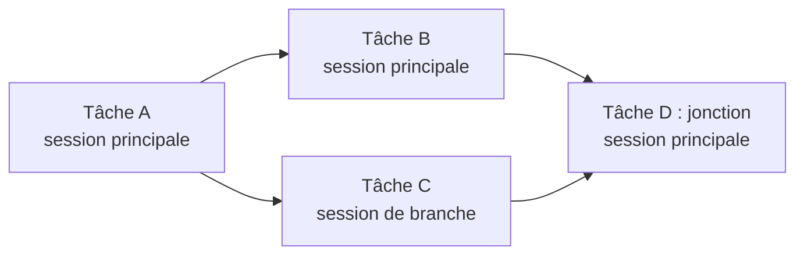
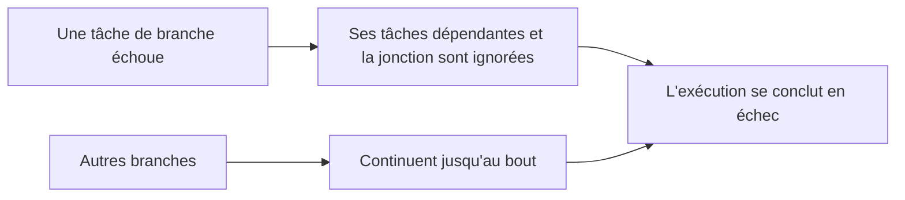

# Exécuter un workflow

Lancer un workflow ne fait pas simplement pointer une exécution vers ce workflow. Le lancement **copie** la conception publiée dans une nouvelle [exécution](../guides/workflow-executions.md), et c'est dans cet enregistrement que l'exécution se déroule désormais.

| Copié dans l'exécution | Source |
|---|---|
| Nom et prompt en vigueur | La dernière version publiée, ou les données actuelles pour un workflow encore à l'état `brouillon`, ou lorsqu'un Développeur a choisi d'exécuter les [modifications non publiées](../guides/workflows.md#trying-the-edits-out) d'un workflow à l'état `modifié` |
| Tâches, toutes à l'état `en attente`, avec leurs dépendances et leurs liaisons d'outils | Les modèles de tâches de cette même conception |
| La révision de la compétence d'agent suivie par l'exécution | La révision publiée de la compétence à ce moment-là |
| Les [simulacres d'outils](./mcp-gateway-and-proxy.md#tool-mocks-and-dry-runs) choisis, par valeur | Les simulacres tels qu'ils se présentent à ce moment-là |

Rien dans cette liste n'est relu ensuite à la source. Modifier le workflow, récupérer une nouvelle version de la compétence ou supprimer l'un ou l'autre n'atteint jamais une exécution déjà en cours, et une exécution terminée reste consultable après la disparition du workflow dont elle est issue.

## Comment l'exécution progresse {#how-the-run-advances}

La session du workflow s'ouvre sur un message de lancement fixe, l'agent d'exécution étant déjà au travail. La publication valait approbation du plan : il n'y a donc rien à confirmer avant de commencer.

L'agent ne choisit pas la tâche suivante. Dès que toutes les dépendances d'une tâche sont terminées, A2Flow l'**attribue** à la session qui la traitera, et l'agent ne traite que les tâches qui lui sont attribuées. Le démarrage de toute autre tâche, qu'elle soit attribuée ailleurs ou que ses dépendances ne soient pas terminées, est refusé.

Une exécution se termine à l'état `terminé` lorsque toutes les tâches ont atteint un état final sans aucun échec, et à l'état `échec` lorsqu'au moins une a échoué. Les états peuvent être suivis en direct dans la vue des tâches de l'exécution, en lecture seule, sous forme de tableau ou de graphe de dépendances.

Lorsqu'une tâche échoue, toutes les tâches qui l'attendent encore, directement ou plus loin dans la chaîne, passent à l'état `ignoré`, car elles ne peuvent plus s'exécuter. C'est ce qui permet à l'exécution de se conclure à l'état `échec` au lieu d'attendre indéfiniment une tâche qui ne démarrera jamais. Les tâches d'autres branches qui ne dépendent pas de celle qui a échoué continuent normalement.

## Branches parallèles {#parallel-branches}

Lorsque le graphe de tâches se ramifie, les branches ne s'attendent pas les unes les autres. Une exécution est d'abord traitée dans une seule **session principale** ; lorsqu'une tâche devient prête alors que la session qui devrait la prendre est encore occupée par une autre, A2Flow **dérive** pour elle une **session de branche**. La branche démarre avec une copie de tout ce que la session principale savait jusque-là, puis traite sa propre chaîne de tâches en parallèle de la session principale. Une approbation attendue par une branche n'arrête que cette branche.

| Situation | Où va la tâche |
|---|---|
| Une tâche racine, ou dont les dépendances ont été traitées par la session principale | La session principale, avec dérivation d'une nouvelle session de branche si la session principale est encore occupée par une autre tâche |
| Une tâche dont les dépendances ont été traitées par une session de branche active | Cette session de branche, là encore avec dérivation si elle est occupée |
| Une tâche dont les dépendances ont été traitées par une session de branche terminée | La session principale |
| Une **jonction**, dont les dépendances ont été traitées par plusieurs sessions | La session principale, une fois terminées toutes les branches qui l'alimentent |

- Une session de branche qui n'a plus de tâches se termine par un bref résumé de ce qu'elle a fait. La session principale lit ces résumés avant de traiter une jonction.
- Une session en attente d'une approbation peut aussi dériver une **consultation**. Celle-ci s'ouvre lorsque quelqu'un y pose une question, ne traite aucune tâche, ne change rien et se ferme lorsque l'approbation est décidée. Elle ne compte jamais dans la limite ci-dessous, et rien de ce qu'elle dit n'atteint l'exécution ([Consultations](../guides/workflow-executions.md#consultations)).
- Une branche peut dériver à son tour, mais le nombre de sessions simultanées est limité. Une fois la limite atteinte, une tâche prête attend sa session : l'exécution revient alors à traiter les tâches l'une après l'autre.
- Une tâche en échec n'arrête que sa propre chaîne : les tâches qui l'attendent, ainsi que toute jonction qu'elle alimente, passent à l'état `ignoré` comme décrit ci-dessus, tandis que les autres branches terminent leur travail. L'exécution se conclut ensuite à l'état `échec`.

## Pourquoi l'état « en cours » est important {#why-in_progress-matters}

Faire passer une tâche à l'état `en cours` n'est pas une simple formalité. C'est ce qui débloque les outils de cette tâche : la [passerelle](./mcp-gateway-and-proxy.md) n'autorise un appel que si l'outil est lié à une tâche que l'exécution a actuellement en cours. Une tâche terminée ne peut plus agir, et une tâche qui n'a pas encore démarré n'a jamais pu le faire.

La liste des tâches de l'exécution et les liaisons d'outils de chaque tâche sont fixées au démarrage de l'exécution, par copie de la conception publiée du workflow, et l'agent ne fait qu'avancer les états. Il ne peut ni ajouter, ni retirer, ni relier autrement une tâche. C'est aussi pourquoi une [approbation](./approvals.md) ne relit pas les liaisons d'une tâche au moment où elles comptent : elle signe l'ensemble qu'elle a vu au moment où l'approbateur a statué, de sorte qu'aucune modification ultérieure du workflow ne peut élargir une autorisation déjà accordée.
