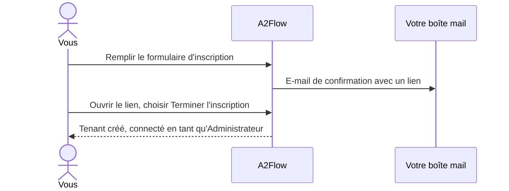

# S'inscrire

Si le déploiement l'autorise, n'importe qui peut créer son propre tenant depuis l'écran de connexion et commencer à utiliser A2Flow en tant qu'Administrateur. Aucun Super administrateur n'a besoin de créer le tenant ni le compte au préalable. L'inscription reste désactivée tant que l'opérateur ne l'active pas : voir [Inscription](../operations/configuration.md#sign-up) dans la référence de configuration. L'écran de connexion ne propose **Créer un compte** que tant que le déploiement a encore de la place pour un tenant de plus : voir [Le nombre maximal de Tenants](../guides/system-settings.md#tenant-limit).

## Créer votre compte {#creating-your-account}

1. Ouvrez A2Flow à son adresse principale, et non à l'adresse propre d'un tenant, puis choisissez **Créer un compte** sous le formulaire de connexion.
2. Renseignez **E-mail**, **Nom d'utilisateur**, **Prénom**, **Nom** et **Mot de passe**, puis choisissez **Créer le compte**. L'écran **Consultez vos e-mails** s'affiche. Rien n'a encore été créé.
3. Ouvrez le lien de l'e-mail envoyé par A2Flow. L'écran **Terminer l'inscription** s'ouvre ; choisissez le bouton **Terminer l'inscription**.
4. L'écran **Bienvenue dans A2Flow** affiche votre nouveau **Tenant** et votre **Nom d'utilisateur**. Notez le tenant : il vous servira pour vous reconnecter.
5. Choisissez **Continuer**. Vous êtes connecté en tant qu'**Administrateur** du tenant.

| Élément | Règle |
|---|---|
| **Nom d'utilisateur** | De 3 à 64 lettres, chiffres, points, tirets ou traits de soulignement. Une adresse e-mail n'est pas acceptée |
| **Mot de passe** | De 12 à 72 caractères |
| Le lien | Utilisable une seule fois, dans les 24 heures suivant l'envoi. Il peut être ouvert dans n'importe quel navigateur |
| Un autre e-mail | Une adresse reçoit au plus un e-mail de confirmation par minute |

## Si le lien ne fonctionne pas {#link-problems}

| Ce que vous voyez | Que faire |
|---|---|
| Aucun e-mail n'arrive | Vérifiez votre dossier de spam. Après une minute, remplissez à nouveau le formulaire pour recevoir un nouvel e-mail |
| « Ce lien d'inscription est invalide ou a expiré » | Le lien a déjà servi ou date de plus de 24 heures. Remplissez à nouveau le formulaire |
| « Le nombre maximal de Tenants est atteint » | Le déploiement est plein. Demandez à l'opérateur de relever le **Nombre maximal de Tenants** dans les paramètres système ; le lien reste utilisable jusqu'à son expiration |
| « Ce lien est incomplet » | Votre messagerie a tronqué le lien. Copiez le lien complet de l'e-mail dans le navigateur |

## Votre nouveau tenant {#your-new-tenant}

A2Flow nomme le tenant d'après votre nom d'utilisateur, suivi de six caractères aléatoires : le nom d'utilisateur `Jane.Doe` obtient un tenant comme `jane-doe-3fa9c1`. Vous en êtes le seul utilisateur, avec le rôle **Administrateur** : vous pouvez ajouter le reste de votre équipe dans [Utilisateurs](../guides/users-and-groups.md#users) et brancher la connexion de votre entreprise dans [Authentification unique](../guides/single-sign-on.md). Tant que vous ne définissez pas de LLM propre au tenant, ses agents utilisent celui du système : voir [Le LLM du tenant](../guides/users-and-groups.md#tenant-llm).

## Se reconnecter {#signing-in-again}

À l'adresse principale, saisissez votre **Nom d'utilisateur**, le **Tenant** affiché sur l'écran de bienvenue et votre **Mot de passe**. Quand le déploiement donne à chaque tenant sa propre adresse, l'écran de bienvenue l'affiche aussi sous **Adresse du tenant**. Connectez-vous à cette adresse et le tenant est rempli pour vous : voir [À l'adresse de votre tenant](../guides/single-sign-on.md#tenant-address).
