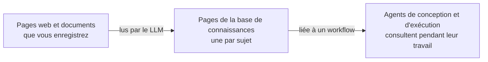

# Bases de connaissances

Une base de connaissances est un wiki que le LLM rédige pour vous à partir des pages web et des documents que vous enregistrez. Liez-la à un workflow, et les agents de ce workflow y font leurs recherches pendant qu'ils le conçoivent et l'exécutent, que ce soit pour accomplir une tâche à la manière de votre organisation ou pour répondre à la question d'un participant dans la discussion.

Ouvrez **Bases de connaissances** dans la barre latérale d'administration pour les gérer.

## Comment le wiki est rédigé {#how-the-wiki-is-written}

Le LLM ne produit pas un résumé par document. Il lit chaque source et en intègre le contenu dans des **pages de sujet** : il met à jour la page du sujet si elle existe déjà, et n'en rédige une nouvelle que pour un sujet qu'aucune page ne couvre encore. Cinq documents sur le même VPN aboutissent ainsi à une seule page VPN, qui réunit tout ce qu'ils disent.

Chaque affirmation d'une page porte une note de bas de page indiquant la source dont elle provient, et chaque page liste ses sources en haut. C'est ce qui permet à A2Flow de retirer plus tard une source sans reconstruire tout le wiki.

## Créer une base de connaissances {#creating-a-knowledge-base}

1. Cliquez sur **+ Ajouter une base de connaissances**.
2. Saisissez un **Nom** et une **Description**. Rédigez la description à l'intention des agents : c'est ce qu'ils lisent pour décider si cette base de connaissances peut répondre à ce qu'ils cherchent.
3. Cliquez sur **Enregistrer**. La base de connaissances s'ouvre, prête à recevoir des sources.

Créer, modifier et supprimer des bases de connaissances et leurs sources nécessite le rôle **Développeur**. Toute personne qui peut ouvrir une base de connaissances peut en lire les pages.

## Ajouter des sources {#adding-sources}

Sur la page de la base de connaissances, la section **Sources** accepte deux types de source :

| Source | Comment l'ajouter |
|---|---|
| Une page web | Saisissez son URL et cliquez sur **Ajouter une URL** |
| Un document | Cliquez sur **Importer des documents** et choisissez un ou plusieurs fichiers : PDF, Word (`.docx`), HTML, Markdown, CSV, JSON ou texte brut |

Une source est lue en arrière-plan : vous pouvez donc continuer à travailler ou quitter la page. Son **État** passe par les valeurs suivantes :

| État | Signification |
|---|---|
| **Non lue** | Enregistrée, mais pas encore lue. Cliquez sur **Lire** pour commencer. Seule une source ajoutée avec les [données de démonstration](../getting-started/demo-data.md) démarre ainsi |
| **En file d'attente** | Attend son tour. Les sources d'une même base de connaissances sont lues une à la fois, car elles modifient les mêmes pages |
| **Lecture** | Le LLM lit la source et rédige les pages |
| **Prête** | Les connaissances de la source sont dans le wiki. **Lu le** indique à quel moment |
| **Échec** | La lecture a échoué, et rien de ce qu'elle aurait rédigé n'a été conservé. Le motif est affiché sous l'état |
| **Suppression** | La source est en cours de retrait du wiki (voir ci-dessous) |

Un long document est lu par parties, l'une après l'autre : un gros manuel prend donc un certain temps. Un PDF numérisé sans couche de texte n'a rien à lire et échoue avec un message qui le précise.

Les pages web sont récupérées depuis le serveur A2Flow : une page protégée par une connexion, ou située à une adresse de réseau privé, ne peut donc pas être ajoutée.

### Relire une source {#reading-a-source-again}

Cliquez sur **Relire** sur une source pour retirer du wiki ce qu'elle y a apporté et la lire de nouveau. Utilisez cette action quand une page web a changé, ou pour réessayer une source en échec. Une source bloquée à l'état **Lecture** après un redémarrage du serveur se récupère de la même façon.

### Retirer une source {#removing-a-source}

Cliquez sur **Supprimer** sur une source et confirmez. Le LLM ne revoit que les pages qui la citent, en retire ce qui provient de cette seule source et conserve ce que d'autres sources étayent aussi. Une page qui n'a plus aucune source est supprimée. La source disparaît de la liste une fois l'opération terminée.

## Parcourir les pages {#browsing-the-pages}

La section **Pages** liste toutes les pages, et chaque ligne affiche le titre et le chemin de la page, son **Type** et la date de sa dernière mise à jour (**Mis à jour le**). Cliquez sur un titre pour lire la page. Les pages sont en lecture seule : pour en corriger une, corrigez ou retirez la source dont elle provient et relisez-la.

Cliquez sur **Télécharger l'archive** dans l'en-tête de la page pour télécharger toute la base de connaissances sous forme de fichier zip. L'archive suit l'[Open Knowledge Format](https://github.com/GoogleCloudPlatform/open-knowledge-format), avec un fichier Markdown par page, ses métadonnées en tête, et un `index.md` dans chaque dossier : les autres outils qui lisent ce format peuvent donc l'utiliser eux aussi.

## Lier une base de connaissances à un workflow {#linking-a-knowledge-base-to-a-workflow}

Ouvrez la page de détail du workflow, choisissez des bases de connaissances sous **Bases de connaissances**, puis cliquez sur **Enregistrer**. Vous pouvez aussi les choisir au moment de [générer le workflow](./workflows.md#generating-a-workflow), afin que l'agent de conception les consulte dès sa toute première conception.

| Qui fait les recherches | Quand |
|---|---|
| L'agent de conception | Pendant qu'il conçoit les modèles de tâches du workflow, juste après la génération, et pendant qu'il les affine dans la session de conception |
| L'agent d'exécution | Pendant qu'il traite les tâches d'une exécution, et quand un participant lui pose une question dans la session du workflow |

Les agents ne voient que les bases de connaissances liées à leur workflow. Ils en parcourent le contenu, y cherchent par mot-clé et lisent les pages pertinentes ; quand ils s'appuient sur une page, ils la nomment. Quand les bases de connaissances liées ne couvrent pas un point, ils ont pour consigne de le dire plutôt que de deviner.

Les liens ne font pas partie de la conception publiée d'un workflow. Les modifier prend effet à la recherche suivante, y compris dans les exécutions déjà en cours, et ne marque pas un workflow publié comme modifié.

## Étiquettes {#tags}

Le formulaire de création et la page de détail d'une base de connaissances comportent un sélecteur **Étiquettes**, et la liste propose une colonne **Étiquettes** filtrable. Une [étiquette de contrôle d'accès](./tags.md) masque une base de connaissances aux personnes dont les groupes ne la portent pas, ainsi qu'à l'agent qui travaille pour elles, même lorsque la base de connaissances est liée au workflow :

| Où s'exécute l'agent | Les groupes de qui comptent |
|---|---|
| Discussion de conception du workflow | La personne qui discute |
| Exécution du workflow | La personne qui a lancé l'exécution, pendant toute sa durée |

Les administrateurs ne sont pas soumis à cette restriction.

## Supprimer une base de connaissances {#deleting-a-knowledge-base}

Supprimer une base de connaissances supprime aussi ses sources et ses pages, et la délie de tous les workflows.
