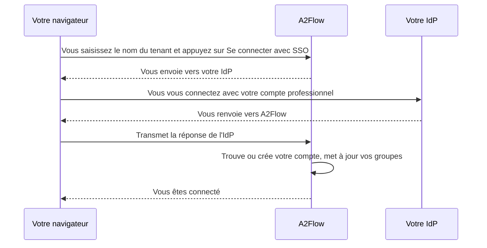

# Authentification unique

Chaque [tenant](../concepts/tenants.md) peut connecter un **fournisseur d'identité (IdP)** compatible OpenID Connect, comme Microsoft Entra ID, Okta ou Keycloak. Son personnel se connecte alors avec son compte professionnel, sans mot de passe A2Flow distinct. La première connexion crée le compte A2Flow, et les groupes de l'IdP déterminent à quels [groupes d'utilisateurs](./users-and-groups.md#user-groups) appartient la personne, et donc quels rôles elle détient.

Les mots de passe continuent de fonctionner à côté de l'authentification unique. Les comptes Super administrateur n'appartiennent à aucun tenant et se connectent toujours avec un mot de passe.

## Fonctionnement {#how-it-works}

## Avant de commencer {#before-you-start}

- Il vous faut le rôle Administrateur dans le tenant.
- Un opérateur doit avoir défini l'URL de base du déploiement au déploiement — voir [Paramètres du serveur](../operations/configuration.md#server-settings). Tant qu'elle n'est pas définie, **Paramètres du tenant** affiche un avertissement à la place de l'**URI de redirection** et l'authentification unique reste indisponible.
- A2Flow doit pouvoir joindre votre IdP à une adresse publique. Un IdP sur un réseau privé ne fonctionne qu'une fois son hôte autorisé par l'opérateur ; voir [Authentification unique](../operations/configuration.md#single-sign-on) dans la référence de configuration.

Pour essayer l'authentification unique sans votre propre IdP, démarrez le Keycloak fourni avec la pile Docker Compose — voir [Essayer l'authentification unique avec Keycloak](../getting-started/docker-compose.md#keycloak).

## La mettre en place {#set-it-up}

1. Dans votre IdP, enregistrez une nouvelle application pour A2Flow : une application web dotée d'un secret client. Notez son URL de l'émetteur, son ID client et son secret client.
2. Dans A2Flow, ouvrez **Paramètres du tenant** dans la barre latérale d'administration et trouvez la section **Authentification unique**. Appuyez sur **Copier** à côté de **URI de redirection** et enregistrez cette adresse comme URI de redirection de l'application dans votre IdP.
3. Dans votre IdP, faites en sorte que le jeton d'ID de l'application porte la liste des groupes de chaque personne (le claim de groupes). L'oublier retire les rôles ; voir [À savoir](#things-to-know).
4. Remplissez la section à l'aide du tableau ci-dessous et cochez **Activer l'authentification unique**.
5. Enregistrez. L'enregistrement vérifie que l'URL de l'émetteur est une adresse autorisée (`https`, ou un hôte autorisé par l'opérateur) et, si **Activer l'authentification unique** est cochée, que l'URL de l'émetteur, l'ID client et le secret client sont renseignés. Il ne contacte pas l'IdP, donc le vrai test est l'étape suivante.
6. Sur chaque groupe d'utilisateurs qui doit suivre un groupe de l'IdP, ouvrez **Groupes d'utilisateurs**, ouvrez le groupe et renseignez **Groupe IdP** ; voir [Groupes et rôles](#groups-and-roles).
7. Essayez : ouvrez l'écran de connexion, saisissez le nom du tenant et appuyez sur **Se connecter avec SSO**.

| Champ | Remarques |
|---|---|
| **Activer l'authentification unique** | L'interrupteur. L'activer exige l'URL de l'émetteur, l'ID client et le secret client. |
| **URL de l'émetteur** | L'émetteur OpenID Connect de votre IdP, comme `https://idp.example.com`. |
| **ID client** | L'ID client de l'application dans votre IdP. |
| **Secret client** | En écriture seule : il n'est jamais réaffiché. Une fois enregistré, le champ indique « Enregistré — laissez vide pour le conserver ». |
| **Claim de groupes** | Le nom du claim du jeton d'ID qui liste les groupes d'une personne. `groups`, sauf si votre IdP utilise un autre nom. |
| **Faire confiance aux adresses e-mail de cet IdP** | Désactivé par défaut. Permet à A2Flow de rattacher un compte existant par adresse e-mail même quand l'IdP ne marque pas l'adresse comme vérifiée. Microsoft Entra ID en a besoin. |
| **URI de redirection** | En lecture seule. L'adresse à enregistrer dans votre IdP ; tous les tenants utilisent la même. |

## Se connecter {#signing-in}

Sur l'écran de connexion, saisissez le nom du tenant dans **Tenant** et appuyez sur **Se connecter avec SSO**. Le bouton reste désactivé tant que **Tenant** est vide. Vous êtes envoyé vers votre IdP, vous vous y connectez, puis vous revenez dans A2Flow, connecté. La connexion par nom d'utilisateur et mot de passe fonctionne comme avant.

Se déconnecter d'A2Flow ne vous déconnecte pas de l'IdP : en appuyant de nouveau sur **Se connecter avec SSO**, vous pouvez donc entrer directement.

## Messages d'erreur de connexion {#sign-in-errors}

Une tentative échouée vous ramène à l'écran de connexion avec l'un de ces messages.

| Message | Signification et marche à suivre |
|---|---|
| L'authentification unique n'est pas disponible pour ce tenant. | Le nom du tenant est faux, le tenant est désactivé, ou son authentification unique n'est pas configurée ou pas activée. A2Flow ne précise volontairement pas lequel, pour que le message ne serve pas à découvrir quels tenants existent. Vérifiez le nom, puis interrogez l'administrateur de votre tenant. |
| Échec de l'authentification unique. Veuillez réessayer. | L'échange avec l'IdP ne s'est pas terminé, ou l'IdP n'a envoyé aucune adresse e-mail ou une adresse inutilisable, ou deux comptes du tenant partagent votre adresse e-mail, ou un compte portant votre adresse e-mail est déjà rattaché à une autre identité de l'IdP, ou l'adresse e-mail de l'IdP n'est pas de confiance et un compte A2Flow portant cette adresse existe déjà. Dans ce dernier cas, demandez à l'administrateur de votre tenant d'activer **Faire confiance aux adresses e-mail de cet IdP** ou de modifier l'adresse e-mail de l'un des deux comptes. Sinon, réessayez ; si cela échoue encore, demandez à l'administrateur de votre tenant de vérifier les paramètres et l'application enregistrée dans l'IdP. |
| Votre compte est désactivé. | Votre compte A2Flow ou tout votre tenant est désactivé, ou le compte a été supprimé. Un administrateur peut réactiver le compte avec **Activé**. |
| Votre compte auprès du fournisseur d'identité n'est pas autorisé à se connecter à A2Flow. | Vous n'avez pas encore de compte A2Flow et n'appartenez à aucun groupe de l'IdP associé à un groupe d'utilisateurs, ou l'IdP a omis votre liste de groupes parce que vous appartenez à un très grand nombre de groupes. Demandez à l'administrateur de l'IdP de vous ajouter à un groupe associé. |

## Comment une personne est associée à un compte {#account-matching}

À chaque connexion, A2Flow cherche le compte dans cet ordre :

1. **Un compte déjà rattaché à cette identité de l'IdP** est utilisé.
2. **Un compte existant ayant la même adresse e-mail** est rattaché, une seule fois. L'adresse est comparée sans tenir compte de la casse, et n'est acceptée que si l'IdP la marque comme vérifiée ou si **Faire confiance aux adresses e-mail de cet IdP** est activé. Exactement un compte non rattaché doit correspondre ; si deux ou plus correspondent, la connexion échoue.
3. **Sinon, un nouveau compte est créé**, mais seulement pour une personne appartenant à au moins un groupe de l'IdP associé à un groupe d'utilisateurs. Toute autre personne est refusée. Un nouveau compte n'est jamais créé pour une adresse e-mail qu'un compte du tenant possède déjà, ni lorsque l'adresse e-mail de l'IdP est inutilisable ; la connexion échoue alors.

Un nouveau compte reçoit pour nom d'utilisateur le preferred username de l'IdP, sinon la partie de l'adresse e-mail située avant le `@`. Les caractères autres que lettres, chiffres, `.`, `_` et `-` sont supprimés, le nom devient `user` s'il en reste trop peu, et `-2`, `-3`, etc. sont ajoutés quand le nom est déjà pris. Le prénom et le nom viennent de l'IdP. Le compte n'a ni rôle direct ni mot de passe : ses rôles viennent de ses groupes, et un administrateur peut définir un mot de passe plus tard comme solution de secours.

Le nom et l'adresse e-mail d'un compte existant ne sont jamais écrasés par ceux de l'IdP.

## Groupes et rôles {#groups-and-roles}

Sur chaque groupe d'utilisateurs, **Groupe IdP** contient la valeur que le claim de groupes de l'IdP liste pour ce groupe. Microsoft Entra ID envoie l'ID d'objet du groupe, et non son nom : saisissez donc cet ID. La correspondance est exacte et sensible à la casse.

À chaque connexion SSO, pour chaque groupe d'utilisateurs doté d'un **Groupe IdP** :

- la personne rejoint le groupe quand le claim contient la valeur, et
- le quitte quand il ne la contient pas.

Les groupes d'utilisateurs sans **Groupe IdP** et les rôles accordés directement à un compte ne sont jamais touchés. Les changements de groupes faits dans l'IdP prennent effet à la prochaine connexion SSO de la personne, pas immédiatement.

Les membres d'un groupe doté d'un **Groupe IdP** sont gérés par l'IdP et ne peuvent pas être modifiés à la main. Sur la page du groupe, la liste **Membres** est en lecture seule et indique « Géré par votre IdP », et un tel groupe ne peut pas non plus être ajouté aux **Groupes** d'un utilisateur ni en être retiré. Si vous renseignez **Groupe IdP** sur un groupe qui a déjà des membres, ceux-ci restent jusqu'à la prochaine connexion SSO de chacun.

## À savoir {#things-to-know}

| Situation | Ce qui se passe |
|---|---|
| L'IdP n'envoie pas le claim de groupes, ou le nom de **Claim de groupes** ne correspond pas | Toute personne qui se connecte est retirée de tous les groupes associés et perd les rôles que ces groupes lui donnaient. Vérifiez le claim dans l'IdP avant d'activer l'authentification unique. |
| Microsoft Entra ID | Il envoie des ID d'objet de groupe, pas des noms. Pour une personne appartenant à un très grand nombre de groupes, il omet la liste. A2Flow conserve alors les appartenances actuelles de cette personne et ne peut pas lui créer de nouveau compte. |
| Vous modifiez **URL de l'émetteur** ou **ID client** | Tous les comptes du tenant sont détachés de leur identité de l'IdP, car l'IdP émet des identités différentes pour une autre application. Les personnes sont rattachées de nouveau par adresse e-mail à leur prochaine connexion, ce qui exige une adresse de confiance (marquée comme vérifiée par l'IdP, ou **Faire confiance aux adresses e-mail de cet IdP** activé). Sinon, la connexion échoue, car l'ancien compte porte encore cette adresse. |
| Quelqu'un est retiré dans l'IdP | Cette personne ne peut plus se connecter par SSO, mais A2Flow ne désactive pas son compte. Décochez **Activé** sur le compte pour bloquer aussi la connexion par mot de passe. |
| Un compte porte le badge **SSO** | Il s'est connecté par authentification unique. Le badge apparaît dans la liste **Utilisateurs** et sur la page de détail du compte. |
