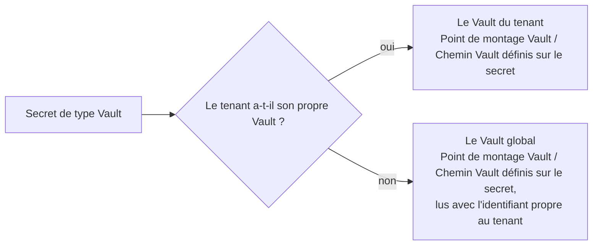

# Utilisateurs, groupes et tenants

Trois sections d'administration déterminent qui peut se connecter et à quoi chacun appartient : les comptes individuels, les ensembles nommés qui accordent des rôles en bloc, et le tenant dans lequel tout cela s'inscrit.

Un utilisateur appartient à un tenant au plus et à autant de groupes de ce tenant que nécessaire. Chaque contrôle d'autorisation s'appuie sur l'**union** des rôles accordés au compte et des rôles hérités de ses groupes : voir [Rôles et autorisations](../concepts/authorization.md).

## Utilisateurs {#users}

Ouvrez **Utilisateurs** dans la barre latérale d'administration pour gérer les comptes. La liste affiche une ligne par compte ; cliquez sur un nom d'utilisateur pour ouvrir sa page de détail, où vous pouvez modifier les mêmes champs ou supprimer le compte.

| Champ | Remarques |
|---|---|
| **Nom d'utilisateur** | Unique au sein du tenant. Non modifiable après la création. |
| **Prénom** / **Nom** | Affichés ensemble comme nom d'affichage partout où un utilisateur est nommé. |
| **E-mail** | Adresse à laquelle sont envoyés les e-mails de notification. |
| **Mot de passe** | Jamais réaffiché. En modification, le laisser vide conserve le mot de passe actuel. En définir un nouveau déconnecte l'utilisateur partout où il est connecté. |
| **Activé** | Décochez-le pour bloquer la connexion sans supprimer le compte. Dans la liste, un compte désactivé apparaît estompé et porte un petit badge sur son avatar : la colonne **Activé** elle-même peut donc être masquée depuis le sélecteur de colonnes. |
| **E-mail vérifié** | Les adresses non vérifiées sont ignorées par l'[envoi des e-mails](./notifications.md#email-delivery). |
| **Rôles** | Une case à cocher par rôle : voir ci-dessous. |
| **Groupes** | Appartenances aux groupes, modifiables depuis l'un ou l'autre côté. |

### Rôles {#roles}

Le formulaire de création et la page de détail comportent un sélecteur de rôles, avec une case à cocher par rôle, et la liste affiche une colonne **Rôles**.

- **Super administrateur** n'est proposé qu'à un Super administrateur connecté. Toute autre tentative de l'accorder ou de le retirer est refusée.
- Super administrateur exclut tous les autres rôles : le cocher désactive les autres (et inversement), avec une indication qui en explique la raison.
- La colonne Rôles ne peut être ni triée ni filtrée, car les rôles sont stockés sous forme de liste et non de valeur unique.

**Rôles issus des groupes.** Le sélecteur ne modifie que les attributions **directes**. Les rôles hérités d'un [groupe d'utilisateurs](./users-and-groups.md#user-groups) apparaissent en dessous, sous **Rôles issus des groupes**, sous forme de puces en lecture seule : seule une modification du groupe peut les changer. La colonne Rôles de la liste affiche les deux, les rôles hérités étant estompés, de sorte que l'on voit d'emblée quelles attributions cette page permet de modifier.

### Groupes {#groups}

Les appartenances actuelles s'affichent sous forme de puces amovibles ; **Sélectionner des groupes…** ouvre un tableau paginé et filtrable des groupes du tenant pour en ajouter d'autres. Le bouton est masqué pour un compte à portée plateforme (un Super administrateur ou l'utilisateur système créé à l'initialisation), qui n'appartient à aucun tenant et ne peut donc jamais être membre. La même appartenance se modifie aussi du côté du [groupe](./users-and-groups.md#user-groups).

### Agir en tant que {#impersonate}

Les lignes des utilisateurs à la place desquels vous avez le droit d'agir portent une action **Agir en tant que**. Elle est masquée sur votre propre ligne, sur celle de tout Super administrateur et, sauf si vous êtes Super administrateur, sur celle de tout Administrateur. Une fois votre choix confirmé, vous arrivez sur la page de bienvenue en agissant en tant que cet utilisateur. Voir [Emprunt d'identité](../concepts/impersonation.md) pour l'ensemble des règles et la manière d'arrêter.

### Supprimer un utilisateur {#deleting-a-user}

La suppression d'un compte auquel rien d'autre ne fait référence l'efface purement et simplement. Un compte qui possède encore des enregistrements (tout ce qu'il a créé ou mis à jour en dernier) est conservé, désactivé et masqué de la liste des utilisateurs, afin que ces enregistrements continuent d'afficher un nom. Dans les deux cas, le compte ne peut plus se connecter.

Les enregistrements n'affichent jamais un identifiant d'utilisateur brut. Chaque page de détail et chaque liste résout le propriétaire en nom ; deux comptes reçoivent à la place un libellé, car ils possèdent des enregistrements au-delà des frontières des tenants : le compte interne s'affiche **Utilisateur système**, et un Super administrateur que vous ne pouvez pas voir s'affiche **Super administrateur**.

## Échecs de connexion {#failed-sign-ins}

Des mots de passe erronés à répétition verrouillent un compte pendant un certain temps. Une fois atteint le nombre d'échecs fixé par **Échecs de connexion avant verrouillage** pour le même nom d'utilisateur (et le même tenant) sur la durée fixée par **Minutes de verrouillage** (5 échecs en 15 minutes, sauf si le tenant a changé ces valeurs), l'écran de connexion refuse même le mot de passe correct et indique combien de minutes patienter. Le verrou se lève dès que le plus ancien de ces échecs atteint l'ancienneté fixée par **Minutes de verrouillage**.

Chaque tenant définit ses propres valeurs. Pour les changer dans votre tenant, ouvrez **Paramètres du tenant** dans la barre latérale d'administration (le rôle Administrateur est requis) :

| Champ | Remarques |
|---|---|
| **Échecs de connexion avant verrouillage** | Nombre d'échecs qui verrouille un compte. De 1 à 100 ; 5 par défaut. |
| **Minutes de verrouillage** | Nombre de minutes sur lequel les échecs sont comptés, et durée pendant laquelle un compte verrouillé le reste. De 1 à 1440 (un jour) ; 15 par défaut. |

Un Super administrateur modifie ces deux mêmes champs sur la page de détail d'un tenant, sous **Tenants**, ou ouvre **Paramètres du tenant** après avoir choisi ce tenant comme tenant actif. Les comptes qui n'appartiennent à aucun tenant, comme `root`, utilisent toujours les valeurs par défaut.

Une connexion réussie remet à zéro le compteur d'échecs du compte. Un nom d'utilisateur inexistant est verrouillé après le même nombre d'échecs : un verrouillage ne révèle donc jamais si un compte existe. Personne n'a besoin de déverrouiller un compte : le verrou se lève de lui-même.

## Le Vault du tenant {#tenant-vault}

Les [secrets de type Vault](./secrets.md) d'un tenant sont lus depuis un HashiCorp Vault (KV v2 uniquement). Un tenant peut connecter **son propre** Vault ; sinon, il lit depuis le **Vault global** qu'un Super administrateur configure dans [Paramètres système](./system-settings.md#global-vault), en s'y connectant avec l'[identifiant du Vault global](#global-vault-credential) propre au tenant.

Pour connecter le Vault propre au tenant, ouvrez **Paramètres du tenant** dans la barre latérale d'administration (le rôle Administrateur est requis). Un Super administrateur ouvre la même page après avoir choisi ce tenant comme tenant actif.

| Champ | Remarques |
|---|---|
| **Adresse Vault** | L'adresse du Vault, commençant par `http://` ou `https://`. Elle doit être joignable sur une adresse publique : une adresse de réseau privé ou de la machine locale est rejetée. Laissez-la vide et enregistrez pour déconnecter le Vault du tenant, ce qui supprime aussi l'identifiant stocké ; le tenant revient alors au Vault global. |
| **Méthode d'authentification Vault** | **Jeton** pour un jeton statique, ou **AppRole** pour un ID de rôle et un ID de secret qu'A2Flow échange contre un jeton de courte durée. |
| **ID de rôle Vault** / **Point de montage AppRole** | AppRole uniquement. Le point de montage est `approle` par défaut. |
| **Jeton Vault** / **ID de secret Vault** | L'identifiant correspondant à la méthode choisie. Il n'est jamais réaffiché : une fois enregistré, le champ indique « Enregistré — laissez vide pour le conserver ». Changer de méthode d'authentification oblige à en saisir un nouveau. |

Enregistrer une adresse sans identifiant, ou AppRole sans ID de rôle, est rejeté avec une erreur. Un tenant qui n'a ni Vault propre ni identifiant pour le Vault global ne peut pas résoudre ses secrets de type Vault.

## Votre propre compte {#your-own-account}

Cliquez sur le bouton de profil dans la barre d'application et choisissez **Profil** pour consulter votre compte. La page s'ouvre sur une carte d'identité : une bannière, votre avatar à cheval sur son bord inférieur, votre nom d'affichage en titre et, à côté, votre `@username`, vos rôles et des pastilles d'état. Viennent ensuite deux cartes en lecture seule et une carte **Préférences** :

| Carte | Contenu |
|---|---|
| **Compte** | Nom d'utilisateur, e-mail, prénom et nom |
| **Accès** | Rôles, Rôles issus des groupes et Groupes |
| **Préférences** | La [langue](#language) d'affichage des écrans |

**Compte** et **Accès** sont en lecture seule : modifier ces attributs requiert le rôle Administrateur et la page de détail de l'utilisateur côté administration. Vous pouvez vous-même modifier deux choses : votre langue et votre avatar, sur lequel il suffit de cliquer.

### Langue {#language}

Les écrans d'A2Flow existent en English, 日本語, Español, 简体中文, 한국어 et Français. Chaque langue est listée sous son propre nom : vous trouvez donc la vôtre quelle que soit la langue affichée à l'écran.

1. Ouvrez **Profil** depuis le bouton de profil de la barre d'application.
2. Dans la carte **Préférences**, choisissez une **Langue**. L'écran change aussitôt et reste dans cette langue sur tous les navigateurs où vous vous connectez.

Choisir **Utiliser la langue du navigateur**, l'option par défaut, laisse le choix aux réglages de langue de votre navigateur. Un navigateur réglé sur une autre langue que celles-ci obtient l'anglais.

| Situation | Langue affichée |
|---|---|
| Connecté, avec une langue choisie | Cette langue |
| Connecté, en suivant le navigateur | Celle du navigateur, sinon l'anglais |
| La page de connexion | La dernière langue utilisée dans ce navigateur, sinon celle du navigateur |
| En agissant en tant qu'un autre utilisateur ([emprunt d'identité](../concepts/impersonation.md)) | La vôtre, pour que vous puissiez lire l'écran. Le contrôle **Langue** est désactivé |

La langue couvre ce qu'A2Flow dit lui-même : le texte des écrans, les messages et les erreurs de validation, ainsi que la formulation de ses propres notifications. Ces éléments restent tels qu'ils ont été écrits :

- Tout ce que des personnes ou des agents ont écrit : noms, descriptions, titres d'approbation, réponses de discussion. L'agent répond dans la langue de la conversation, et non dans celle définie ici.
- La raison technique jointe à certaines erreurs, affichée en anglais après le message traduit.
- Les [e-mails de notification](./notifications.md#email-delivery), qui sont en anglais.

### Avatars {#avatars}

Chaque utilisateur a un avatar, affiché sur le bouton de profil ainsi que dans la liste et la page de détail des utilisateurs côté administration. Par défaut, il est généré à partir du tenant et du nom d'utilisateur : aucune image n'est stockée, et un même nom d'utilisateur dans deux tenants obtient deux visages distincts.

Cliquer sur l'avatar de votre page Profil ouvre une boîte de dialogue offrant deux façons de le changer :

- **Importer** une image personnalisée : PNG, JPEG, WebP ou GIF, jusqu'à 2 Mo. L'import est validé immédiatement et ferme la boîte de dialogue. Supprimer l'image rétablit l'avatar généré.
- **Personnaliser** l'avatar généré en modifiant la palette de couleurs dont il est tiré. La palette est le seul état non enregistré de la boîte de dialogue : **Rétablir les valeurs par défaut** ramène les nuances d'origine, **Enregistrer** les valide, et fermer la boîte de dialogue abandonne tout ce qui n'est pas enregistré.

| Priorité | Utilisé lorsque |
|---|---|
| 1. Image importée | Une image a été importée |
| 2. Avatar généré, palette personnalisée | Une palette a été enregistrée |
| 3. Avatar généré, palette par défaut | Aucun des deux |

La graine décide toujours quelle couleur va où : les utilisateurs restent donc visuellement distincts, même avec une palette commune. Une palette identique à celle par défaut est stockée comme une absence de palette : réinitialiser puis enregistrer l'efface donc réellement. La modification de l'avatar relève uniquement de l'utilisateur lui-même : la page de détail de l'utilisateur côté administration l'affiche en lecture seule.

## Groupes d'utilisateurs {#user-groups}

Ouvrez **Groupes d'utilisateurs** dans la barre latérale d'administration pour gérer les groupes, ces ensembles nommés d'utilisateurs qui accordent leurs rôles à chaque membre. Un groupe appartient à un seul tenant, et son nom y est unique.

| Champ | Remarques |
|---|---|
| **Nom** | Unique au sein du tenant. |
| **Description** | Texte libre. |
| **Rôles accordés** | Détenus par chaque membre, en plus de ses propres attributions. |
| **Membres** | Les comptes du groupe. |
| **Étiquettes** | Libellés servant à classer les groupes, partagés avec les autres sections dotées d'étiquettes. Ici, une étiquette de contrôle d'accès donne à chaque membre l'accès aux enregistrements qui la portent. |

**Rôles accordés** utilise le même sélecteur que les pages Utilisateurs, sans **Super administrateur** : un groupe ne peut jamais l'accorder, et l'option est masquée pour tout le monde, Super administrateurs compris. Comme un Super administrateur n'appartient à aucun tenant, il ne peut pas non plus être membre.

Les **Étiquettes** relèvent du même vocabulaire, commun à tout le tenant, que celui des secrets et des autres registres dotés d'étiquettes. Le formulaire de création et la page de détail comportent un sélecteur **Étiquettes**, et la liste une colonne **Étiquettes** filtrable : voir [Étiquettes](./tags.md). Un groupe est aussi l'endroit où l'accès s'accorde : attacher une [étiquette de contrôle d'accès](./tags.md#access-control-tags) à un groupe permet à ses membres de voir les enregistrements qui la portent, et un administrateur peut attacher une telle étiquette à un groupe sans la détenir lui-même.

Les **Membres** s'affichent sous forme de puces amovibles ; **Sélectionner des membres…** ouvre un tableau paginé et filtrable des utilisateurs du tenant. Les comptes à portée plateforme n'y figurent pas, car ils n'appartiennent à aucun tenant. Renseigner les membres remplace intégralement les appartenances ; ne pas toucher au champ lors d'une modification les laisse telles quelles. La même appartenance se modifie aussi du côté de chaque [utilisateur](./users-and-groups.md#users).

Rien n'est copié sur la fiche de l'utilisateur : changer les rôles ou les membres d'un groupe prend donc effet pour toutes les personnes concernées dès leur prochaine requête. **Supprimer** un groupe ne touche pas aux comptes, mais retire les rôles qu'il leur accordait.

L'écriture dans cette section requiert le rôle Administrateur. La lecture reste ouverte : un utilisateur sans ce rôle voit quand même la liste et une page de détail en lecture seule.

## Tenants {#tenants}

Ouvrez **Tenants** dans la barre latérale d'administration pour gérer les tenants, la frontière organisationnelle de plus haut niveau du fonctionnement multi-tenant. Ce que cette frontière implique pour tout le reste, et la façon dont un Super administrateur choisit le tenant à utiliser, sont traités dans [Tenants](../concepts/tenants.md) ; cette section porte sur les enregistrements eux-mêmes.

Contrairement à toutes les autres sections d'administration, celle-ci est **réservée au Super administrateur** (l'administrateur d'un tenant change le verrouillage de connexion et le Vault propre de celui-ci dans **Paramètres du tenant**). Elle est masquée de la barre latérale et de la page de bienvenue pour tous les autres rôles, et les écritures venant de quiconque d'autre sont refusées.

| Champ | Remarques |
|---|---|
| **Nom d'affichage** | Le libellé lisible. Unique. |
| **Nom** | Un identifiant compatible avec les URL, en minuscules et en kebab-case. Unique et non modifiable après la création. |
| **Activé** | Décochez-le pour désactiver un tenant sans le supprimer : ses utilisateurs ne peuvent plus se connecter, et toute personne déjà connectée est déconnectée à sa prochaine requête. |
| **Échecs de connexion avant verrouillage** / **Minutes de verrouillage** | La façon dont les échecs de connexion verrouillent les comptes du tenant : voir [Échecs de connexion](#failed-sign-ins). |
| **Connexion au Vault global** | Cochez-la pour enregistrer l'identifiant du tenant pour le Vault global : voir ci-dessous. |

### L'identifiant du Vault global {#global-vault-credential}

Un tenant sans Vault propre lit le [Vault global](./system-settings.md#global-vault) avec un identifiant qui n'appartient qu'à lui. Seul un Super administrateur l'enregistre, sur la page de détail du tenant ; l'administrateur du tenant ne le voit jamais.

| Champ | Remarques |
|---|---|
| **Connexion au Vault global** | Affiche les champs ci-dessous. Décochez-la et enregistrez pour supprimer l'identifiant stocké. |
| **Méthode d'authentification Vault** | **Jeton** ou **AppRole**, comme pour le [Vault propre d'un tenant](#tenant-vault). |
| **ID de rôle Vault** / **Point de montage AppRole** | AppRole uniquement. Le point de montage est `approle` par défaut. |
| **Jeton Vault** / **ID de secret Vault** | En écriture seule, comme tout autre identifiant Vault. Changer de méthode d'authentification oblige à en saisir un nouveau. |

Émettez l'identifiant dans Vault avec une stratégie qui n'autorise la lecture que des données de ce tenant. C'est cette stratégie qui sépare les tenants sur le Vault global : un secret peut indiquer n'importe quel **Point de montage Vault** et **Chemin Vault**, et Vault refuse la lecture si l'identifiant du tenant ne les couvre pas.

Un tenant **Default** est créé au premier démarrage et contient l'utilisateur `admin` initial. Un tenant ne peut pas être supprimé tant qu'un utilisateur lui est encore affecté : réaffectez ou supprimez d'abord ces comptes.
