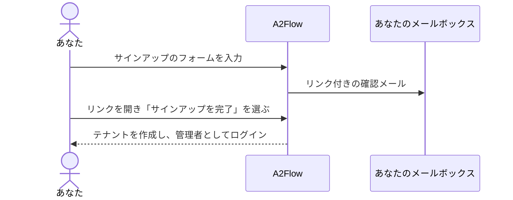

# サインアップ

デプロイで許可されていれば、誰でもログイン画面から自分のテナントを作り、その管理者として A2Flow を使い始められます。上位管理者が先にテナントやアカウントを作っておく必要はありません。サインアップは運用者が有効にするまでオフです。設定リファレンスの[サインアップ](../operations/configuration.md#sign-up)を参照してください。ログイン画面に**アカウントを作成**が表示されるのは、デプロイにまだ新しいテナントを作る余地があるときだけです。[テナント数の上限](../guides/system-settings.md#tenant-limit)を参照してください。

## アカウントを作成する {#creating-your-account}

1. テナント専用のアドレスではなく、A2Flow のメインのアドレスを開き、ログインフォームの下にある **アカウントを作成** を選びます。
2. **メール**、**ユーザー名**、**名**、**姓**、**パスワード** を入力し、**アカウントを作成** を選びます。**メールを確認してください** の画面が出ます。この時点ではまだ何も作られていません。
3. A2Flow から届いたメールのリンクを開きます。**サインアップを完了する** の画面が開くので、**サインアップを完了** を選びます。
4. **A2Flow へようこそ** の画面に、新しい **テナント** と **ユーザー名** が表示されます。テナントは控えておいてください。次にログインするときに必要です。
5. **続ける** を選びます。テナントの **管理者** としてログインした状態になります。

| 項目 | ルール |
|---|---|
| **ユーザー名** | 3〜64 文字の英数字、ドット、ハイフン、アンダースコア。メールアドレスは使えません |
| **パスワード** | 12〜72 文字 |
| リンク | 送信から 24 時間以内に 1 回だけ使えます。どのブラウザで開いてもかまいません |
| メールの再送 | 同じアドレスに送る確認メールは 1 分に 1 通までです |

## リンクがうまく使えないとき {#link-problems}

| 状況 | 対処 |
|---|---|
| メールが届かない | 迷惑メールのフォルダーを確認してください。1 分たってからフォームをもう一度送ると、新しいメールが届きます |
| 「このサインアップのリンクは無効か、期限が切れています」 | リンクは使用済みか、24 時間を過ぎています。フォームからやり直してください |
| 「テナント数が上限に達しています。」 | デプロイが満杯です。運用者に、システム設定の**テナント数の上限**を上げてもらってください。リンクは期限が切れるまで使えます |
| 「このリンクは不完全です」 | メールソフトがリンクを途中で切っています。メールからリンク全体をコピーしてブラウザに貼り付けてください |

## 新しいテナント {#your-new-tenant}

テナント名は、ユーザー名のあとにランダムな 6 文字を付けたものになります。たとえばユーザー名 `Jane.Doe` なら `jane-doe-3fa9c1` のようなテナントです。ユーザーはあなた 1 人で、**管理者** ロールを持っています。チームのほかのメンバーは[ユーザー](../guides/users-and-groups.md#users)で追加でき、会社のアカウントでのログインは[シングルサインオン](../guides/single-sign-on.md)で設定できます。テナント独自の LLM を設定するまで、エージェントはシステムの LLM を使います。[テナントの LLM](../guides/users-and-groups.md#tenant-llm)を参照してください。

## もう一度ログインする {#signing-in-again}

メインのアドレスで、**ユーザー名**、ようこそ画面に出た **テナント**、**パスワード** を入力します。デプロイがテナントごとに専用のアドレスを用意している場合は、ようこそ画面に **テナントのアドレス** としても表示されます。そこでログインすれば、テナントは自動で入ります。[テナントのアドレスでログインする](../guides/single-sign-on.md#tenant-address)を参照してください。
