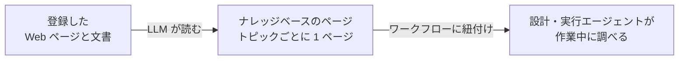

# ナレッジベース

ナレッジベースは、登録した Web ページや文書をもとに LLM が書き上げる Wiki です。ワークフローに紐付けると、そのワークフローのエージェントは設計中も実行中もここを調べます。組織のやり方どおりにタスクを進めるためにも、チャットで参加者から受けた質問に答えるためにも使います。

管理サイドバーの**ナレッジベース**を開くと管理できます。

## Wiki の書かれ方 {#how-the-wiki-is-written}

LLM は文書ごとに要約を 1 つずつ作るわけではありません。ソースを読むたびに、その内容を**トピックのページ**へまとめ込みます。すでにあるトピックならそのページを書き直し、どのページも扱っていないトピックのときだけ新しいページを作ります。同じ VPN について書かれた文書が 5 つあれば、5 つの内容をまとめた VPN のページが 1 つできます。

ページの記述にはそれぞれ出典のソースを示す脚注が付き、ページの先頭には参照したソースの一覧が載ります。この仕組みがあるので、あとからソースを取り除くときも Wiki 全体を作り直さずに済みます。

## ナレッジベースを作る {#creating-a-knowledge-base}

1. **+ ナレッジベースを追加**を押します。
2. **名前**と**説明**を入力します。説明はエージェントに向けて書いてください。探している答えがこのナレッジベースにありそうか、エージェントはこの説明を読んで判断します。
3. **保存**を押します。ナレッジベースのページが開き、ソースを追加できる状態になります。

ナレッジベースとそのソースの作成・編集・削除には**開発者**ロールが必要です。ナレッジベースを開ける人なら誰でも、そのページを読めます。

## ソースを追加する {#adding-sources}

ナレッジベースのページの**ソース**セクションでは、2 種類のソースを追加できます。

| ソース | 追加のしかた |
|---|---|
| Web ページ | URL を入力して**URL を追加**を押す |
| 文書 | **ドキュメントをアップロード**を押してファイルを 1 つ以上選ぶ。PDF、Word(`.docx`)、HTML、Markdown、CSV、JSON、プレーンテキストに対応 |

ソースはバックグラウンドで読み込まれるので、そのまま作業を続けてもページを離れてもかまいません。**ステータス**は次のように移り変わります。

| ステータス | 意味 |
|---|---|
| **未読** | 登録済みだが、まだ読み込んでいない。**読み込む**を押すと始まる。この状態から始まるのは[デモデータ](../getting-started/demo-data.md)で登録されたソースだけ |
| **待機中** | 順番待ち。同じナレッジベースのソースは同じページを編集するので、1 つずつ読み込まれる |
| **読み込み中** | LLM がソースを読み、ページを書いている |
| **準備完了** | ソースの知識が Wiki に入った。**既読日時**にその日時が出る |
| **失敗** | 読み込みに失敗し、書こうとしていた内容は何も残っていない。理由がステータスの下に出る |
| **削除中** | ソースを Wiki から取り除いている(後述) |

長い文書は何回かに分けて順番に読むので、大きなマニュアルでは時間がかかります。テキスト層のないスキャン PDF は読める文字がないので、その旨のメッセージを出して失敗します。

Web ページは A2Flow のサーバーから取得します。ログインが必要なページや、プライベートネットワークのアドレスにあるページは追加できません。

### ソースを読み直す {#reading-a-source-again}

ソースの**再読み込み**を押すと、そのソースが Wiki に加えた内容をいったん取り除き、読み直します。Web ページの内容が変わったときや、失敗したソースをやり直すときに使います。サーバーの再起動などで**読み込み中**のまま止まったソースも、同じ操作で復旧できます。

### ソースを取り除く {#removing-a-source}

ソースの**削除**を押して確認すると、LLM はそのソースを引用しているページだけを見直します。そのソースにしか裏付けのない内容は取り除き、ほかのソースも支えている内容は残します。ソースが 1 つもなくなったページは削除されます。この処理が終わると、ソースは一覧から消えます。

## ページを見る {#browsing-the-pages}

**ページ**セクションには全ページが並びます。各行にはタイトルとパス、**種類**、**更新日時**が出ます。タイトルを押すとそのページを読めます。ページは読み取り専用です。直したいときは、出典のソースを修正または削除してから読み直してください。

ページ見出しの**バンドルをダウンロード**を押すと、ナレッジベース全体を zip ファイルでダウンロードできます。中身は [Open Knowledge Format](https://github.com/GoogleCloudPlatform/open-knowledge-format) に沿っています。ページごとに先頭へメタデータの付いた Markdown ファイルが 1 つずつあり、各フォルダに `index.md` が入ります。この形式を読めるほかのツールでもそのまま使えます。

## ワークフローに紐付ける {#linking-a-knowledge-base-to-a-workflow}

ワークフローの詳細ページを開き、**ナレッジベース**でナレッジベースを選んで**保存**を押します。[ワークフローを生成する](./workflows.md#generating-a-workflow)ときに選んでおくこともでき、そうすると設計エージェントが最初の設計から参照します。

| 調べるエージェント | 調べるタイミング |
|---|---|
| 設計エージェント | 生成直後にタスクテンプレートを設計するときと、設計セッションで調整しているとき |
| 実行エージェント | 実行のタスクを進めているときと、ワークフローセッションで参加者に質問されたとき |

エージェントから見えるのは、自分のワークフローに紐付いたナレッジベースだけです。エージェントは目次をたどったり、キーワードで検索したりして、合いそうなページを読みます。ページの内容に基づいて答えるときは、そのページを示します。紐付いたナレッジベースに載っていないことは、推測で補わずにそう伝えるよう指示されています。

紐付けはワークフローの公開済みの設計には含まれません。変更は次に調べるときから効き、すでに進行中の実行にも反映されます。公開済みのワークフローが `変更あり` になることもありません。

## タグ {#tags}

ナレッジベースの作成フォームと詳細ページには**タグ**ピッカーがあり、一覧には絞り込みのできる**タグ**列があります。[アクセス制御タグ](./tags.md)を付けたナレッジベースは、そのタグを持つグループに属さない人からは見えなくなります。その人のために動くエージェントからも、ワークフローに紐付いていても見えません。

| エージェントが動く場所 | 誰のグループで判定するか |
|---|---|
| ワークフローの設計チャット | チャットしている人 |
| ワークフローの実行 | その実行を開始した人（実行の間ずっと） |

管理者は制限を受けません。

## ナレッジベースを削除する {#deleting-a-knowledge-base}

ナレッジベースを削除すると、そのソースとページも削除され、すべてのワークフローとの紐付けも外れます。
