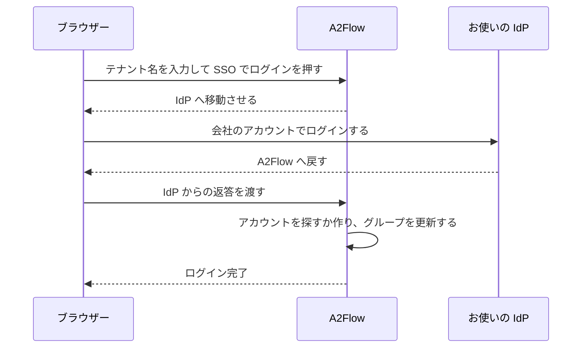

# シングルサインオン

[テナント](../concepts/tenants.md)ごとに、OpenID Connect に対応した **IdP(アイデンティティプロバイダー)** を 1 つ接続できます。Microsoft Entra ID、Okta、Keycloak などが使えます。接続すると、そのテナントの従業員は A2Flow 専用のパスワードではなく、会社のアカウントでログインします。初回のログインで A2Flow のアカウントが作られ、IdP のグループによって、その人がどの[ユーザーグループ](./users-and-groups.md#user-groups)に属すか、つまりどのロールを持つかが決まります。

シングルサインオンを有効にしても、パスワードでのログインは引き続き使えます。上位管理者のアカウントはどのテナントにも属さないので、常にパスワードでログインします。

## 仕組み {#how-it-works}

## はじめる前に {#before-you-start}

- テナントの管理者ロールが必要です。
- 運用者がデプロイ時に、デプロイのベース URL を設定している必要があります。[サーバーの設定](../operations/configuration.md#server-settings)を参照してください。設定されていない間は、**テナント設定**の **リダイレクト URI** の代わりに警告が表示され、シングルサインオンは使えません。
- A2Flow から IdP に、パブリックなアドレスで接続できる必要があります。プライベートネットワーク上の IdP は、運用担当者がそのホストを許可して初めて使えます。設定リファレンスの[シングルサインオン](../operations/configuration.md#single-sign-on)を参照してください。

## 設定する {#set-it-up}

1. IdP で、A2Flow 用のアプリケーションを新しく登録します。クライアントシークレットを持つ Web アプリケーションとして登録します。発行者 URL、クライアント ID、クライアントシークレットを控えます。
2. A2Flow で管理サイドバーの**テナント設定**を開き、**シングルサインオン**セクションを探します。**リダイレクト URI**の横の**コピー**を押し、そのアドレスを IdP のアプリケーションのリダイレクト URI として登録します。
3. IdP で、アプリケーションの ID トークンに、各人が属するグループの一覧(グループクレーム)を含めるよう設定します。これを忘れるとロールが外れてしまいます。詳しくは[知っておくこと](#things-to-know)を参照してください。
4. 下の表を見ながらセクションの項目を入力し、**シングルサインオンを有効にする**にチェックを入れます。
5. 保存します。保存時には、発行者 URL が許可されたアドレス（`https`、または運用担当者が許可したホスト）であることを確認し、**シングルサインオンを有効にする**にチェックを入れている場合は、発行者 URL、クライアント ID、クライアントシークレットが入力されていることも確認します。IdP には接続しないので、実際の確認は次の手順で行います。
6. IdP のグループに従わせたいユーザーグループごとに、**ユーザーグループ**からそのグループを開き、**IdP グループ**を入力します。詳しくは[グループとロール](#groups-and-roles)を参照してください。
7. 試します。ログイン画面を開き、テナント名を入力して **SSO でログイン**を押します。

| 項目 | 説明 |
|---|---|
| **シングルサインオンを有効にする** | スイッチです。オンにするには、発行者 URL、クライアント ID、クライアントシークレットが必要です。 |
| **発行者 URL** | IdP の OpenID Connect 発行者です。たとえば `https://idp.example.com`。 |
| **クライアント ID** | IdP でのアプリケーションのクライアント ID。 |
| **クライアントシークレット** | 書き込み専用で、表示されることはありません。保存後は「保存済み — 維持するには空欄のままにしてください」と表示されます。 |
| **グループクレーム** | 各人のグループを列挙する ID トークンのクレーム名です。IdP が別の名前を使っていない限り `groups` です。 |
| **この IdP のメールアドレスを信頼する** | 初期状態はオフです。IdP がメールアドレスを確認済みとしていなくても、A2Flow がメールアドレスで既存のアカウントを紐付けられるようにします。Microsoft Entra ID ではオンにする必要があります。 |
| **リダイレクト URI** | 読み取り専用です。IdP に登録するアドレスで、どのテナントでも同じものを使います。 |

## ログインする {#signing-in}

ログイン画面の**テナント**にテナント名を入力し、**SSO でログイン**を押します。**テナント**が空の間、ボタンは押せません。IdP に移動するので、そこでログインすると、A2Flow にログインした状態で戻ってきます。ユーザー名とパスワードでのログインも、これまでどおり使えます。

A2Flow からログアウトしても IdP からはログアウトされません。そのため、もう一度 **SSO でログイン**を押すと、そのままログインできてしまうことがあります。

## ログインエラーのメッセージ {#sign-in-errors}

ログインに失敗すると、ログイン画面に戻り、次のいずれかのメッセージが表示されます。

| メッセージ | 意味と対処 |
|---|---|
| このテナントではシングルサインオンを利用できません。 | テナント名が違うか、テナントが無効か、シングルサインオンが未設定またはオフです。どれなのかは、あえて表示しません。どのテナントが存在するかを、このメッセージから探れないようにするためです。名前を確認し、それでもだめならテナントの管理者に尋ねてください。 |
| シングルサインオンに失敗しました。もう一度お試しください。 | IdP とのやり取りが完了しなかったか、IdP からメールアドレスが届かなかった（または使えないアドレスだった）か、テナント内の 2 つのアカウントが同じメールアドレスを持っているか、そのメールアドレスのアカウントがすでに別の IdP の ID に紐付いているか、IdP のメールアドレスが信頼できない状態で同じアドレスの A2Flow アカウントがすでにあります。最後の場合は、テナントの管理者に**この IdP のメールアドレスを信頼する**をオンにするか、2 つのアカウントのどちらかのメールアドレスを変更するよう依頼してください。それ以外の場合はもう一度試し、それでも失敗する場合は、テナントの管理者に設定と IdP に登録したアプリケーションの確認を依頼してください。 |
| アカウントが無効です。 | A2Flow のアカウントかテナント全体が無効になっているか、アカウントが削除されています。管理者が**有効**にチェックを入れると、アカウントを再び使えるようになります。 |
| お使いの IdP アカウントは A2Flow へのログインが許可されていません。 | A2Flow のアカウントがまだなく、ユーザーグループの対応付け先になっている IdP グループにも属していません。または、所属グループが非常に多いため、IdP がグループの一覧を省いています。IdP の管理者に、対応付けられたグループへ追加するよう依頼してください。 |

## アカウントとの対応付け {#account-matching}

A2Flow はログインのたびに、次の順でアカウントを探します。

1. **この IdP の ID にすでに紐付いているアカウント**があれば、それを使います。
2. **同じメールアドレスの既存アカウント**があれば、1 度だけ紐付けます。メールアドレスは大文字小文字を区別せずに比べます。紐付けるのは、IdP がそのアドレスを確認済みとしている場合、または**この IdP のメールアドレスを信頼する**がオンの場合だけです。紐付けられていないアカウントがちょうど 1 つ一致する必要があり、2 つ以上一致するとログインに失敗します。
3. **どちらもなければ新しいアカウントを作ります。** ただし作るのは、ユーザーグループの対応付け先になっている IdP グループに 1 つ以上属している人だけです。それ以外の人は拒否されます。 新しいアカウントは、テナント内のアカウントがすでに持っているメールアドレスに対しては作られず、IdP のメールアドレスが使えるアドレスでない場合も作られません。いずれもログインに失敗します。

新しいアカウントのユーザー名は、IdP の preferred username から、なければメールアドレスの `@` より前の部分から作ります。英数字、`.`、`_`、`-` 以外の文字は取り除かれ、残りが少なすぎる場合は `user` になり、すでに使われている名前には `-2`、`-3` のように番号を付けます。名と姓は IdP のものです。アカウントには直接のロールもパスワードもなく、ロールはグループから得ます。管理者があとからパスワードを設定して、予備の手段にすることもできます。

既存のアカウントの名前とメールアドレスが、IdP の値で上書きされることはありません。

## グループとロール {#groups-and-roles}

ユーザーグループの **IdP グループ**には、そのグループについて IdP のグループクレームが列挙する値を入れます。Microsoft Entra ID が送るのはグループの名前ではなくオブジェクト ID なので、その ID を入力します。一致は完全一致で、大文字と小文字を区別します。

SSO でログインするたびに、**IdP グループ**を持つユーザーグループそれぞれについて、次のようになります。

- クレームにその値が含まれていれば、その人はグループに加わります。
- 含まれていなければ、グループから外れます。

**IdP グループ**のないユーザーグループと、アカウントに直接与えられたロールには、何も起きません。IdP でグループを変更した内容は、その人の次の SSO ログイン時に反映され、すぐには反映されません。

**IdP グループ**を持つグループのメンバーは IdP が管理するので、手作業では編集できません。グループのページでは**メンバー**の一覧が読み取り専用になり、「IdP が管理しています」と表示されます。そのようなグループを、ユーザーの**グループ**に追加したり、そこから外したりすることもできません。すでにメンバーがいるグループに**IdP グループ**を入力した場合、メンバーは各人の次の SSO ログインまでそのまま残ります。

## 知っておくこと {#things-to-know}

| 状況 | 結果 |
|---|---|
| IdP がグループクレームを送らない、または**グループクレーム**の名前が合っていない | ログインした全員が、対応付けられたすべてのグループから外れ、そのグループが与えていたロールを失います。シングルサインオンを有効にする前に、IdP 側のクレームを確認してください。 |
| Microsoft Entra ID | グループの名前ではなくオブジェクト ID を送ります。所属グループが非常に多い人については、一覧を省きます。その場合、A2Flow はその人の現在の所属を保ち、新しいアカウントは作れません。 |
| **発行者 URL** または**クライアント ID**を変更した | アプリケーションが変わると IdP は別の ID を発行するので、テナント内のすべてのアカウントが IdP の ID との紐付けを解かれます。次のログイン時にメールアドレスで再び紐付けられますが、信頼できるアドレス（IdP が確認済みとしているか、**この IdP のメールアドレスを信頼する**がオン）が必要です。そうでない場合は、元のアカウントがそのアドレスをまだ持っているためログインに失敗します。 |
| IdP から誰かを削除した | その人は SSO でログインできなくなりますが、A2Flow はそのアカウントを無効にしません。パスワードでのログインも止めるには、アカウントの**有効**を外してください。 |
| アカウントに **SSO** バッジが付いている | シングルサインオンでログインしたことがあるアカウントです。バッジは**ユーザー**の一覧とアカウントの詳細ページに表示されます。 |
