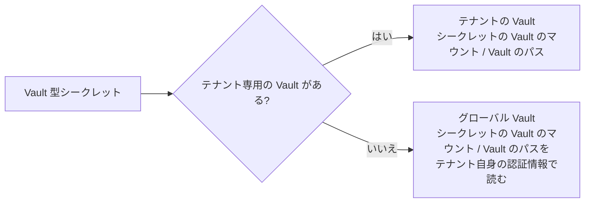

# ユーザー、グループ、テナント

ログインできるのは誰か、その人がどこに属するかは、3 つの管理セクションが受け持ちます。個々のアカウント、ロールをまとめて与える名前つきの束、そしてそれらすべてが収まるテナントです。

1 人のユーザーが属せるテナントは多くても 1 つで、そのテナントのグループにはいくつでも属せます。権限のチェックはすべて、アカウントに直接与えられたロールとグループから継承したロールの**和集合**で行われます。詳しくは[ロールと権限](../concepts/authorization.md)を参照してください。

## ユーザー {#users}

管理サイドバーの**ユーザー**を開くと、アカウントを管理できます。一覧はアカウント 1 件につき 1 行で、ユーザー名をクリックすると詳細ページが開き、同じ項目を編集したりアカウントを削除したりできます。

| 項目 | 説明 |
|---|---|
| **ユーザー名** | テナント内で一意。作成後は変更できません。 |
| **名** / **姓** | ユーザー名が表示されるあらゆる場所で、この 2 つを並べた表示名が使われます。 |
| **メール** | 通知メールの宛先です。 |
| **パスワード** | 表示されることはありません。編集時に空のままにすると、今のパスワードが保たれます。新しいパスワードを設定すると、そのユーザーはログイン中のすべての場所からログアウトされます。 |
| **有効** | 外すと、アカウントを削除せずにログインだけを止められます。一覧では無効なアカウントの行が淡く表示され、アバターに小さなバッジが付くので、**有効**列自体は列ピッカーで隠せます。 |
| **メール確認済み** | 未確認のアドレスは[メール配信](./notifications.md#email-delivery)の対象から外れます。 |
| **ロール** | ロールごとのチェックボックス。後述します。 |
| **グループ** | 所属グループ。どちら側からでも編集できます。 |

[シングルサインオン](./single-sign-on.md)でログインしたことのあるアカウントには、一覧と詳細ページで **SSO** バッジが付きます。この方法で作られたアカウントには、管理者がパスワードを設定するまでパスワードがありません。

### ロール {#roles}

新規作成フォームと詳細ページにはロールごとのチェックボックスが並び、一覧には**ロール**列が出ます。

- **上位管理者**は、ログインしているのが上位管理者のときだけ選べます。それ以外からの付与や剥奪は拒否されます。
- 上位管理者はほかのすべてのロールと排他です。チェックすると残りが選べなくなり(逆も同じ)、その理由が注記として出ます。
- **ロール**列は並べ替えも絞り込みもできません。ロールが単一の値ではなくリストとして保存されているためです。

**グループからのロール**。このチェックボックスが編集するのは**直接**の付与だけです。[ユーザーグループ](./users-and-groups.md#user-groups)から継承したロールは、その下の**グループから付与されたロール**に読み取り専用のチップとして出ます。変えられるのはグループ側の編集だけです。一覧の**ロール**列には両方が出ますが、継承したものは淡く表示されるので、このページで変えられるのがどれかは一目で分かります。

### グループ {#groups}

今の所属は削除できるチップとして並び、**グループを選択…** を押すとテナントのグループの表がダイアログで開きます。ページ送りと絞り込みはサーバー側で効きます。プラットフォーム所属のアカウント(上位管理者と初期投入されるシステムユーザー)にはこのボタンが出ません。どのテナントにも属さないため、グループのメンバーにはなれないからです。同じ所属は[グループ](./users-and-groups.md#user-groups)側からも編集できます。

### 代理ログイン {#impersonate}

代理ログインできる相手の行には**代理ログイン**の操作が出ます。自分自身の行、上位管理者の行、そして自分が上位管理者でない限り管理者の行には出ません。確認するとようこそページに移り、その人として操作している状態になります。誰が誰になれるのか、どうやって元に戻るのかは[代理ログイン](../concepts/impersonation.md)を参照してください。

### ユーザーを削除する {#deleting-a-user}

ほかから参照されていないアカウントは、そのまま消えます。何かのレコードを持っている場合 — 作成者や最終更新者として記録されている場合 — は、無効化してユーザー一覧から隠す形で残ります。持っているレコードの名前解決が続くようにするためです。どちらの場合も、そのアカウントではログインできなくなります。

レコードにユーザー ID がそのまま出ることはありません。詳細ページも一覧も、所有者を名前に解決して表示します。ただし 2 種類のアカウントだけは名前ではなくラベルになります。テナントをまたいでレコードを持つためで、内部のアカウントは**システムユーザー**、自分からは見えない上位管理者は**上位管理者**と表示されます。

## ログインの失敗 {#failed-sign-ins}

パスワードを何度も間違えると、そのアカウントはしばらくロックされます。同じユーザー名(とテナント)で**ロック時間(分)** 以内に**ロックまでのログイン失敗回数**回失敗すると(テナントが変えていなければ 15 分以内に 5 回)、ログイン画面は正しいパスワードも拒否し、あと何分待てばよいかを表示します。ロックは、それらの失敗のうち最も古いものから**ロック時間(分)** が経つと解けます。

この 2 つの値はテナントごとに決められます。自分のテナントの値を変えるには、管理サイドバーの**テナント設定**を開きます(管理者ロールが必要です)。

| フィールド | 説明 |
|---|---|
| **ロックまでのログイン失敗回数** | 何回失敗したらアカウントをロックするか。1 から 100、既定値は 5 です。 |
| **ロック時間(分)** | 失敗を数える期間であり、ロックが続く時間でもあります(分)。1 から 1440(1 日)、既定値は 15 です。 |

上位管理者は**テナント**にあるテナントの詳細ページでも同じ 2 つを編集できます。テナントとして操作している間なら**テナント設定**も使えます。`root` のようにどのテナントにも属さないアカウントには、常に既定値が使われます。

ログインに成功すると、そのアカウントの失敗回数はリセットされます。存在しないユーザー名も同じ回数でロックされるので、ロックの有無からアカウントの存在はわかりません。ロックは時間が経てば自動で解けるので、誰かが解除する必要はありません。

## テナントの Vault {#tenant-vault}

テナントの [Vault 型シークレット](./secrets.md)は HashiCorp Vault(KV v2 のみ)から読まれます。テナントは**自分専用の** Vault に接続できます。接続していないテナントは、上位管理者が [システム設定](./system-settings.md#global-vault) で設定した**グローバル Vault** を使い、テナント自身の[グローバル Vault の認証情報](#global-vault-credential)でログインして読みます。

テナント専用の Vault に接続するには、管理サイドバーの**テナント設定**を開きます(管理者ロールが必要です)。上位管理者は、そのテナントとして操作している間に同じページを開きます。

| 項目 | 説明 |
|---|---|
| **Vault のアドレス** | Vault のアドレス。`http://` か `https://` で始めます。公開アドレスで到達できる必要があり、プライベートネットワークやローカルマシンのアドレスは拒否されます。空にして保存すると、そのテナントの Vault 接続を外し、保存済みの認証情報も削除します。以後そのテナントはグローバル Vault を使います。 |
| **Vault の認証方式** | 静的トークンなら**トークン**、ロール ID とシークレット ID を短期トークンに交換するなら **AppRole** です。 |
| **Vault のロール ID** / **AppRole のマウント** | AppRole のときだけ使います。マウントの既定値は `approle` です。 |
| **Vault トークン** / **Vault のシークレット ID** | 選んだ方式の認証情報。二度と表示されず、保存後の欄には「保存済み — 維持するには空欄のままにしてください」と出ます。認証方式を切り替えるときは、新しい認証情報の入力が必要です。 |

認証情報のないアドレスや、ロール ID のない AppRole を保存しようとすると、エラーで拒否されます。テナント専用の Vault も、グローバル Vault の認証情報もなければ、そのテナントの Vault 型シークレットは解決できません。

## 自分のアカウント {#your-own-account}

アプリバーのプロファイルボタンから**プロファイル**を選ぶと、自分のアカウントを確認できます。ページの先頭はアイデンティティカードです。バナーがあり、その下端にアバターが重なり、表示名が見出しになり、その横に `@username`、ロール、状態のピルが並びます。その下には読み取り専用のカードが 2 枚と、**設定**カードがあります。

| カード | 内容 |
|---|---|
| **アカウント** | ユーザー名、メールアドレス、姓名 |
| **アクセス** | ロール、グループからのロール、所属グループ |
| **設定** | 画面の[言語](#language) |

**アカウント**と**アクセス**は読み取り専用です。これらの属性を変えるには管理者ロールと管理側のユーザー詳細ページが要ります。自分で編集できるのは言語とアバターの 2 つで、アバターはクリックすると編集できます。

### 言語 {#language}

A2Flow の画面は English、日本語、Español、简体中文、한국어、Français で表示できます。選択肢は各言語の自称で並ぶので、今の画面が何語でも自分の言語を見つけられます。

1. アプリバーのプロファイルボタンから**プロファイル**を開きます。
2. **設定**カードの**言語**で選びます。画面はその場で切り替わり、どのブラウザでログインしてもその言語で表示されます。

既定の**ブラウザの言語に従う**を選ぶと、ブラウザの言語設定で決まります。ブラウザの設定がこれらの言語のどれでもなければ英語になります。

| 状況 | 表示される言語 |
|---|---|
| ログイン中で、言語を選んでいる | 選んだ言語 |
| ログイン中で、ブラウザに従っている | ブラウザの言語。なければ英語 |
| ログイン画面 | このブラウザで最後に使った言語。なければブラウザの言語 |
| 別のユーザーとして操作している([代理ログイン](../concepts/impersonation.md)) | 自分の言語のまま。画面を読めるようにするためで、**言語**の選択は無効になります |

翻訳されるのは A2Flow 自身の言葉です。画面の文言、メッセージ、入力エラー、A2Flow が出す通知の定型文がこれにあたります。次のものは書かれたままです。

- 人やエージェントが書いたもの。名前、説明、承認のタイトル、チャットの返答などです。エージェントはここでの設定ではなく、会話の言語で答えます。
- 一部のエラーに付く技術的な理由。翻訳されたメッセージの後ろに英語で表示されます。
- [通知メール](./notifications.md#email-delivery)。英語で送られます。

### アバター {#avatars}

すべてのユーザーにアバターがあり、プロファイルボタン、管理側のユーザー一覧と詳細ページに出ます。既定ではテナントとユーザー名から生成されるので、画像は保存されず、2 つのテナントに同じユーザー名があっても別々の顔になります。

**プロファイル**ページでアバターをクリックすると、変更の方法が 2 つあるダイアログが開きます。

- 画像を**アップロード**する。PNG、JPEG、WebP、GIF で 2 MB まで。アップロードは即座に確定してダイアログが閉じます。削除すると生成されたアバターに戻ります。
- 生成されるアバターの**配色を変える**。描画に使うパレットを編集します。このダイアログで未保存になるのはパレットだけで、**既定に戻す**で色見本を戻し、**保存**で確定します。保存せずに閉じたぶんは破棄されます。

| 優先順位 | 使われる条件 |
|---|---|
| 1. アップロードした画像 | 画像をアップロードしている |
| 2. 生成アバター(独自パレット) | パレットを保存している |
| 3. 生成アバター(既定パレット) | どちらもない |

どの色がどこに置かれるかは相変わらずシードが決めるので、パレットを共有していてもユーザーごとの見分けはつきます。既定とまったく同じパレットは「パレットなし」として保存されるため、リセットして保存すると本当に記録が消えます。アバターの編集は本人だけができます。管理側のユーザー詳細ページでは読み取り専用です。

## ユーザーグループ {#user-groups}

管理サイドバーの**ユーザーグループ**を開くと、グループを管理できます。グループはユーザーの名前つきの束で、持っているロールを全メンバーに与えます。グループが属するテナントはちょうど 1 つで、名前はそのテナント内で一意です。

| 項目 | 説明 |
|---|---|
| **名前** | テナント内で一意。 |
| **説明** | 自由入力。 |
| **付与するロール** | 各メンバーが、自分自身への付与に上乗せして持つロール。 |
| **メンバー** | グループに属するアカウント。 |
| **IdP グループ** | 省略可。グループをテナントの IdP のグループに結び付けます。[シングルサインオン](./single-sign-on.md#groups-and-roles)を参照してください。このグループのメンバーは IdP が管理するので手作業では編集できず、**メンバー**は読み取り専用で「IdP が管理しています」と表示されます。 |
| **タグ** | グループを分類するラベル。ほかのタグを付けられるセクションと共有します。ここにアクセス制御タグを付けると、そのタグの付いたレコードへのアクセスを全メンバーに与えます。 |

**付与するロール**の選択肢は**ユーザー**のページと同じもので、**上位管理者**だけがありません。グループが上位管理者を与えることはできず、この選択肢は上位管理者から見ても出ません。上位管理者はどのテナントにも属さないので、そもそもメンバーにもなれません。

**タグ**はシークレットなど、タグを付けられるほかの登録簿と共有するテナント共通の語彙です。新規作成フォームと詳細ページには**タグ**のピッカーがあり、一覧には絞り込みできる**タグ**列があります。[タグ](./tags.md)を参照してください。グループはアクセスを与える場所でもあります。[アクセス制御タグ](./tags.md#access-control-tags)をグループに付けると、そのタグの付いたレコードがメンバーに見えるようになります。管理者は、自分がそのタグを持っていなくてもグループに付けられます。

**メンバー**は削除できるチップとして並び、**メンバーを選択…** を押すとテナントのユーザーの表がダイアログで開きます。プラットフォーム所属のアカウントは出てきません。どのテナントにも属さないためです。メンバーを指定すると所属はまるごと置き換わり、編集時に触らなければそのまま保たれます。同じ所属は[ユーザー](./users-and-groups.md#users)側からも編集できます。

ユーザーのレコードに写しは持たないので、グループのロールやメンバーを変えると、影響を受ける全員に次のリクエストから効きます。グループを**削除**してもアカウントはそのままですが、グループが与えていたロールは失われます。

このセクションへの書き込みには管理者ロールが要ります。読み取りは開いているので、ロールがなくても一覧と読み取り専用の詳細ページは見られます。

## テナント {#tenants}

管理サイドバーの**テナント**を開くと、テナントを管理できます。テナントはマルチテナンシーの最上位の組織境界です。その境界がほかのすべてにとって何を意味するのか、上位管理者がどうやって操作対象のテナントを選ぶのかは[テナント](../concepts/tenants.md)で扱います。ここではレコードそのものを説明します。

ほかのどの管理セクションとも違い、ここは**上位管理者専用**です(テナント自身の管理者は、ログインのロック設定、テナント専用の Vault、[シングルサインオン](./single-sign-on.md)を**テナント設定**で変えます)。それ以外のロールにはサイドバーからもようこそページからも見えず、書き込みも拒否されます。

| 項目 | 説明 |
|---|---|
| **表示名** | 人が読むためのラベル。一意。 |
| **名前** | URL に使える識別子で、小文字のケバブケース。一意で、作成後は変更できません。 |
| **有効** | 外すと、削除せずにテナントを止められます。所属ユーザーはログインできなくなり、すでにログインしている人も次のリクエストでログアウトされます。 |
| **ロックまでのログイン失敗回数** / **ロック時間(分)** | 失敗したログインでテナントのアカウントをどうロックするか。[ログインの失敗](#failed-sign-ins)を参照してください。 |
| **グローバル Vault へのログイン** | チェックすると、そのテナントのグローバル Vault 用の認証情報を登録できます。下記を参照してください。 |

### グローバル Vault の認証情報 {#global-vault-credential}

自分専用の Vault を持たないテナントは、そのテナントだけの認証情報で[グローバル Vault](./system-settings.md#global-vault) を読みます。登録できるのは上位管理者だけで、場所はテナントの詳細ページです。テナントの管理者には見えません。

| 項目 | 説明 |
|---|---|
| **グローバル Vault へのログイン** | 下の項目を表示します。チェックを外して保存すると、保存済みの認証情報を削除します。 |
| **Vault の認証方式** | **トークン**か **AppRole**。[テナント専用の Vault](#tenant-vault) と同じです。 |
| **Vault のロール ID** / **AppRole のマウント** | AppRole のときだけ使います。マウントの既定値は `approle` です。 |
| **Vault トークン** / **Vault のシークレット ID** | ほかの Vault の認証情報と同じく書き込み専用です。認証方式を切り替えるときは、新しい認証情報の入力が必要です。 |

認証情報は、このテナントのデータだけを読めるポリシーを付けて Vault で発行してください。グローバル Vault でテナント同士を分けているのはこのポリシーです。シークレットはどの**Vault のマウント**と**Vault のパス**でも指定できますが、テナントの認証情報が許していなければ Vault が読み取りを拒否します。

初回起動時に **Default** テナントが投入され、初期の `admin` ユーザーがそこに入ります。ユーザーが 1 人でも割り当てられているテナントは削除できません。先にそのアカウントを移すか削除してください。
