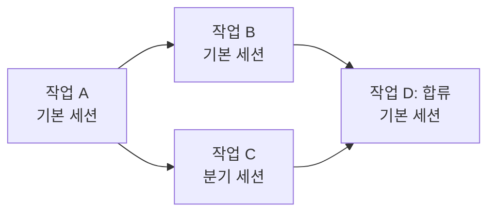
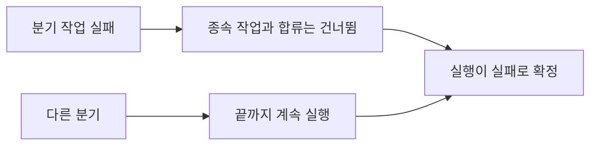

# 워크플로 실행

워크플로를 실행한다고 해서 실행이 워크플로를 가리키는 것은 아닙니다. 게시된 디자인을 새 [워크플로 실행](../guides/workflow-executions.md)으로 **복사**하며, 이후 실행은 그 레코드 안에서 이루어집니다.

| 실행으로 복사되는 항목 | 가져오는 곳 |
|---|---|
| 이름과 유효 프롬프트 | 마지막으로 게시된 버전. 단, 워크플로가 아직 `초안`이거나 개발자가 `수정됨` 워크플로의 [게시되지 않은 편집 내용](../guides/workflows.md#trying-the-edits-out)을 실행하기로 선택한 경우에는 현재 행 |
| 모두 `대기 중`인 작업과 그 종속성 및 도구 연결 | 같은 디자인의 작업 템플릿 |
| 실행이 따르는 에이전트 스킬 리비전 | 그 시점의 스킬 게시 리비전 |
| 선택한 [도구 모의](./mcp-gateway-and-proxy.md#tool-mocks-and-dry-runs)(값으로 복사) | 그 시점의 도구 모의 내용 |

이 목록의 어떤 항목도 나중에 원본에서 다시 읽지 않습니다. 워크플로를 편집하거나, 스킬을 풀하거나, 둘 중 하나를 삭제해도 이미 진행 중인 실행에는 절대 영향을 주지 않으며, 완료된 실행은 원본 워크플로가 없어진 후에도 계속 읽을 수 있습니다.

## 실행이 진행되는 방식 {#how-the-run-advances}

워크플로 세션은 고정된 시작 메시지와 함께 열리고, 실행 에이전트는 이미 작업 중입니다. 게시가 곧 계획의 승인이었으므로 시작 전에 확인할 것은 없습니다.

다음에 어떤 작업을 할지는 에이전트가 고르지 않습니다. 작업의 종속 대상이 모두 완료되는 순간 A2Flow가 해당 작업을 처리할 세션에 **할당**하며, 에이전트는 자신에게 할당된 작업만 처리합니다. 그 밖의 작업, 즉 다른 곳에 할당되었거나 종속 대상이 끝나지 않은 작업을 시작하려고 하면 거부됩니다.

모든 작업이 종료 상태에 도달하고 그중 실패가 없으면 실행은 `완료됨`으로 끝나고, 하나라도 실패하면 `실패`로 끝납니다. 상태는 실행의 읽기 전용 작업 보기에서 표나 종속성 그래프로 실시간으로 볼 수 있습니다.

작업이 실패하면 그 작업을 직접 또는 연쇄적으로 기다리는 모든 작업은 더 이상 실행될 수 없으므로 `건너뜀`으로 설정됩니다. 덕분에 실행은 시작되지 않을 작업을 영원히 기다리지 않고 `실패`로 확정될 수 있습니다. 실패한 작업에 종속되지 않은 다른 분기의 작업은 정상적으로 계속 실행됩니다.

## 병렬 분기 {#parallel-branches}

작업 그래프가 갈라지면 분기들은 서로를 기다리지 않습니다. 실행은 처음에 하나의 **기본 세션**에서 진행됩니다. 작업이 준비되었는데 이를 맡을 세션이 다른 작업으로 아직 바쁘면, A2Flow는 해당 작업을 위한 **분기 세션**을 **포크**합니다. 분기 세션은 그 시점까지 기본 세션이 알고 있던 모든 내용의 사본을 가지고 시작한 다음, 기본 세션과 나란히 자신의 작업 체인을 처리합니다. 한 분기가 기다리는 승인은 그 분기만 멈춥니다.

| 상황 | 작업이 가는 곳 |
|---|---|
| 루트 작업이거나, 종속 대상을 기본 세션이 처리한 작업 | 기본 세션. 기본 세션이 다른 작업으로 아직 바쁘면 새 분기 세션으로 포크됩니다 |
| 종속 대상을 활성 분기 세션 하나가 처리한 작업 | 해당 분기 세션. 바쁘면 마찬가지로 포크됩니다 |
| 종속 대상을 종료된 분기 세션이 처리한 작업 | 기본 세션 |
| **합류**: 종속 대상을 둘 이상의 세션이 처리한 작업 | 기본 세션. 합류로 이어지는 모든 분기가 끝난 후에 처리합니다 |

- 처리할 작업이 없어진 분기 세션은 수행한 내용을 짧게 요약하고 종료됩니다. 기본 세션은 합류 작업을 처리하기 전에 이 요약을 읽습니다.
- 승인을 기다리는 세션은 **상담**을 포크할 수도 있습니다. 상담은 누군가 그 세션에서 질문하면 열리고, 어떤 작업도 처리하지 않고 아무것도 변경하지 않으며, 승인이 결정되면 닫힙니다. 아래의 제한에 포함되지 않으며, 상담에서 나온 내용은 실행에 전달되지 않습니다([상담](../guides/workflow-executions.md#consultations)).
- 분기는 다시 포크할 수 있지만 동시에 실행되는 세션 수에는 제한이 있습니다. 제한에 도달하면 준비된 작업은 자신의 세션을 기다리며, 실행은 작업을 하나씩 차례로 처리하는 방식으로 돌아갑니다.
- 실패한 작업은 자신의 체인만 멈춥니다. 앞서 설명한 대로 그 작업을 기다리는 작업과 그 작업이 이어지는 합류는 `건너뜀`이 되고, 다른 분기는 작업을 끝까지 마칩니다. 그런 다음 실행은 `실패`로 확정됩니다.

## `진행 중` 상태가 중요한 이유 {#why-in_progress-matters}

작업을 `진행 중`으로 표시하는 것은 단순한 기록이 아닙니다. 이것이 해당 작업의 도구를 사용할 수 있게 합니다. [게이트웨이](./mcp-gateway-and-proxy.md)는 도구가 실행에서 현재 진행 중인 작업에 연결되어 있을 때만 호출을 허용합니다. 끝난 작업은 더 이상 동작할 수 없고, 아직 시작되지 않은 작업은 처음부터 동작할 수 없습니다.

실행의 작업 목록과 모든 작업의 도구 연결은 실행이 시작될 때 워크플로의 게시된 디자인에서 복사되어 고정되며, 에이전트는 상태만 진행시킵니다. 작업을 추가하거나 제거하거나 다시 연결할 수 없습니다. 이 때문에 [승인](./approvals.md)도 중요한 시점에 작업의 연결을 다시 읽지 않습니다. 승인자가 결정한 순간에 본 집합에 서명하므로, 이후 워크플로가 어떻게 바뀌어도 이미 부여된 권한을 넓힐 수 없습니다.
