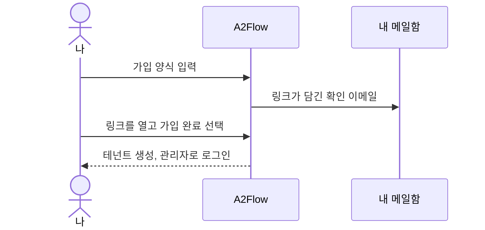

# 가입하기

배포에서 허용하면 누구나 로그인 화면에서 자신의 테넌트를 만들고 그 관리자로 A2Flow를 사용하기 시작할 수 있습니다. 슈퍼 관리자가 테넌트나 계정을 먼저 만들어 둘 필요가 없습니다. 가입은 운영자가 켜기 전까지 꺼져 있습니다. 구성 참조의 [가입](../operations/configuration.md#sign-up)을 참조하세요.

## 계정 만들기 {#creating-your-account}

1. 테넌트 전용 주소가 아니라 A2Flow의 기본 주소를 열고, 로그인 양식 아래의 **계정 만들기**를 선택합니다.
2. **이메일**, **사용자 이름**, **이름**, **성**, **비밀번호**를 입력하고 **계정 만들기**를 선택합니다. **이메일을 확인하세요** 화면이 나타납니다. 아직 아무것도 만들어지지 않았습니다.
3. A2Flow가 보낸 이메일의 링크를 엽니다. **가입 완료하기** 화면이 열리면 **가입 완료**를 선택합니다.
4. **A2Flow에 오신 것을 환영합니다** 화면에 새 **테넌트**와 **사용자 이름**이 표시됩니다. 다시 로그인할 때 필요하므로 테넌트를 적어 두세요.
5. **계속**을 선택합니다. 테넌트의 **관리자**로 로그인한 상태가 됩니다.

| 항목 | 규칙 |
|---|---|
| **사용자 이름** | 3~64자의 영문자, 숫자, 점, 하이픈, 밑줄. 이메일 주소는 사용할 수 없습니다 |
| **비밀번호** | 12~72자 |
| 링크 | 보낸 뒤 24시간 안에 한 번만 사용할 수 있습니다. 어느 브라우저에서 열어도 됩니다 |
| 이메일 다시 받기 | 한 주소로 보내는 확인 이메일은 1분에 1통까지입니다 |

## 링크가 작동하지 않을 때 {#link-problems}

| 보이는 내용 | 해결 방법 |
|---|---|
| 이메일이 오지 않음 | 스팸 폴더를 확인하세요. 1분이 지난 뒤 양식을 다시 제출하면 새 이메일을 받습니다 |
| "이 가입 링크는 유효하지 않거나 만료되었습니다" | 이미 사용했거나 24시간이 지난 링크입니다. 양식을 다시 제출하세요 |
| "이 링크는 불완전합니다" | 메일 프로그램이 링크를 잘랐습니다. 이메일에서 링크 전체를 복사해 브라우저에 붙여 넣으세요 |

## 새 테넌트 {#your-new-tenant}

A2Flow는 사용자 이름 뒤에 임의의 6자를 붙여 테넌트 이름을 정합니다. 예를 들어 사용자 이름 `Jane.Doe`에는 `jane-doe-3fa9c1` 같은 테넌트가 만들어집니다. 사용자는 회원님 한 명뿐이며 **관리자** 역할을 가지므로, 팀의 다른 사람은 [사용자](../guides/users-and-groups.md#users)에서 추가하고 회사 계정 로그인은 [싱글 사인온](../guides/single-sign-on.md)에서 연결할 수 있습니다. 테넌트 자체의 LLM을 설정하기 전까지 에이전트는 시스템의 LLM을 사용합니다. [테넌트의 LLM](../guides/users-and-groups.md#tenant-llm)을 참조하세요.

## 다시 로그인하기 {#signing-in-again}

기본 주소에서 **사용자 이름**, 환영 화면에 표시된 **테넌트**, **비밀번호**를 입력합니다. 배포가 테넌트마다 전용 주소를 제공하면 환영 화면에 **테넌트 주소**로도 표시됩니다. 그 주소에서 로그인하면 테넌트가 자동으로 채워집니다. [테넌트 주소에서 로그인하기](../guides/single-sign-on.md#tenant-address)를 참조하세요.
