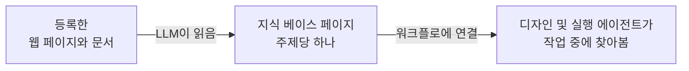

# 지식 베이스

지식 베이스는 등록한 웹 페이지와 문서를 바탕으로 LLM이 대신 작성해 주는 위키입니다. 워크플로에 연결하면 워크플로의 에이전트가 디자인하고 실행하는 동안 여기서 내용을 찾아봅니다. 조직의 방식대로 작업을 수행하거나 채팅에서 참여자의 질문에 답하기 위해서입니다.

관리 사이드바에서 **지식 베이스**를 열어 관리합니다.

## 위키 작성 방식 {#how-the-wiki-is-written}

LLM은 문서마다 요약을 하나씩 만들지 않습니다. 각 소스를 읽고 그 내용을 **주제 페이지**에 녹여 넣습니다. 이미 있는 주제면 해당 페이지를 업데이트하고, 어떤 페이지도 다루지 않는 주제일 때만 새 페이지를 작성합니다. 같은 VPN에 관한 문서 다섯 개는 그 내용을 모두 담은 VPN 페이지 하나가 됩니다.

페이지의 모든 문장에는 출처 소스를 밝히는 각주가 붙고, 각 페이지 맨 위에는 소스 목록이 표시됩니다. 덕분에 A2Flow는 나중에 위키 전체를 다시 만들지 않고도 소스를 빼낼 수 있습니다.

## 지식 베이스 만들기 {#creating-a-knowledge-base}

1. **+ 지식 베이스 추가**를 클릭합니다.
2. **이름**과 **설명**을 입력합니다. 설명은 에이전트를 대상으로 작성하세요. 에이전트가 찾는 내용에 이 지식 베이스가 답할 수 있는지 판단할 때 읽는 내용입니다.
3. **저장**을 클릭합니다. 지식 베이스가 열리고 소스를 추가할 수 있습니다.

지식 베이스와 소스를 만들고, 편집하고, 삭제하려면 **개발자** 역할이 필요합니다. 지식 베이스를 열 수 있는 사람은 누구나 페이지를 읽을 수 있습니다.

## 소스 추가 {#adding-sources}

지식 베이스 페이지의 **소스** 섹션에서는 두 종류의 소스를 추가할 수 있습니다.

| 소스 | 추가 방법 |
|---|---|
| 웹 페이지 | URL을 입력하고 **URL 추가**를 클릭합니다 |
| 문서 | **문서 업로드**를 클릭하고 파일을 하나 이상 선택합니다. PDF, Word(`.docx`), HTML, Markdown, CSV, JSON, 일반 텍스트를 지원합니다 |

소스는 백그라운드에서 읽으므로 계속 작업하거나 페이지를 떠나도 됩니다. **상태**는 다음과 같이 바뀝니다.

| 상태 | 의미 |
|---|---|
| **읽지 않음** | 등록되었지만 아직 읽지 않았습니다. **읽기**를 클릭하면 시작합니다. [데모 데이터](../getting-started/demo-data.md)로 추가된 소스만 이 상태로 시작합니다 |
| **대기열** | 차례를 기다리고 있습니다. 한 지식 베이스의 소스는 같은 페이지를 편집하므로 한 번에 하나씩 읽습니다 |
| **읽는 중** | LLM이 소스를 읽고 페이지를 작성하고 있습니다 |
| **준비됨** | 소스의 지식이 위키에 반영되었습니다. **읽은 일시**에 그 시각이 표시됩니다 |
| **실패** | 읽기에 실패했으며 작성하려던 내용은 아무것도 남지 않았습니다. 사유는 상태 아래에 표시됩니다 |
| **제거 중** | 소스를 위키에서 빼내는 중입니다(아래 참조) |

긴 문서는 여러 부분으로 나눠 차례로 읽으므로 큰 매뉴얼은 시간이 걸립니다. 텍스트 레이어가 없는 스캔 PDF는 읽을 내용이 없으므로 그런 내용의 메시지와 함께 실패합니다.

웹 페이지는 A2Flow 서버에서 가져오므로, 로그인이 필요한 페이지나 사설 네트워크 주소의 페이지는 추가할 수 없습니다.

### 소스 다시 읽기 {#reading-a-source-again}

소스에서 **다시 읽기**를 클릭하면 그 소스가 기여한 내용을 위키에서 빼낸 뒤 새로 읽습니다. 웹 페이지가 변경되었거나 실패한 소스를 다시 시도할 때 사용합니다. 서버를 다시 시작한 후 **읽는 중**에 멈춘 소스도 같은 방법으로 복구합니다.

### 소스 제거 {#removing-a-source}

소스에서 **삭제**를 클릭하고 확인합니다. LLM은 그 소스를 인용하는 페이지만 다시 살펴 그 소스에서만 나온 내용을 빼고, 다른 소스도 뒷받침하는 내용은 유지합니다. 소스가 하나도 남지 않은 페이지는 삭제됩니다. 이 과정이 끝나면 소스가 목록에서 사라집니다.

## 페이지 둘러보기 {#browsing-the-pages}

**페이지** 섹션에는 모든 페이지가 나열되며, 각 행에는 제목과 경로, **유형**, 마지막 업데이트 시각(**수정 일시**)이 표시됩니다. 제목을 클릭하면 페이지를 읽을 수 있습니다. 페이지는 읽기 전용입니다. 수정하려면 출처 소스를 고치거나 제거한 뒤 다시 읽으세요.

페이지 머리글에서 **번들 다운로드**를 클릭하면 지식 베이스 전체를 zip 파일로 다운로드합니다. 번들은 [Open Knowledge Format](https://github.com/GoogleCloudPlatform/open-knowledge-format)을 따릅니다. 페이지마다 맨 위에 메타데이터가 있는 Markdown 파일 하나가 있고 모든 폴더에 `index.md`가 포함되므로, 이 형식을 읽는 다른 도구에서도 사용할 수 있습니다.

## 워크플로에 지식 베이스 연결 {#linking-a-knowledge-base-to-a-workflow}

워크플로의 상세 페이지를 열고 **지식 베이스**에서 지식 베이스를 선택한 다음 **저장**을 클릭합니다. [워크플로를 생성](./workflows.md#generating-a-workflow)할 때 선택할 수도 있으며, 그러면 디자인 에이전트가 첫 디자인부터 참고합니다.

| 찾아보는 주체 | 시점 |
|---|---|
| 디자인 에이전트 | 생성 직후 워크플로의 작업 템플릿을 디자인할 때와 디자인 세션에서 다듬을 때 |
| 실행 에이전트 | 실행의 작업을 처리할 때와 워크플로 세션에서 참여자가 질문할 때 |

에이전트에게는 자신의 워크플로에 연결된 지식 베이스만 보입니다. 에이전트는 지식 베이스의 내용을 훑어보고, 키워드로 검색하고, 맞는 페이지를 읽으며, 페이지를 근거로 삼을 때는 그 페이지를 밝힙니다. 연결된 지식 베이스에서 다루지 않는 내용이면 추측하지 말고 그렇게 말하도록 지시받습니다.

연결은 워크플로의 게시된 디자인에 포함되지 않습니다. 변경하면 이미 진행 중인 실행에서도 다음 조회부터 적용되며, 게시된 워크플로가 `수정됨`으로 표시되지 않습니다.

## 태그 {#tags}

지식 베이스의 만들기 양식과 상세 페이지에는 **태그** 선택기가 있고, 목록에는 필터링할 수 있는 **태그** 열이 있습니다. [액세스 제어 태그](./tags.md)는 지식 베이스가 워크플로에 연결되어 있더라도, 그 태그를 가진 그룹에 속하지 않은 사람과 그 사람을 위해 일하는 에이전트에게 지식 베이스를 숨깁니다.

| 에이전트가 실행되는 곳 | 기준이 되는 그룹 |
|---|---|
| 워크플로 디자인 채팅 | 채팅하는 사람 |
| 워크플로 실행 | 실행을 시작한 사람(실행 전체에 걸쳐) |

관리자는 제한받지 않습니다.

## 지식 베이스 삭제 {#deleting-a-knowledge-base}

지식 베이스를 삭제하면 소스와 페이지도 삭제되고 모든 워크플로와의 연결도 해제됩니다.
