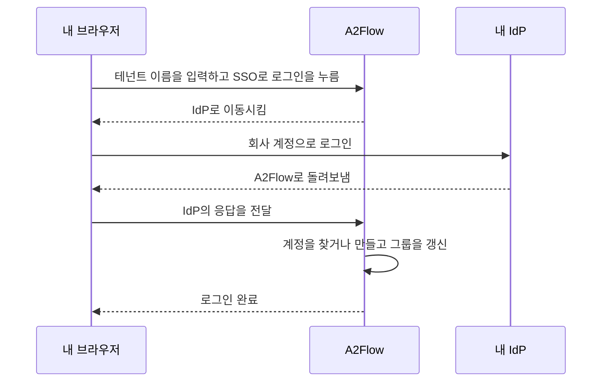

# 싱글 사인온

[테넌트](../concepts/tenants.md)마다 OpenID Connect를 지원하는 **ID 공급자**(IdP)를 하나 연결할 수 있습니다. Microsoft Entra ID, Okta, Keycloak 등이 해당합니다. 연결하면 그 테넌트의 직원은 A2Flow 전용 비밀번호 대신 회사 계정으로 로그인합니다. 처음 로그인할 때 A2Flow 계정이 만들어지고, IdP의 그룹이 그 사람이 어떤 [사용자 그룹](./users-and-groups.md#user-groups)에 속하는지, 즉 어떤 역할을 갖는지를 결정합니다.

싱글 사인온을 켜도 비밀번호 로그인은 그대로 쓸 수 있습니다. 슈퍼 관리자 계정은 어떤 테넌트에도 속하지 않으므로 항상 비밀번호로 로그인합니다.

## 동작 방식 {#how-it-works}

## 시작하기 전에 {#before-you-start}

- 테넌트의 관리자 역할이 필요합니다.
- 운영자가 배포할 때 배포의 기본 URL을 설정해 두어야 합니다. [서버 설정](../operations/configuration.md#server-settings)을 참조하세요. 설정되지 않은 동안에는 **테넌트 설정**에 **리디렉션 URI** 대신 경고가 표시되고 싱글 사인온을 사용할 수 없습니다.
- A2Flow가 공개 주소로 IdP에 접속할 수 있어야 합니다. 사설 네트워크에 있는 IdP는 운영자가 그 호스트를 허용한 뒤에야 쓸 수 있습니다. 설정 레퍼런스의 [싱글 사인온](../operations/configuration.md#single-sign-on)을 참조하세요.

자체 IdP 없이 싱글 사인온을 사용해 보려면 Docker Compose 스택에 포함된 Keycloak을 시작하세요. [Keycloak으로 싱글 사인온 사용해 보기](../getting-started/docker-compose.md#keycloak)를 참조하세요.

## 설정하기 {#set-it-up}

1. IdP에서 A2Flow용 애플리케이션을 새로 등록합니다. 클라이언트 시크릿이 있는 웹 애플리케이션으로 등록합니다. 발급자 URL, 클라이언트 ID, 클라이언트 시크릿을 메모해 둡니다.
2. A2Flow에서 관리 사이드바의 **테넌트 설정**을 열고 **싱글 사인온** 섹션을 찾습니다. **리디렉션 URI** 옆의 **복사**를 눌러, 그 주소를 IdP 애플리케이션의 리디렉션 URI로 등록합니다.
3. IdP에서 애플리케이션의 ID 토큰에 각 사람이 속한 그룹 목록(그룹 클레임)이 담기도록 설정합니다. 잊으면 역할이 제거됩니다. [알아 둘 점](#things-to-know)을 참조하세요.
4. 아래 표를 보며 섹션을 채우고 **싱글 사인온 사용**을 선택합니다.
5. 저장합니다. 저장할 때는 발급자 URL이 허용된 주소(`https`, 또는 운영자가 허용한 호스트)인지 확인하고, **싱글 사인온 사용**을 선택했다면 발급자 URL, 클라이언트 ID, 클라이언트 시크릿이 채워졌는지도 확인합니다. IdP에는 접속하지 않으므로, 실제 확인은 다음 단계에서 합니다.
6. IdP 그룹을 따르게 할 사용자 그룹마다 **사용자 그룹**에서 해당 그룹을 열고 **IdP 그룹**을 입력합니다. [그룹과 역할](#groups-and-roles)을 참조하세요.
7. 시험해 봅니다. 로그인 화면을 열고 테넌트 이름을 입력한 다음 **SSO로 로그인**을 누릅니다.

| 필드 | 설명 |
|---|---|
| **싱글 사인온 사용** | 스위치입니다. 켜려면 발급자 URL, 클라이언트 ID, 클라이언트 시크릿이 필요합니다. |
| **발급자 URL** | IdP의 OpenID Connect 발급자입니다. 예: `https://idp.example.com`. |
| **클라이언트 ID** | IdP에서 애플리케이션의 클라이언트 ID입니다. |
| **클라이언트 시크릿** | 쓰기 전용으로, 다시 표시되지 않습니다. 저장한 뒤에는 필드에 "저장됨 — 유지하려면 비워 두세요"가 표시됩니다. |
| **그룹 클레임** | 한 사람이 속한 그룹을 나열하는 ID 토큰 클레임의 이름입니다. IdP가 다른 이름을 쓰지 않는 한 `groups`입니다. |
| **이 IdP의 이메일 주소 신뢰** | 기본값은 꺼짐입니다. IdP가 주소를 확인된 것으로 표시하지 않더라도 A2Flow가 이메일 주소로 기존 계정을 연결할 수 있게 합니다. Microsoft Entra ID에서는 켜야 합니다. |
| **리디렉션 URI** | 읽기 전용입니다. IdP에 등록할 주소이며, 모든 테넌트가 같은 주소를 씁니다. |

## 로그인하기 {#signing-in}

로그인 화면의 **테넌트**에 테넌트 이름을 입력하고 **SSO로 로그인**을 누릅니다. **테넌트**가 비어 있는 동안에는 버튼이 비활성화됩니다. IdP로 이동하며, 거기서 로그인하면 A2Flow에 로그인된 상태로 돌아옵니다. 사용자 이름과 비밀번호로 로그인하는 방법은 전과 같습니다.

A2Flow에서 로그아웃해도 IdP에서는 로그아웃되지 않으므로, **SSO로 로그인**을 다시 누르면 바로 로그인될 수 있습니다.

## 로그인 오류 메시지 {#sign-in-errors}

로그인에 실패하면 로그인 화면으로 돌아와 다음 메시지 중 하나가 표시됩니다.

| 메시지 | 의미와 대처 |
|---|---|
| 이 테넌트에서는 싱글 사인온을 사용할 수 없습니다. | 테넌트 이름이 틀렸거나, 테넌트가 비활성화되었거나, 싱글 사인온이 설정되지 않았거나 꺼져 있습니다. 이 메시지로 어떤 테넌트가 존재하는지 알아내지 못하도록 A2Flow는 어느 쪽인지 일부러 알려 주지 않습니다. 이름을 확인하고, 그래도 안 되면 테넌트 관리자에게 문의하세요. |
| 싱글 사인온에 실패했습니다. 다시 시도하세요. | IdP와의 교환이 완료되지 않았거나, IdP가 이메일 주소를 보내지 않았거나 쓸 수 없는 주소를 보냈거나, 테넌트의 두 계정이 같은 이메일 주소를 쓰고 있거나, 내 이메일 주소를 쓰는 계정이 이미 다른 IdP 신원에 연결되어 있거나, IdP의 이메일 주소를 신뢰할 수 없는 상태에서 같은 주소의 A2Flow 계정이 이미 있습니다. 마지막 경우에는 테넌트 관리자에게 **이 IdP의 이메일 주소 신뢰**를 켜거나 두 계정 중 하나의 이메일 주소를 바꿔 달라고 요청하세요. 그 밖의 경우에는 다시 시도하고, 계속 실패하면 테넌트 관리자에게 설정과 IdP에 등록한 애플리케이션을 확인해 달라고 요청하세요. |
| 계정이 비활성화되어 있습니다. | A2Flow 계정이나 테넌트 전체가 비활성화되었거나 계정이 삭제되었습니다. 관리자가 **사용**을 선택하면 계정을 다시 쓸 수 있습니다. |
| 사용 중인 ID 공급자 계정으로는 A2Flow에 로그인할 수 없습니다. | 아직 A2Flow 계정이 없고 사용자 그룹에 매핑된 IdP 그룹에도 속해 있지 않거나, 속한 그룹이 매우 많아 IdP가 그룹 목록을 생략했습니다. IdP 관리자에게 매핑된 그룹에 추가해 달라고 요청하세요. |

## 사람과 계정을 대응시키는 방법 {#account-matching}

A2Flow는 로그인할 때마다 다음 순서로 계정을 찾습니다.

1. **이미 이 IdP 신원에 연결된 계정**이 있으면 그것을 씁니다.
2. **이메일 주소가 같은 기존 계정**이 있으면 한 번만 연결합니다. 주소는 대소문자를 구분하지 않고 비교하며, IdP가 확인된 주소로 표시했거나 **이 IdP의 이메일 주소 신뢰**가 켜져 있을 때만 받아들입니다. 아직 연결되지 않은 계정이 정확히 하나만 일치해야 하며, 둘 이상 일치하면 로그인에 실패합니다.
3. **그 밖에는 새 계정을 만듭니다.** 단, 사용자 그룹에 매핑된 IdP 그룹에 하나 이상 속한 사람에게만 만듭니다. 그 밖의 사람은 거부됩니다. 테넌트의 계정이 이미 쓰고 있는 이메일 주소로는 새 계정을 만들지 않으며, IdP의 이메일 주소를 쓸 수 없는 경우에도 만들지 않습니다. 두 경우 모두 로그인에 실패합니다.

새 계정의 사용자 이름은 IdP의 preferred username에서, 없으면 이메일 주소의 `@` 앞부분에서 가져옵니다. 영문자, 숫자, `.`, `_`, `-` 이외의 문자는 제거되고, 남는 글자가 너무 적으면 `user`가 되며, 이미 쓰는 이름이면 `-2`, `-3` 등이 붙습니다. 이름과 성은 IdP에서 가져옵니다. 계정에는 직접 부여된 역할도 비밀번호도 없습니다. 역할은 그룹에서 오며, 관리자가 나중에 비밀번호를 설정해 대체 수단으로 쓸 수 있습니다.

기존 계정의 이름과 이메일 주소는 IdP의 값으로 덮어쓰이지 않습니다.

## 그룹과 역할 {#groups-and-roles}

각 사용자 그룹의 **IdP 그룹**에는 IdP의 그룹 클레임이 그 그룹에 대해 나열하는 값을 입력합니다. Microsoft Entra ID는 그룹 이름이 아니라 그룹의 오브젝트 ID를 보내므로 그 ID를 입력합니다. 일치는 정확히 일치이며 대소문자를 구분합니다.

SSO로 로그인할 때마다, **IdP 그룹**이 있는 사용자 그룹 각각에 대해 다음과 같이 처리됩니다.

- 클레임에 그 값이 있으면 그 사람이 그룹에 가입하고,
- 없으면 그룹에서 빠집니다.

**IdP 그룹**이 없는 사용자 그룹과 계정에 직접 부여된 역할은 건드리지 않습니다. IdP에서 바꾼 그룹은 그 사람의 다음 SSO 로그인 때 반영되며, 즉시 반영되지는 않습니다.

**IdP 그룹**이 있는 그룹의 구성원은 IdP가 관리하므로 직접 편집할 수 없습니다. 그룹 페이지에서 **구성원** 목록은 읽기 전용이며 "IdP에서 관리함"이라고 표시되고, 사용자의 **그룹**에서도 그런 그룹을 추가하거나 제거할 수 없습니다. 이미 구성원이 있는 그룹에 **IdP 그룹**을 입력하면, 구성원은 각자의 다음 SSO 로그인 때까지 그대로 남습니다.

## 알아 둘 점 {#things-to-know}

| 상황 | 결과 |
|---|---|
| IdP가 그룹 클레임을 보내지 않거나 **그룹 클레임**의 이름이 맞지 않음 | 로그인하는 모든 사람이 매핑된 모든 그룹에서 빠지고, 그 그룹이 주던 역할을 잃습니다. 싱글 사인온을 켜기 전에 IdP에서 클레임을 확인하세요. |
| Microsoft Entra ID | 그룹 이름이 아니라 오브젝트 ID를 보냅니다. 속한 그룹이 매우 많은 사람은 목록을 생략합니다. 이때 A2Flow는 그 사람의 현재 소속을 유지하지만 새 계정은 만들 수 없습니다. |
| **발급자 URL** 또는 **클라이언트 ID**를 변경함 | 애플리케이션이 달라지면 IdP가 다른 신원을 발급하므로, 테넌트의 모든 계정이 IdP 신원과의 연결이 해제됩니다. 다음 로그인 때 이메일 주소로 다시 연결되며, 신뢰할 수 있는 주소(IdP가 확인된 주소로 표시했거나 **이 IdP의 이메일 주소 신뢰**가 켜져 있음)여야 합니다. 그렇지 않으면 기존 계정이 그 주소를 아직 쓰고 있으므로 로그인에 실패합니다. |
| IdP에서 누군가를 제거함 | 그 사람은 더 이상 SSO로 로그인할 수 없지만, A2Flow는 그 계정을 비활성화하지 않습니다. 비밀번호 로그인도 막으려면 계정의 **사용**을 해제하세요. |
| 계정에 **SSO** 배지가 붙어 있음 | 싱글 사인온으로 로그인한 적이 있는 계정입니다. 배지는 **사용자** 목록과 계정의 상세 페이지에 표시됩니다. |
