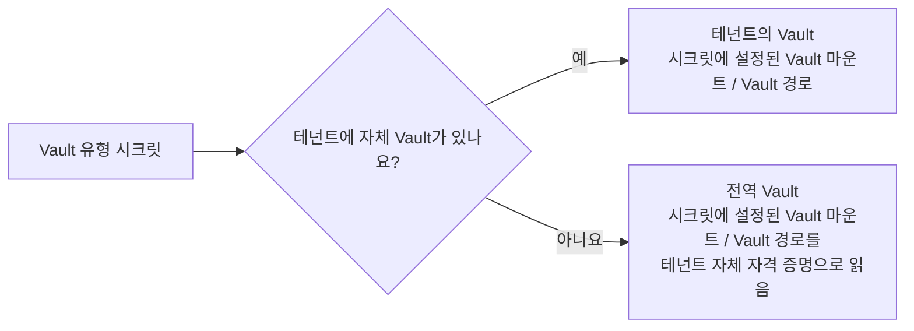

# 사용자, 그룹, 테넌트

누가 로그인할 수 있고 어디에 속하는지는 세 개의 관리 섹션에서 다룹니다. 개별 계정, 역할을 한꺼번에 부여하는 이름 있는 묶음, 그리고 이 모두가 속한 테넌트입니다.

사용자는 테넌트에 최대 하나까지 속할 수 있고, 그 테넌트의 그룹에는 개수 제한 없이 속할 수 있습니다. 모든 권한 검사에는 계정에 부여된 역할과 그룹에서 상속한 역할의 **합집합**이 사용됩니다. 자세한 내용은 [역할과 권한 부여](../concepts/authorization.md)를 참조하세요.

## 사용자 {#users}

관리 사이드바에서 **사용자**를 열면 계정을 관리할 수 있습니다. 목록에는 계정마다 한 행이 표시되며, 사용자 이름을 클릭하면 상세 페이지가 열립니다. 이 페이지에서 같은 항목을 편집하거나 계정을 삭제할 수 있습니다.

| 항목 | 설명 |
|---|---|
| **사용자 이름** | 테넌트 안에서 고유합니다. 만든 후에는 편집할 수 없습니다. |
| **이름** / **성** | 사용자 이름이 표시되는 모든 곳에서 둘을 합친 표시 이름이 사용됩니다. |
| **이메일** | 알림 이메일을 받는 주소입니다. |
| **비밀번호** | 다시 표시되지 않습니다. 편집할 때 비워 두면 현재 비밀번호가 유지됩니다. 새 비밀번호를 설정하면 해당 사용자는 로그인한 모든 곳에서 로그아웃됩니다. |
| **사용** | 선택을 해제하면 계정을 삭제하지 않고 로그인만 막을 수 있습니다. 목록에서 비활성화된 계정은 흐리게 표시되고 아바타에 작은 배지가 붙으므로, **사용** 열 자체는 열 선택기에서 숨길 수 있습니다. |
| **이메일 확인됨** | 확인되지 않은 주소는 [이메일 전송](./notifications.md#email-delivery)에서 제외됩니다. |
| **역할** | 역할별 확인란입니다. 아래를 참조하세요. |
| **그룹** | 소속 그룹입니다. 사용자와 그룹 어느 쪽에서든 편집할 수 있습니다. |

[싱글 사인온](./single-sign-on.md)으로 로그인한 적이 있는 계정에는 목록과 상세 페이지에 **SSO** 배지가 붙습니다. 이렇게 만들어진 계정에는 관리자가 설정하기 전까지 비밀번호가 없습니다.

### 역할 {#roles}

만들기 양식과 상세 페이지에는 역할별 확인란이 있는 역할 선택기가 있고, 목록에는 **역할** 열이 표시됩니다.

- **슈퍼 관리자**는 슈퍼 관리자로 로그인한 경우에만 선택할 수 있습니다. 그 밖의 경우에 이 역할을 부여하거나 회수하려고 하면 거부됩니다.
- 슈퍼 관리자는 다른 모든 역할과 함께 가질 수 없습니다. 선택하면 나머지 역할이 비활성화되고(반대의 경우도 마찬가지입니다), 그 이유를 설명하는 안내가 표시됩니다.
- **역할** 열은 정렬하거나 필터링할 수 없습니다. 역할이 단일 값이 아니라 목록으로 저장되기 때문입니다.

**그룹에서 받은 역할.** 선택기에서는 **직접** 부여한 역할만 편집합니다. [사용자 그룹](./users-and-groups.md#user-groups)에서 상속한 역할은 선택기 아래의 **그룹에서 받은 역할**에 읽기 전용 칩으로 표시되며, 그룹을 편집해야만 바꿀 수 있습니다. 목록의 **역할** 열에는 두 가지가 모두 표시되지만 상속한 역할은 흐리게 표시되므로, 이 페이지에서 바꿀 수 있는 역할이 무엇인지 분명하게 알 수 있습니다.

### 그룹 {#groups}

현재 소속 그룹은 제거할 수 있는 칩으로 표시됩니다. 더 추가하려면 **그룹 선택…** 버튼을 누르세요. 페이지 이동과 필터링이 가능한 테넌트 그룹 표가 열립니다. 플랫폼 범위의 계정(슈퍼 관리자 또는 초기 생성된 시스템 사용자)에는 이 버튼이 표시되지 않습니다. 어떤 테넌트에도 속하지 않아 그룹의 구성원이 될 수 없기 때문입니다. 같은 소속 정보는 [그룹](./users-and-groups.md#user-groups) 쪽에서도 편집할 수 있습니다.

### 대리 로그인 {#impersonate}

대리 로그인할 수 있는 사용자의 행에는 **대리 로그인** 동작이 표시됩니다. 자신의 행과 슈퍼 관리자의 행에는 표시되지 않으며, 자신이 슈퍼 관리자가 아니면 관리자의 행에도 표시되지 않습니다. 확인하면 해당 사용자로 작업하는 상태로 환영 페이지로 이동합니다. 전체 규칙과 중단 방법은 [대리 로그인](../concepts/impersonation.md)을 참조하세요.

### 사용자 삭제 {#deleting-a-user}

다른 곳에서 참조하지 않는 계정을 삭제하면 완전히 제거됩니다. 만들었거나 마지막으로 수정한 레코드가 있어 아직 레코드를 소유한 계정은 삭제되지 않고 비활성화되어 사용자 목록에서 숨겨집니다. 그래야 소유한 레코드가 계속 이름으로 표시되기 때문입니다. 어느 경우든 해당 계정으로는 더 이상 로그인할 수 없습니다.

레코드에는 사용자 ID가 그대로 표시되지 않습니다. 모든 상세 페이지와 목록에서 소유자는 이름으로 표시됩니다. 다만 두 계정은 테넌트 경계를 넘어 레코드를 소유하므로 이름 대신 레이블이 표시됩니다. 내부 계정은 **시스템 사용자**로, 볼 수 없는 슈퍼 관리자는 **슈퍼 관리자**로 표시됩니다.

## 로그인 실패 {#failed-sign-ins}

비밀번호를 반복해서 잘못 입력하면 계정이 한동안 잠깁니다. 같은 사용자 이름(및 테넌트)으로 **잠금 시간(분)** 안에 실패한 횟수가 **잠금 전 로그인 실패 횟수**에 이르면(테넌트에서 변경하지 않았다면 15분 안에 5회) 로그인 화면은 올바른 비밀번호도 거부하고 몇 분을 기다려야 하는지 알려 줍니다. 잠금은 해당 실패 중 가장 오래된 실패로부터 **잠금 시간(분)** 만큼 지나면 풀립니다.

이 값은 테넌트마다 따로 설정합니다. 자신의 테넌트 값을 변경하려면 관리 사이드바에서 **테넌트 설정**을 여세요(관리자 역할이 필요합니다).

| 항목 | 설명 |
|---|---|
| **잠금 전 로그인 실패 횟수** | 계정을 잠그는 실패 횟수입니다. 1~100이며 기본값은 5입니다. |
| **잠금 시간(분)** | 실패 횟수를 세는 기간이자 계정이 잠겨 있는 시간(분)입니다. 1~1440(하루)이며 기본값은 15입니다. |

슈퍼 관리자는 **테넌트**에 있는 테넌트 상세 페이지에서 같은 두 항목을 편집하거나, 해당 테넌트로 작업하는 동안 **테넌트 설정**을 열 수 있습니다. `root`처럼 어떤 테넌트에도 속하지 않는 계정에는 항상 기본값이 적용됩니다.

로그인에 성공하면 해당 계정의 실패 횟수가 초기화됩니다. 존재하지 않는 사용자 이름도 같은 횟수만큼 실패하면 잠기므로, 잠금 여부로 계정의 존재를 알아낼 수 없습니다. 잠금은 저절로 풀리므로 아무도 해제해 줄 필요가 없습니다.

## 테넌트의 Vault {#tenant-vault}

테넌트의 [Vault 유형 시크릿](./secrets.md)은 HashiCorp Vault(KV v2만 해당)에서 읽어 옵니다. 테넌트는 **자체** Vault에 연결할 수 있습니다. 연결하지 않은 테넌트는 슈퍼 관리자가 [시스템 설정](./system-settings.md#global-vault)에서 구성한 **전역 Vault**에서 읽으며, 이때 테넌트 자체의 [전역 Vault 자격 증명](#global-vault-credential)으로 로그인합니다.

테넌트 자체 Vault에 연결하려면 관리 사이드바에서 **테넌트 설정**을 여세요(관리자 역할이 필요합니다). 슈퍼 관리자는 해당 테넌트로 작업하는 동안 같은 페이지를 엽니다.

| 항목 | 설명 |
|---|---|
| **Vault 주소** | Vault의 주소로, `http://` 또는 `https://`로 시작합니다. 공개 주소로 접근할 수 있어야 하며, 사설 네트워크나 로컬 컴퓨터의 주소는 거부됩니다. 비워 두고 저장하면 테넌트의 Vault 연결이 해제되고 저장된 자격 증명도 삭제되며, 이후 해당 테넌트는 다시 전역 Vault를 사용합니다. |
| **Vault 인증 방식** | 고정 토큰을 쓰려면 **토큰**을, A2Flow가 역할 ID와 시크릿 ID를 단기 토큰으로 교환하게 하려면 **AppRole**을 선택합니다. |
| **Vault 역할 ID** / **AppRole 마운트** | AppRole에서만 사용합니다. 마운트의 기본값은 `approle`입니다. |
| **Vault 토큰** / **Vault 시크릿 ID** | 선택한 방식의 자격 증명입니다. 다시 표시되지 않으며, 저장한 후에는 입력란에 "저장됨 — 유지하려면 비워 두세요"가 표시됩니다. 인증 방식을 바꾸려면 새 자격 증명을 입력해야 합니다. |

자격 증명 없이 주소만 저장하거나 역할 ID 없이 AppRole을 저장하면 오류와 함께 거부됩니다. 자체 Vault도, 전역 Vault용 자격 증명도 없는 테넌트는 Vault 유형 시크릿을 확인할 수 없습니다.

## 내 계정 {#your-own-account}

앱 바의 프로필 버튼을 클릭하고 **프로필**을 선택하면 자신의 계정을 확인할 수 있습니다. 페이지 맨 위에는 ID 카드가 있습니다. 배너의 아래쪽 가장자리에 아바타가 걸쳐 있고, 표시 이름이 제목으로 나오며, 그 옆에 `@username`, 역할, 상태 표시가 나란히 있습니다. 그 아래에 읽기 전용 카드 두 개와 **환경설정** 카드가 이어집니다.

| 카드 | 표시 내용 |
|---|---|
| **계정** | 사용자 이름, 이메일, 이름과 성 |
| **액세스** | 역할, 그룹에서 받은 역할, 그룹 |
| **환경설정** | 화면에 표시할 [언어](#language) |

**계정**과 **액세스**는 읽기 전용입니다. 이 속성을 변경하려면 관리자 역할과 관리용 사용자 상세 페이지가 필요합니다. 직접 편집할 수 있는 것은 언어와 아바타 두 가지이며, 아바타는 클릭하여 편집합니다.

### 언어 {#language}

A2Flow 화면은 English, 日本語, Español, 简体中文, 한국어, Français로 제공됩니다. 각 언어는 해당 언어로 쓴 이름으로 표시되므로, 화면이 어떤 언어로 표시되어 있든 자신의 언어를 찾을 수 있습니다.

1. 앱 바의 프로필 버튼에서 **프로필**을 엽니다.
2. **환경설정** 카드의 **언어**에서 언어를 선택합니다. 화면이 바로 전환되며, 어느 브라우저에서 로그인하든 그 언어로 표시됩니다.

기본값인 **브라우저 언어 사용**을 선택하면 브라우저의 언어 설정에 따릅니다. 브라우저 설정이 이 언어들 중 어느 것도 아니면 영어로 표시됩니다.

| 상황 | 표시되는 언어 |
|---|---|
| 로그인했고 언어를 선택한 경우 | 선택한 언어 |
| 로그인했고 브라우저 언어를 따르는 경우 | 브라우저의 언어, 해당 언어가 없으면 영어 |
| 로그인 페이지 | 이 브라우저에서 마지막으로 사용한 언어, 없으면 브라우저의 언어 |
| 다른 사용자로 작업하는 경우([대리 로그인](../concepts/impersonation.md)) | 화면을 읽을 수 있도록 자신의 언어로 표시됩니다. **언어** 선택은 비활성화됩니다 |

언어 설정은 A2Flow가 직접 표시하는 내용에 적용됩니다. 화면 문구, 메시지와 유효성 검사 오류, A2Flow가 보내는 알림의 문구가 여기에 해당합니다. 다음은 작성된 그대로 유지됩니다.

- 사람이나 에이전트가 작성한 내용: 이름, 설명, 승인 제목, 채팅 답변. 에이전트는 여기서 설정한 언어가 아니라 대화의 언어로 답합니다.
- 일부 오류에 첨부되는 기술적인 원인. 번역된 메시지 뒤에 영어로 표시됩니다.
- [알림 이메일](./notifications.md#email-delivery). 영어로 발송됩니다.

### 아바타 {#avatars}

모든 사용자에게는 아바타가 있으며, 프로필 버튼과 관리용 사용자 목록 및 상세 페이지에 표시됩니다. 기본적으로 아바타는 사용자의 테넌트와 사용자 이름으로 생성되므로 이미지가 저장되지 않으며, 두 테넌트에 같은 사용자 이름이 있어도 서로 다른 모습이 됩니다.

**프로필** 페이지에서 아바타를 클릭하면 아바타를 변경하는 두 가지 방법이 있는 대화 상자가 열립니다.

- 사용자 지정 이미지 **업로드**: PNG, JPEG, WebP, GIF 형식으로 2MB까지 가능합니다. 업로드하면 바로 적용되고 대화 상자가 닫힙니다. 이미지를 제거하면 생성된 아바타로 돌아갑니다.
- 생성된 아바타 **사용자 지정**: 아바타를 그릴 때 쓰는 색상 팔레트를 편집합니다. 이 대화 상자에서 저장되지 않는 상태로 남는 것은 팔레트뿐입니다. **기본값으로 재설정**은 색상 견본을 되돌리고, **저장**은 적용하며, 대화 상자를 닫으면 저장하지 않은 내용은 버려집니다.

| 우선순위 | 사용 조건 |
|---|---|
| 1. 업로드한 이미지 | 이미지를 업로드한 경우 |
| 2. 생성된 아바타, 사용자 지정 팔레트 | 팔레트를 저장한 경우 |
| 3. 생성된 아바타, 기본 팔레트 | 둘 다 해당하지 않는 경우 |

어떤 색을 어디에 놓을지는 여전히 시드가 결정하므로, 같은 팔레트를 쓰더라도 사용자가 시각적으로 구별됩니다. 기본값과 똑같은 팔레트는 팔레트가 없는 것으로 저장되므로, 재설정한 뒤 저장하면 팔레트가 실제로 지워집니다. 아바타는 본인만 편집할 수 있으며, 관리용 사용자 상세 페이지에서는 읽기 전용으로 표시됩니다.

## 사용자 그룹 {#user-groups}

관리 사이드바에서 **사용자 그룹**을 열면 그룹을 관리할 수 있습니다. 그룹은 이름이 있는 사용자 묶음으로, 그룹의 역할을 모든 구성원에게 부여합니다. 그룹은 정확히 하나의 테넌트에 속하며, 이름은 그 테넌트 안에서 고유합니다.

| 항목 | 설명 |
|---|---|
| **이름** | 테넌트 안에서 고유합니다. |
| **설명** | 자유롭게 입력합니다. |
| **부여된 역할** | 모든 구성원이 자신에게 직접 부여된 역할에 더해 갖는 역할입니다. |
| **구성원** | 그룹에 속한 계정입니다. |
| **IdP 그룹** | 선택 사항입니다. 그룹을 테넌트 ID 공급자의 그룹에 연결합니다. [싱글 사인온](./single-sign-on.md#groups-and-roles)을 참조하세요. 이런 그룹의 구성원은 IdP가 관리하므로 직접 편집할 수 없으며, **구성원**은 읽기 전용으로 "IdP에서 관리함"이 표시됩니다. |
| **태그** | 그룹을 분류하는 레이블로, 태그를 지원하는 다른 섹션과 함께 사용합니다. 여기에 액세스 제어 태그를 붙이면 해당 태그가 붙은 레코드에 대한 액세스 권한이 모든 구성원에게 부여됩니다. |

**부여된 역할**은 **사용자** 페이지와 같은 선택기를 사용하지만 **슈퍼 관리자**는 없습니다. 그룹은 이 역할을 부여할 수 없으며, 슈퍼 관리자를 포함한 누구에게도 이 옵션이 표시되지 않습니다. 슈퍼 관리자는 어떤 테넌트에도 속하지 않으므로 구성원이 될 수도 없습니다.

**태그**는 시크릿을 비롯해 태그를 지원하는 다른 레지스트리와 함께 쓰는 테넌트 공통 어휘입니다. 만들기 양식과 상세 페이지에는 **태그** 선택기가 있고, 목록에는 필터링할 수 있는 **태그** 열이 있습니다. [태그](./tags.md)를 참조하세요. 그룹은 액세스 권한을 부여하는 곳이기도 합니다. [액세스 제어 태그](./tags.md#access-control-tags)를 그룹에 붙이면 구성원이 해당 태그가 붙은 레코드를 볼 수 있으며, 관리자는 자신이 그 태그를 갖고 있지 않아도 그룹에 붙일 수 있습니다.

**구성원**은 제거할 수 있는 칩으로 표시됩니다. **구성원 선택…** 버튼을 누르면 페이지 이동과 필터링이 가능한 테넌트 사용자 표가 열립니다. 플랫폼 범위의 계정은 어떤 테넌트에도 속하지 않으므로 표시되지 않습니다. 구성원을 지정하면 소속이 통째로 교체되며, 편집할 때 이 항목을 건드리지 않으면 그대로 유지됩니다. 같은 소속 정보는 각 [사용자](./users-and-groups.md#users) 쪽에서도 편집할 수 있습니다.

사용자 레코드에는 아무것도 복사되지 않으므로, 그룹의 역할이나 소속을 변경하면 영향을 받는 모든 사람의 바로 다음 요청부터 적용됩니다. 그룹을 **삭제**해도 계정은 그대로 남지만, 그룹이 부여하던 역할은 사라집니다.

이 섹션에 쓰려면 관리자 역할이 필요합니다. 읽기는 제한되지 않으므로, 이 역할이 없는 사용자도 목록과 읽기 전용 상세 페이지를 볼 수 있습니다.

## 테넌트 {#tenants}

관리 사이드바에서 **테넌트**를 열면 테넌트를 관리할 수 있습니다. 테넌트는 멀티테넌시의 최상위 조직 경계입니다. 이 경계가 다른 모든 것에 어떤 의미인지, 슈퍼 관리자가 작업할 테넌트를 어떻게 선택하는지는 [테넌트](../concepts/tenants.md)에서 다룹니다. 이 섹션에서는 레코드 자체를 설명합니다.

다른 모든 관리 섹션과 달리 이 섹션은 **슈퍼 관리자 전용**입니다(테넌트 자체 관리자는 로그인 잠금, 자체 Vault, [싱글 사인온](./single-sign-on.md)을 **테넌트 설정**에서 변경합니다). 다른 역할에는 사이드바와 환영 페이지에 표시되지 않으며, 다른 사람의 쓰기는 거부됩니다.

| 항목 | 설명 |
|---|---|
| **표시 이름** | 사람이 읽는 레이블입니다. 고유합니다. |
| **이름** | URL에 안전한 식별자로, 소문자 kebab-case입니다. 고유하며 만든 후에는 편집할 수 없습니다. |
| **사용** | 선택을 해제하면 테넌트를 삭제하지 않고 비활성화할 수 있습니다. 소속 사용자는 더 이상 로그인할 수 없고, 이미 로그인한 사용자는 다음 요청 때 로그아웃됩니다. |
| **잠금 전 로그인 실패 횟수** / **잠금 시간(분)** | 로그인 실패 시 테넌트의 계정을 잠그는 방식입니다. [로그인 실패](#failed-sign-ins)를 참조하세요. |
| **전역 Vault에 로그인** | 선택하면 테넌트의 전역 Vault용 자격 증명을 등록합니다. 아래를 참조하세요. |

### 전역 Vault 자격 증명 {#global-vault-credential}

자체 Vault가 없는 테넌트는 해당 테넌트만의 자격 증명으로 [전역 Vault](./system-settings.md#global-vault)를 읽습니다. 이 자격 증명은 슈퍼 관리자만 테넌트 상세 페이지에서 등록할 수 있으며, 테넌트 자체 관리자에게는 표시되지 않습니다.

| 항목 | 설명 |
|---|---|
| **전역 Vault에 로그인** | 아래 항목을 표시합니다. 선택을 해제하고 저장하면 저장된 자격 증명이 삭제됩니다. |
| **Vault 인증 방식** | **토큰** 또는 **AppRole**입니다. [테넌트 자체 Vault](#tenant-vault)와 같습니다. |
| **Vault 역할 ID** / **AppRole 마운트** | AppRole에서만 사용합니다. 마운트의 기본값은 `approle`입니다. |
| **Vault 토큰** / **Vault 시크릿 ID** | 다른 모든 Vault 자격 증명과 마찬가지로 쓰기 전용입니다. 인증 방식을 바꾸려면 새 자격 증명을 입력해야 합니다. |

자격 증명은 이 테넌트의 데이터만 읽을 수 있는 정책을 붙여 Vault에서 발급하세요. 전역 Vault에서 테넌트를 서로 분리하는 것은 이 정책입니다. 시크릿에는 어떤 **Vault 마운트**와 **Vault 경로**든 지정할 수 있으며, 테넌트의 자격 증명이 허용하지 않으면 Vault가 읽기를 거부합니다.

처음 시작할 때 **Default** 테넌트가 만들어지고, 초기 `admin` 사용자가 여기에 속합니다. 사용자가 한 명이라도 할당된 테넌트는 삭제할 수 없습니다. 먼저 해당 계정을 다른 곳에 할당하거나 삭제하세요.
