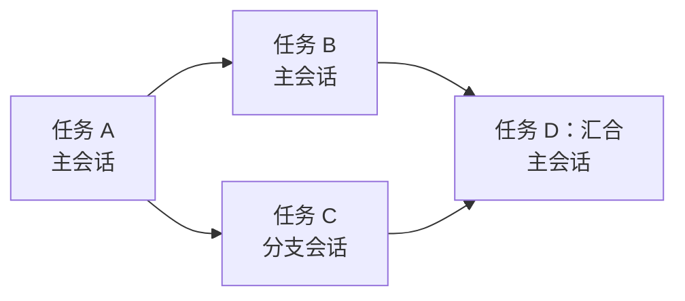
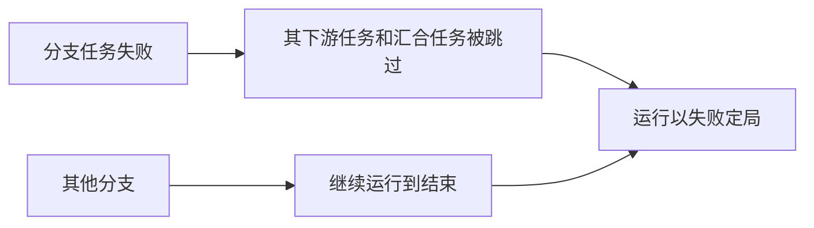

# 运行工作流

运行工作流并不是让一次运行指向工作流，而是把已发布的设计**复制**到一个新的[工作流执行](../guides/workflow-executions.md)上，此后这次运行就存在于这条记录之中。

| 复制到运行上的内容 | 来源 |
|---|---|
| 名称和生效的提示词 | 上次发布的版本；如果工作流仍是 `草稿`，或开发人员选择运行 `已修改` 工作流的[未发布的编辑](../guides/workflows.md#trying-the-edits-out)，则取当前内容 |
| 任务（全部为 `待处理`）及其依赖关系和工具绑定 | 同一设计的任务模板 |
| 运行所遵循的代理技能修订版本 | 技能在那一刻已发布的修订版本 |
| 所选的[工具模拟](./mcp-gateway-and-proxy.md#tool-mocks-and-dry-runs)，按值复制 | 模拟在那一刻的内容 |

此列表中的任何内容以后都不会再从来源读取。编辑工作流、拉取技能或删除其中任何一个，都不会影响已在进行中的运行；已结束的运行在其来源工作流被删除后仍然可读。

## 运行如何推进 {#how-the-run-advances}

工作流会话以一条固定的启动消息打开，执行代理已经开始工作。发布就是对计划的批准，因此开始之前没有什么需要确认的。

下一个任务不由代理选择。任务的依赖一旦全部完成，A2Flow 就把它**分配**给将要处理它的会话，代理只处理分配给自己的任务。启动其他任何任务（分配给别处的任务，或依赖尚未完成的任务）都会被拒绝。

当每个任务都进入终止状态且其中没有失败时，运行以 `已完成` 结束；只要至少有一个任务失败，运行就以 `失败` 结束。可以在运行的只读任务视图中实时查看状态，以表格或依赖图的形式显示。

当某个任务失败时，所有仍在等待它的任务（无论是直接依赖还是位于链条更下游）都会被设为 `已跳过`，因为它们已经无法运行。正因如此，运行才能以 `失败` 定局，而不是永远等待一个永远不会开始的任务。其他分支上不依赖失败任务的任务则照常继续运行。

## 并行分支 {#parallel-branches}

当任务图出现分支时，各分支不会彼此等待。运行起初在一个**主会话**中进行；当某个任务已就绪，而本应接手它的会话仍在忙于另一个任务时，A2Flow 会为它**分叉**出一个**分支会话**。分支会话从主会话截至此时所知一切内容的副本开始，然后与主会话并行处理自己的任务链。某个分支等待审批时，只有该分支会停下来。

| 情况 | 任务的去向 |
|---|---|
| 根任务，或其依赖由主会话处理的任务 | 主会话；如果主会话仍在忙于另一个任务，则分叉出一个新的分支会话 |
| 其依赖由一个仍在运行的分支会话处理的任务 | 该分支会话；如果它正忙，同样分叉 |
| 其依赖由一个已结束的分支会话处理的任务 | 主会话 |
| **汇合**任务：其依赖由多个会话处理 | 主会话，要等汇入它的每个分支都结束之后 |

- 没有任务可处理的分支会话，会以一份简短的工作摘要结束。主会话在处理汇合任务之前会读取这些摘要。
- 等待审批的会话还可以分叉出一个**咨询**。它在有人于此处提问时打开，不处理任何任务，也不更改任何内容，并在审批有了决定后关闭。它从不计入下面的数量上限，其中所说的任何内容也都不会进入运行（[咨询](../guides/workflow-executions.md#consultations)）。
- 分支可以再次分叉，但同时运行的会话数量有上限。达到上限后，已就绪的任务会等待其会话，运行也就退回到逐个处理任务的方式。
- 失败的任务只会中止它自己的链条：如前所述，等待它的任务以及它所汇入的汇合任务都会变为 `已跳过`，而其他分支会完成各自的工作。随后运行以 `失败` 定局。

## 为什么 `进行中` 很重要 {#why-in_progress-matters}

把任务标记为 `进行中` 并不是简单的记账，而是解锁该任务工具的动作：只有当工具绑定到运行当前进行中的任务时，[网关](./mcp-gateway-and-proxy.md)才允许调用。已结束的任务不能再行动，尚未开始的任务也从来不能行动。

运行的任务列表和每个任务的工具绑定在运行开始时就已固定（从工作流已发布的设计复制而来），代理只是推进状态，不能添加、删除任务或重新绑定工具。这也是[审批](./approvals.md)在关键时刻不会重新读取任务绑定的原因：它签署的是审批人作出决定那一刻所看到的集合，因此之后对工作流的任何更改，都无法扩大已经给出的授权。
