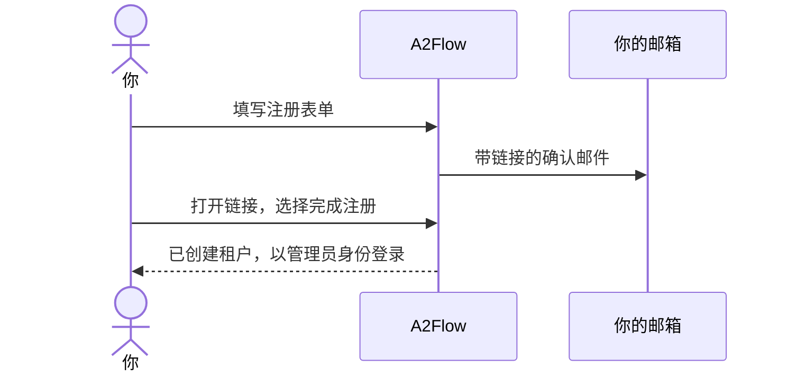

# 注册

如果部署允许，任何人都可以在登录页面创建自己的租户，并以该租户管理员的身份开始使用 A2Flow，无需超级管理员事先创建租户或账户。在运维人员开启之前，注册处于关闭状态，请参阅配置参考中的[注册](../operations/configuration.md#sign-up)。只有当部署还有空间容纳新的租户时，登录页面才会提供**创建账户**，请参阅[租户数量上限](../guides/system-settings.md#tenant-limit)。

## 创建账户 {#creating-your-account}

1. 打开 A2Flow 的主地址（而不是某个租户的专属地址），选择登录表单下方的**创建账户**。
2. 填写**电子邮件**、**用户名**、**名**、**姓**和**密码**，然后选择**创建账户**。随后出现**请查收邮件**页面。此时还没有创建任何内容。
3. 打开 A2Flow 发来的邮件中的链接。**完成注册**页面打开后，选择**完成注册**按钮。
4. **欢迎使用 A2Flow** 页面会显示新的**租户**和你的**用户名**。请记下租户，再次登录时需要用到。
5. 选择**继续**。你将以该租户**管理员**的身份登录。

| 项目 | 规则 |
|---|---|
| **用户名** | 3 到 64 个字母、数字、点、连字符或下划线。不接受电子邮件地址 |
| **密码** | 12 到 72 个字符 |
| 链接 | 发送后 24 小时内只能使用一次，可以在任何浏览器中打开 |
| 再次发送 | 同一地址每分钟最多收到一封确认邮件 |

## 链接无法使用时 {#link-problems}

| 看到的情况 | 处理方法 |
|---|---|
| 没有收到邮件 | 请检查垃圾邮件文件夹。一分钟后重新提交表单，即可收到新邮件 |
| “此注册链接无效或已过期” | 链接已被使用或已超过 24 小时。请重新填写表单 |
| “租户数量已达上限” | 部署已满。请让运维人员在系统设置中调高**租户数量上限**；链接在过期之前仍然有效 |
| “此链接不完整” | 邮件程序截断了链接。请从邮件中复制完整链接粘贴到浏览器 |

## 新租户 {#your-new-tenant}

A2Flow 以你的用户名加上 6 个随机字符为租户命名：用户名 `Jane.Doe` 会得到类似 `jane-doe-3fa9c1` 的租户。你是它唯一的用户，拥有**管理员**角色，因此可以在[用户](../guides/users-and-groups.md#users)中添加团队其他成员，并在[单点登录](../guides/single-sign-on.md)中接入公司的登录方式。在为租户设置自己的 LLM 之前，其智能体使用系统的 LLM，请参阅[租户的 LLM](../guides/users-and-groups.md#tenant-llm)。

## 再次登录 {#signing-in-again}

在主地址输入你的**用户名**、欢迎页面上显示的**租户**和**密码**。如果部署为每个租户提供专属地址，欢迎页面还会将其显示为**租户地址**。在那里登录时，租户会自动填好，请参阅[在租户地址登录](../guides/single-sign-on.md#tenant-address)。
