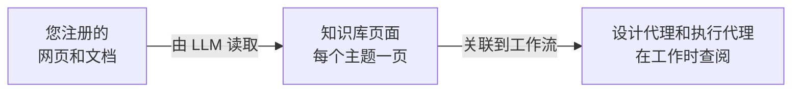

# 知识库

知识库是 LLM 根据您注册的网页和文档为您编写的 Wiki。将它关联到工作流后，工作流的代理在设计和运行工作流时都会查阅它，以按照您组织的方式执行任务，或在聊天中回答参与者的问题。

在管理侧边栏中打开**知识库**即可管理。

## Wiki 的编写方式 {#how-the-wiki-is-written}

LLM 不会为每个文档单独写一份摘要。它会阅读每个来源，并将其内容整合到**主题页面**中：如果主题已有页面，就更新该页面；只有当现有页面都未涵盖某个主题时，才编写新页面。关于同一个 VPN 的五份文档，最终会成为一个 VPN 页面，汇集这些文档的全部内容。

页面上的每条陈述都带有脚注，注明其来源，每个页面的顶部也列出了它的来源。正因如此，A2Flow 日后才能移除某个来源，而不必重建整个 Wiki。

## 创建知识库 {#creating-a-knowledge-base}

1. 点击 **+ 添加知识库**。
2. 输入**名称**和**描述**。描述要写给代理看：代理读取它来判断此知识库能否回答要查找的内容。
3. 点击**保存**。知识库随即打开，可以添加来源。

创建、编辑和删除知识库及其来源需要**开发人员**角色。任何能打开知识库的人都可以阅读其页面。

## 添加来源 {#adding-sources}

在知识库页面上，**来源**部分接受两种来源：

| 来源 | 添加方式 |
|---|---|
| 网页 | 输入其 URL，然后点击**添加 URL** |
| 文档 | 点击**上传文档**并选择一个或多个文件：PDF、Word（`.docx`）、HTML、Markdown、CSV、JSON 或纯文本 |

来源在后台读取，因此您可以继续工作或离开页面。其**状态**会依次经历以下状态：

| 状态 | 含义 |
|---|---|
| **未读取** | 已注册但尚未读取。点击**读取**开始。只有通过[演示数据](../getting-started/demo-data.md)添加的来源才从此状态开始 |
| **排队中** | 等待轮到自己。同一知识库的来源一次读取一个，因为它们会编辑相同的页面 |
| **读取中** | LLM 正在读取来源并编写页面 |
| **就绪** | 来源的知识已进入 Wiki。**读取时间**显示完成时间 |
| **失败** | 读取失败，本应写入的内容都不会保留。原因显示在状态下方 |
| **移除中** | 正在从 Wiki 中移除该来源（见下文） |

较长的文档会分成几部分依次读取，因此大型手册需要一些时间。没有文本层的扫描版 PDF 没有可读取的内容，会失败并显示相应的提示信息。

网页由 A2Flow 服务器抓取，因此无法添加需要登录的页面或位于私有网络地址上的页面。

### 重新读取来源 {#reading-a-source-again}

点击来源上的**重新读取**，可将它贡献的内容从 Wiki 中取出并重新读取。适用于网页内容已更改，或要重试失败的来源时。服务器重启后卡在**读取中**的来源，也可以用同样的方式恢复。

### 移除来源 {#removing-a-source}

点击来源上的**删除**并确认。LLM 只会重新处理引用该来源的页面，移除仅来自该来源的内容，保留其他来源同样支持的内容。完全没有来源的页面会被删除。完成后，该来源会从列表中消失。

## 浏览页面 {#browsing-the-pages}

**页面**部分列出所有页面，每行显示标题和路径、**类型**以及最后更新时间（**更新时间**）。点击标题即可阅读页面。页面是只读的：要更正页面，请修正或移除它的来源，然后重新读取。

点击页面标题栏中的**下载捆绑包**，可将整个知识库下载为 zip 文件。捆绑包遵循 [Open Knowledge Format](https://github.com/GoogleCloudPlatform/open-knowledge-format)：每个页面一个 Markdown 文件，元数据位于文件顶部，每个文件夹中还有一个 `index.md`，因此读取该格式的其他工具也可以使用它。

## 将知识库关联到工作流 {#linking-a-knowledge-base-to-a-workflow}

打开工作流的详情页，在**知识库**下选择知识库，然后点击**保存**。您也可以在[生成工作流](./workflows.md#generating-a-workflow)时选择，这样设计代理从最初的设计起就会查阅它们。

| 谁在查阅 | 何时查阅 |
|---|---|
| 设计代理 | 生成后立即设计工作流的任务模板时，以及在设计会话中完善模板时 |
| 执行代理 | 逐一处理运行的任务时，以及参与者在工作流会话中向它提问时 |

代理只能看到关联到其工作流的知识库。它们会浏览知识库的内容、按关键字搜索，并阅读合适的页面；依据某个页面时，会指明该页面。当关联的知识库未涵盖某些内容时，代理被告知要如实说明，而不是猜测。

关联不属于工作流已发布的设计。更改关联后，下一次查阅时即生效，已在进行中的运行也是如此，并且不会将已发布的工作流标记为 `已修改`。

## 标签 {#tags}

知识库的创建表单和详情页带有**标签**选择器，列表中有可筛选的**标签**列。[访问控制标签](./tags.md)会对所在用户组不带有该标签的人隐藏知识库，也对为他们工作的代理隐藏，即使该知识库已关联到工作流也是如此：

| 代理运行的位置 | 由谁的用户组决定 |
|---|---|
| 工作流设计聊天 | 正在聊天的人 |
| 工作流运行 | 发起此次运行的人，在整个运行期间都是如此 |

管理员不受限制。

## 删除知识库 {#deleting-a-knowledge-base}

删除知识库时，其来源和页面也会一并删除，并解除它与所有工作流的关联。
