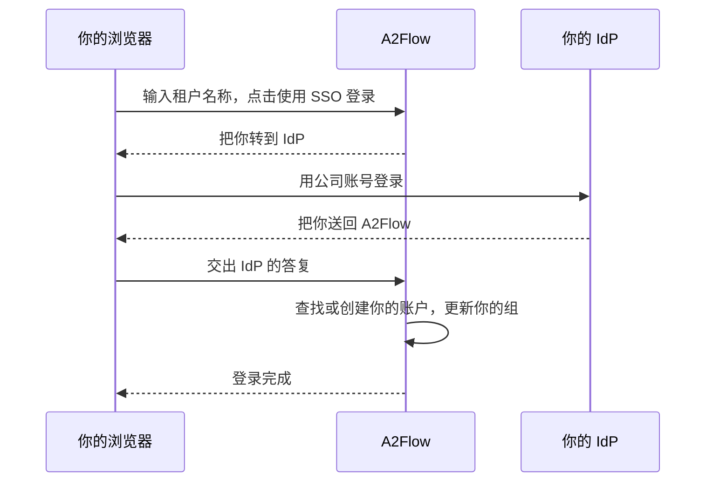

# 单点登录

每个[租户](../concepts/tenants.md)可以接入一个支持 OpenID Connect 的**身份提供商（IdP）**，例如 Microsoft Entra ID、Okta 或 Keycloak。接入后，该租户的员工用公司账号登录，不再需要单独的 A2Flow 密码。首次登录会创建 A2Flow 账户，而 IdP 的组决定这个人属于哪些[用户组](./users-and-groups.md#user-groups)，也就决定了他拥有哪些角色。

启用单点登录后，密码登录依然可用。超级管理员账户不属于任何租户，始终使用密码登录。

## 工作方式 {#how-it-works}

## 开始之前 {#before-you-start}

- 你需要在该租户中拥有管理员角色。
- 运维人员必须已在部署时设置部署的基础 URL，请参阅[服务器设置](../operations/configuration.md#server-settings)。未设置时，**租户设置**会显示警告来代替**重定向 URI**，单点登录也无法使用。
- A2Flow 必须能通过公网地址访问你的 IdP。位于私有网络中的 IdP 只有在运维人员允许其主机后才能使用，请参阅配置参考中的[单点登录](../operations/configuration.md#single-sign-on)。

## 设置步骤 {#set-it-up}

1. 在 IdP 中为 A2Flow 注册一个新应用，类型为带客户端密钥的 Web 应用。记下它的颁发者 URL、客户端 ID 和客户端密钥。
2. 在 A2Flow 中，打开管理侧边栏的**租户设置**，找到**单点登录**部分。点击**重定向 URI**旁的**复制**，并把该地址登记为 IdP 中该应用的重定向 URI。
3. 在 IdP 中，让应用的 ID 令牌带上每个人所属组的列表（组声明）。忘记这一步会导致角色被移除，请参阅[注意事项](#things-to-know)。
4. 对照下表填写该部分，并勾选**启用单点登录**。
5. 保存。保存时会检查颁发者 URL 是否为允许的地址（`https`，或运维人员已允许的主机）；如果勾选了**启用单点登录**，还会检查颁发者 URL、客户端 ID 和客户端密钥是否已填写。不会联系 IdP，所以真正的测试是下一步。
6. 对每个需要跟随 IdP 组的用户组，打开**用户组**，打开该组并填写 **IdP 组**，请参阅[组与角色](#groups-and-roles)。
7. 试一试：打开登录界面，输入租户名称并点击**使用 SSO 登录**。

| 字段 | 说明 |
|---|---|
| **启用单点登录** | 开关。开启它需要颁发者 URL、客户端 ID 和客户端密钥。 |
| **颁发者 URL** | IdP 的 OpenID Connect 颁发者，例如 `https://idp.example.com`。 |
| **客户端 ID** | 应用在 IdP 中的客户端 ID。 |
| **客户端密钥** | 只写：不会再次显示。保存后，该字段显示“已保存 — 留空则保留”。 |
| **组声明** | ID 令牌中列出一个人所属组的声明名称。除非你的 IdP 使用别的名称，否则为 `groups`。 |
| **信任此 IdP 的电子邮件地址** | 默认关闭。即使 IdP 没有把地址标记为已验证，也允许 A2Flow 按电子邮件地址关联已有账户。Microsoft Entra ID 需要开启它。 |
| **重定向 URI** | 只读。需要登记到 IdP 的地址，所有租户使用同一个。 |

## 登录 {#signing-in}

在登录界面的**租户**中输入租户名称，点击**使用 SSO 登录**。**租户**为空时按钮不可用。你会被转到 IdP，在那里登录后回到 A2Flow，并处于已登录状态。使用用户名和密码登录的方式与以前相同。

退出 A2Flow 不会退出 IdP，所以再次点击**使用 SSO 登录**时，可能会直接登录进去。

## 登录错误信息 {#sign-in-errors}

登录失败时，你会回到登录界面，并看到下列信息之一。

| 信息 | 含义与处理 |
|---|---|
| 此租户无法使用单点登录。 | 租户名称有误、租户已被停用，或其单点登录尚未设置或未开启。A2Flow 特意不说明是哪一种，这样就无法借此信息得知有哪些租户。请检查名称，仍不行就询问租户管理员。 |
| 单点登录失败，请重试。 | 与 IdP 的交互没有完成，或 IdP 没有提供电子邮件地址（或提供的地址无法使用），或租户中有两个账户使用了你的电子邮件地址，或使用你电子邮件地址的账户已关联到另一个 IdP 身份，或 IdP 的电子邮件地址不被信任而 A2Flow 中已有使用该地址的账户。最后一种情况下，请让租户管理员开启**信任此 IdP 的电子邮件地址**，或修改两个账户之一的电子邮件地址。其他情况请重试；如果仍然失败，请让租户管理员检查设置以及在 IdP 中注册的应用。 |
| 你的账号已被停用。 | 你的 A2Flow 账户或整个租户已被停用，或账户已被删除。管理员可以通过**已启用**重新启用该账户。 |
| 你的身份提供商账号不允许登录 A2Flow。 | 你还没有 A2Flow 账户，并且不属于任何已与用户组对应的 IdP 组；或者因为你所属的组非常多，IdP 省略了你的组列表。请让 IdP 管理员把你加入某个已对应的组。 |

## 如何把人与账户对应起来 {#account-matching}

每次登录时，A2Flow 按以下顺序查找账户：

1. 使用**已关联到该 IdP 身份的账户**。
2. 关联**电子邮件地址相同的已有账户**，只关联一次。地址比较时不区分大小写，并且只有在 IdP 把它标记为已验证，或**信任此 IdP 的电子邮件地址**已开启时才会接受。必须恰好有一个尚未关联的账户匹配；如果有两个或更多，登录失败。
3. **否则创建新账户**，但只针对至少属于一个已与用户组对应的 IdP 组的人。其他人会被拒绝。 租户中已有账户使用某个电子邮件地址时，不会再为它创建新账户；IdP 的电子邮件地址无法使用时也不会创建，登录都会失败。

新账户的用户名取自 IdP 的 preferred username，没有的话取电子邮件地址 `@` 之前的部分。字母、数字、`.`、`_` 和 `-` 以外的字符会被去掉，剩下的太少时用户名为 `user`，名称已被占用时会加上 `-2`、`-3` 等。名和姓来自 IdP。账户没有直接角色，也没有密码：角色来自它所属的组，管理员之后可以设置一个密码作为备用。

已有账户的姓名和电子邮件地址绝不会被 IdP 的值覆盖。

## 组与角色 {#groups-and-roles}

在每个用户组上，**IdP 组**填写 IdP 的组声明中为该组列出的值。Microsoft Entra ID 发送的是组的对象 ID，而不是名称，所以请填写该 ID。匹配是精确的，并区分大小写。

每次 SSO 登录时，对每个设有 **IdP 组**的用户组：

- 声明中包含该值时，这个人加入该组；
- 不包含时，这个人离开该组。

没有 **IdP 组**的用户组，以及直接授予账户的角色，绝不会被改动。在 IdP 中所做的组变更，会在这个人下一次 SSO 登录时生效，而不是立即生效。

设有 **IdP 组**的组，其成员由 IdP 管理，不能手动编辑。在该组的页面上，**成员**列表是只读的，并显示“由 IdP 管理”，也不能在用户的**用户组**中添加或移除这样的组。如果你在已有成员的组上填写 **IdP 组**，这些成员会保留到各自下一次 SSO 登录为止。

## 注意事项 {#things-to-know}

| 情况 | 结果 |
|---|---|
| IdP 没有发送组声明，或**组声明**的名称不匹配 | 每个登录的人都会被移出所有已对应的组，并失去这些组授予的角色。启用单点登录之前，请先在 IdP 中确认该声明。 |
| Microsoft Entra ID | 发送的是组的对象 ID，而不是名称。对于所属组非常多的人，它会省略该列表。此时 A2Flow 会保留这个人当前的成员关系，但无法为其创建新账户。 |
| 你更改了**颁发者 URL** 或**客户端 ID** | 租户中的所有账户都会与其 IdP 身份解除关联，因为换一个应用，IdP 就会签发不同的身份。人们会在下次登录时按电子邮件地址重新关联，这要求地址可信（IdP 标记为已验证，或已开启**信任此 IdP 的电子邮件地址**）。否则登录会失败，因为原账户仍然使用该地址。 |
| 某人在 IdP 中被删除 | 他无法再通过 SSO 登录，但 A2Flow 不会停用其账户。如需同时阻止密码登录，请取消勾选该账户的**已启用**。 |
| 账户带有 **SSO** 标记 | 它曾通过单点登录登录过。该标记显示在**用户**列表和账户的详情页中。 |
