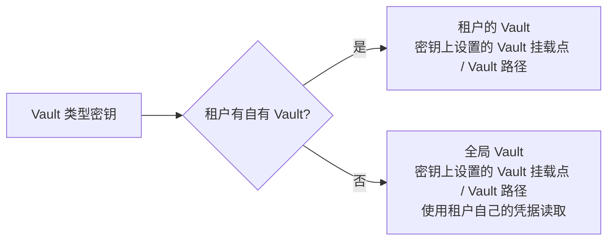

# 用户、用户组和租户

谁可以登录、归属于哪里，由三个管理分区负责：各个账户、批量授予角色的命名集合，以及容纳这一切的租户。

一个用户最多属于一个租户，并可加入该租户的任意多个用户组。所有授权检查使用的都是账户直接获授的角色与从用户组继承的角色的**并集**，详见[角色与授权](../concepts/authorization.md)。

## 用户 {#users}

在管理侧边栏中打开**用户**即可管理账户。列表中每个账户占一行；点击用户名会打开其详情页，可在此编辑相同的字段或删除账户。

| 字段 | 说明 |
|---|---|
| **用户名** | 在租户内唯一。创建后不可编辑。 |
| **名** / **姓** | 凡显示用户姓名之处，都合并显示为显示名称。 |
| **电子邮件** | 通知邮件的收件地址。 |
| **密码** | 绝不会回显。编辑时留空则保留当前密码。设置新密码会使该用户在所有已登录的位置退出登录。 |
| **已启用** | 取消勾选可在不删除账户的情况下阻止登录。在列表中，已停用的账户以淡色显示，头像上带有小徽章，因此**已启用**列本身可以通过列选择器隐藏。 |
| **电子邮件已验证** | 未验证的地址会被[邮件投递](./notifications.md#email-delivery)跳过。 |
| **角色** | 每个角色一个复选框，详见下文。 |
| **用户组** | 所属用户组，两侧均可编辑。 |

### 角色 {#roles}

创建表单和详情页提供角色选择器，每个角色一个复选框；列表中显示**角色**列。

- **超级管理员**只对已登录的超级管理员显示。其他人授予或撤销此角色都会被拒绝。
- 超级管理员与其他所有角色互斥，因此勾选它会禁用其余角色（反之亦然），并显示说明原因的提示。
- **角色**列不能排序或筛选，因为角色存储为列表，而不是单个值。

**来自用户组的角色**。选择器只编辑**直接**授予的角色。从[用户组](./users-and-groups.md#user-groups)继承的角色以只读胶囊显示在其下方的**来自用户组的角色**中，只有编辑用户组才能更改。列表的**角色**列同时显示两者，继承的角色以淡色显示，因此可以一眼看出此页面能更改哪些授权。

### 用户组 {#groups}

当前所属的用户组显示为可移除的胶囊；**选择用户组…** 会打开一个分页、可筛选的表格，列出租户的用户组以便继续添加。平台级账户（超级管理员或预置的系统用户）不显示此按钮，因为它们不属于任何租户，永远不能成为成员。同样的成员关系也可以在[用户组](./users-and-groups.md#user-groups)一侧编辑。

### 代理登录 {#impersonate}

您有权代理登录的行会显示**代理登录**操作。您自己的行、任何超级管理员的行，以及（除非您是超级管理员）任何管理员的行都不显示此操作。确认后会以该用户的身份进入欢迎页。完整规则和停止方法请参阅[代理登录](../concepts/impersonation.md)。

### 删除用户 {#deleting-a-user}

没有被其他内容引用的账户会被直接移除。仍拥有记录（由其创建或最后更新的任何内容）的账户则会保留，但被停用并从用户列表中隐藏，这样它拥有的记录仍能解析出名称。无论哪种情况，该账户都无法再登录。

记录绝不会显示原始用户 ID。每个详情页和列表都会将所有者解析为名称；只有两类账户显示为标签而不是名称，因为它们拥有的记录跨越租户边界：内部账户显示为**系统用户**，您无权查看的超级管理员显示为**超级管理员**。

## 登录失败 {#failed-sign-ins}

多次输入错误密码会使账户被锁定一段时间。在**锁定时长（分钟）** 内，同一用户名（和租户）失败达到**锁定前的登录失败次数**后（除非租户更改过，否则为 15 分钟内 5 次），登录界面会连正确的密码也拒绝，并提示还需等待多少分钟。当这些失败中最早的一次已过去**锁定时长（分钟）** 后，锁定解除。

每个租户可设置自己的值。要为您的租户更改这些值，请在管理侧边栏中打开**租户设置**（需要管理员角色）：

| 字段 | 说明 |
|---|---|
| **锁定前的登录失败次数** | 失败多少次后锁定账户。1 到 100；默认值为 5。 |
| **锁定时长（分钟）** | 统计失败次数的时间范围（分钟），也是被锁定账户保持锁定的时长。1 到 1440（一天）；默认值为 15。 |

超级管理员可以在**租户**下某租户的详情页编辑这两个字段，也可以在以该租户身份操作时打开**租户设置**。不属于任何租户的账户（如 `root`）始终使用默认值。

登录成功会清除账户的失败计数。不存在的用户名在失败相同次数后同样会被锁定，因此锁定绝不会泄露账户是否存在。无需任何人解锁账户：锁定会自动解除。

## 租户的 Vault {#tenant-vault}

租户的 [Vault 类型密钥](./secrets.md)从 HashiCorp Vault（仅限 KV v2）读取。租户可以连接**自有** Vault；未连接的租户则从超级管理员在[系统设置](./system-settings.md#global-vault)中配置的**全局 Vault** 读取，并使用租户自己的[全局 Vault 凭据](#global-vault-credential)登录。

要连接租户的自有 Vault，请在管理侧边栏中打开**租户设置**（需要管理员角色）。超级管理员可在以该租户身份操作时打开同一页面。

| 字段 | 说明 |
|---|---|
| **Vault 地址** | Vault 的地址，以 `http://` 或 `https://` 开头。必须能通过公网地址访问：私有网络或本机的地址会被拒绝。留空并保存可断开租户的 Vault，同时删除已存储的凭据；此后租户改回使用全局 Vault。 |
| **Vault 认证方式** | **令牌**表示静态令牌；**AppRole** 表示由 A2Flow 用角色 ID 和密钥 ID 换取短期令牌。 |
| **Vault 角色 ID** / **AppRole 挂载点** | 仅限 AppRole。挂载点默认为 `approle`。 |
| **Vault 令牌** / **Vault 密钥 ID** | 所选方式的凭据。此后不再显示：保存后，该字段显示“已保存 — 留空则保留”。切换认证方式时必须输入新凭据。 |

保存地址而不提供凭据，或使用 AppRole 而不提供角色 ID，都会被拒绝并显示错误。既没有自有 Vault，也没有全局 Vault 凭据的租户无法解析其 Vault 类型密钥。

## 您自己的账户 {#your-own-account}

点击应用栏中的个人资料按钮并选择**个人资料**，即可查看您自己的账户。页面顶部是身份卡片：一条横幅，您的头像压在其下边缘，显示名称作为标题，旁边是 `@username`、角色和状态胶囊；其下是两张只读卡片和一张**偏好设置**卡片：

| 卡片 | 显示内容 |
|---|---|
| **账户** | 用户名、电子邮件、名和姓 |
| **访问权限** | 角色、来自用户组的角色和用户组 |
| **偏好设置** | 界面显示的[语言](#language) |

**账户**和**访问权限**是只读的：更改这些属性需要管理员角色，并在管理端的用户详情页进行。您可以自行编辑的有两项：语言和头像，点击头像即可编辑。

### 语言 {#language}

A2Flow 的界面提供 English、日本語、Español、简体中文、한국어 和 Français。每种语言都以其自身的名称列出，因此无论当前界面是什么语言，您都能找到自己的语言。

1. 通过应用栏中的个人资料按钮打开**个人资料**。
2. 在**偏好设置**卡片中选择**语言**。界面会立即切换，并且在您登录的每个浏览器上都保持该语言。

**跟随浏览器语言**是默认选项，选择它后由浏览器的语言设置决定。如果浏览器设置的不是这些语言之一，则显示英语。

| 情形 | 显示的语言 |
|---|---|
| 已登录，已选择语言 | 所选语言 |
| 已登录，跟随浏览器 | 浏览器的语言，否则为英语 |
| 登录页面 | 此浏览器中最后使用的语言，否则为浏览器的语言 |
| 以其他用户身份操作（[代理登录](../concepts/impersonation.md)） | 您自己的语言，以便您能读懂界面。**语言**控件处于禁用状态 |

语言设置涵盖 A2Flow 自身输出的内容：界面文字、消息和验证错误，以及其通知的措辞。以下内容保持原文：

- 人或代理写下的任何内容：名称、描述、审批标题、聊天回复。代理使用对话的语言回答，而不是此处设置的语言。
- 某些错误附带的技术原因，以英语显示在翻译后的消息之后。
- [通知邮件](./notifications.md#email-delivery)，使用英语。

### 头像 {#avatars}

每个用户都有头像，显示在个人资料按钮以及管理端的用户列表和详情页上。默认情况下，头像根据用户的租户和用户名生成，因此不存储任何图片，两个租户中的相同用户名也会得到两个不同的头像。

点击**个人资料**页面上的头像，会打开一个对话框，提供两种更改方式：

- **上传**自定义图片：PNG、JPEG、WebP 或 GIF，最大 2 MB。上传会立即生效并关闭对话框。移除后恢复为生成的头像。
- **自定义**生成的头像，即编辑绘制头像所用的调色板。调色板是此对话框中唯一可能未保存的内容：**恢复默认**会还原色块，**保存**会提交更改，关闭对话框则丢弃所有未保存的内容。

| 优先级 | 使用条件 |
|---|---|
| 1. 已上传的图片 | 已上传图片 |
| 2. 生成的头像，自定义调色板 | 已保存调色板 |
| 3. 生成的头像，默认调色板 | 两者皆无 |

种子仍决定哪种颜色用在哪里，因此即使使用相同的调色板，用户之间也能在视觉上区分开。与默认调色板完全相同的调色板会按“无调色板”存储，因此恢复默认并保存后确实会清除它。头像只能由本人编辑，管理端的用户详情页以只读方式显示头像。

## 用户组 {#user-groups}

在管理侧边栏中打开**用户组**即可管理用户组。用户组是命名的用户集合，会将其角色授予每位成员。一个用户组恰好属于一个租户，其名称在该租户内唯一。

| 字段 | 说明 |
|---|---|
| **名称** | 在租户内唯一。 |
| **描述** | 自由文本。 |
| **授予的角色** | 每位成员在自身获授角色之外额外持有的角色。 |
| **成员** | 用户组中的账户。 |
| **标签** | 用于给用户组分类的标记，与其他可加标签的分区共用。在此处附加访问控制标签，会授予每位成员对带有该标签的记录的访问权限。 |

**授予的角色**使用与**用户**页面相同的选择器，只是没有**超级管理员**：用户组永远不能授予该角色，这个选项对所有人都隐藏，超级管理员也不例外。由于超级管理员不属于任何租户，他们也永远不能成为成员。

**标签**与密钥及其他可加标签的注册表共用同一套租户级词汇。创建表单和详情页提供**标签**选择器，列表中有可筛选的**标签**列，详见[标签](./tags.md)。用户组也是授予访问权限的地方：将[访问控制标签](./tags.md#access-control-tags)附加到用户组后，其成员就能看到带有该标签的记录，而且管理员自己不持有该标签也可以把它附加到用户组。

**成员**显示为可移除的胶囊；**选择成员…** 会打开一个分页、可筛选的表格，列出租户的用户。平台级账户不在其中，因为它们不属于任何租户。提供成员列表会整体替换成员关系；编辑时不动此字段则保持原样。同样的成员关系也可以在每个[用户](./users-and-groups.md#users)一侧编辑。

不会向用户记录复制任何内容，因此更改用户组的角色或成员后，受影响的所有人从下一个请求起即生效。**删除**用户组不会影响账户，但会收回它所授予的角色。

写入此分区需要管理员角色。读取不受限制，因此没有该角色的查看者仍能看到列表和只读的详情页。

## 租户 {#tenants}

在管理侧边栏中打开**租户**即可管理租户。租户是多租户的顶层组织边界。这一边界对其他一切内容意味着什么，以及超级管理员如何选择要操作的租户，请参阅[租户](../concepts/tenants.md)；本节只介绍租户记录本身。

与其他管理分区不同，此分区**仅限超级管理员**（租户自己的管理员改在**租户设置**中更改登录锁定和自有 Vault）。对其他所有角色，它不会显示在侧边栏和欢迎页上，其他人的写入也会被拒绝。

| 字段 | 说明 |
|---|---|
| **显示名称** | 便于阅读的标签。唯一。 |
| **名称** | URL 安全的标识符，小写 kebab-case。唯一，创建后不可编辑。 |
| **已启用** | 取消勾选可在不删除租户的情况下停用它：其用户无法再登录，已登录的用户会在下一个请求时被退出登录。 |
| **锁定前的登录失败次数** / **锁定时长（分钟）** | 登录失败时如何锁定租户的账户，详见[登录失败](#failed-sign-ins)。 |
| **登录全局 Vault** | 勾选后可注册租户的全局 Vault 凭据，详见下文。 |

### 全局 Vault 凭据 {#global-vault-credential}

没有自有 Vault 的租户使用专属于该租户的凭据读取[全局 Vault](./system-settings.md#global-vault)。只有超级管理员才能在租户的详情页注册此凭据，租户自己的管理员永远看不到它。

| 字段 | 说明 |
|---|---|
| **登录全局 Vault** | 显示下方字段。取消勾选并保存会删除已存储的凭据。 |
| **Vault 认证方式** | **令牌**或 **AppRole**，与[租户的自有 Vault](#tenant-vault) 相同。 |
| **Vault 角色 ID** / **AppRole 挂载点** | 仅限 AppRole。挂载点默认为 `approle`。 |
| **Vault 令牌** / **Vault 密钥 ID** | 只写，与其他所有 Vault 凭据一样。切换认证方式时必须输入新凭据。 |

请在 Vault 中为此凭据配置只允许读取该租户数据的策略。正是这一策略让全局 Vault 上的各租户彼此隔离：密钥可以指定任意 **Vault 挂载点**和 **Vault 路径**，如果租户的凭据未覆盖，Vault 会拒绝读取。

首次启动时会预置一个 **Default** 租户，其中包含初始预置的 `admin` 用户。只要还有用户分配给某个租户，该租户就无法删除，请先重新分配或删除这些账户。
